# PIXELCRAFT audit: GITCRAFT 3D Department UI (/)

Target: `forgecraft/ui/dist (Vercel build)` · method pixelcraft-1.0 · 2026-11-05T13:46:44+00:00 · commit `1530d7e950`

## 1. Overall PIXELCRAFT score: **65.9** / 100 (fair)

Evidence coverage 100% · confidence **medium** — only automatic journeys (no task-specific journeys with expected taps); canvas-rendered screens: the DOM does not describe what is drawn; browser emulation only (no physical-device evidence)

Coverage and confidence are reported separately from quality: an area with no evidence is *not tested*, never zero and never capped.

## 2. Category scores

| Category | Score | Coverage | Not tested |
|---|---|---|---|
| Visual Quality | **70.2** | 100% | — |
| Usability | **81.9** | 100% | — |
| Consistency | **45.6** | 100% | — |

### Visual Quality

| Area | Points | Awarded | Evidence | Weakest metric |
|---|---|---|---|---|
| Spacing and rhythm | 25 | 17.7 | measured ×128 | related elements evenly spaced (44%) |
| Layout and composition | 25 | 19.5 | measured ×237 | no horizontal overflow (42%) |
| Typography and hierarchy | 20 | 11.9 | measured ×144 | text large enough to read (38%) |
| Buttons and controls | 20 | 11.1 | measured ×161 | neighbouring targets not crowded (17%) |
| Visual consistency | 10 | 10 | measured ×66 | controls share radii and a small palette (100%) |

### Usability

| Area | Points | Awarded | Evidence | Weakest metric |
|---|---|---|---|---|
| Interaction efficiency | 25 | 25 | measured ×20 | journeys complete (100%) |
| Navigation and discoverability | 20 | 12 | measured ×19 | navigation stays in the same place on every screen (0%) |
| Mobile ergonomics | 25 | 20.8 | measured ×135 | inputs do not trigger iOS zoom (8%) |
| Feedback and interaction states | 15 | 9.4 | measured ×38 | controls react to hover (12%) |
| Accessibility | 15 | 14.8 | accessibility ×36, measured ×12 | axe-core WCAG 2.2 AA checks (96%) |

### Consistency

| Area | Points | Awarded | Evidence | Weakest metric |
|---|---|---|---|---|
| Cross-screen consistency | 25 | 0.4 | measured ×12 | primary buttons look the same on every screen (0%) |
| Component consistency | 25 | 19.8 | measured ×12 | inputs share one height (70%) |
| Responsive consistency | 20 | 11.6 | measured ×12 | the same content at every size (50%) |
| Design system adherence | 20 | 7.4 | measured ×24 | font sizes from a scale (0%) |
| State consistency | 10 | 6.4 | measured ×4 | pressed treatment applied consistently (28%) |

## 3. Strongest screens

- **games** — 90.8
- **world-builder** — 86.2
- **pipeline** — 84.9

## 4. Weakest screens

- **home** — 80.5
- **library** — 81.1
- **characters** — 84.4

## 5. Critical usability defects

### Focusing a field zooms the page on iPhone — major · Measured (rendered DOM)

The field's font-size is 15 px; iOS Safari zooms in on any input under 16 px and leaves the page zoomed after typing.

**Fix:** Use font-size: 16px (1rem) for inputs, selects and textareas on mobile.

Seen 20× — screens: characters, home, library, world-builder; viewports: iphone13, iphone17, landscape, narrow, tablet · priority 24.84 (fix now)

- `#brief` on home @ iphone17: font_size_px=15 — 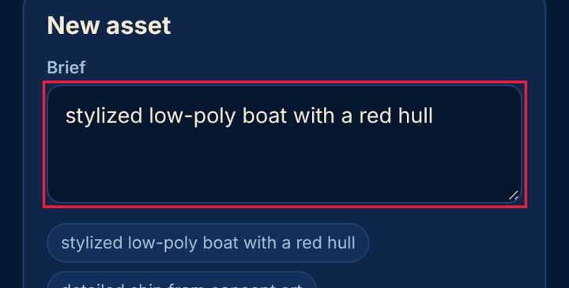
- `#nimg` on home @ iphone17: font_size_px=15 — 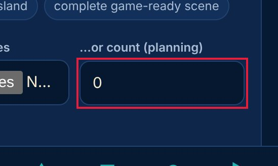
- `#tool` on home @ iphone17: font_size_px=15
### No pressed (active) state — major · Measured (rendered DOM)

Pressing this control changes nothing visually until the action completes; on touch screens there is no hover, so this is the only immediate confirmation of a tap.

**Fix:** Add an :active style (darker tone, scale 0.97, or ripple) to every button and link variant.

Seen 12× — screens: characters, games, home, library, pipeline, world-builder; viewports: desktop, iphone17 · priority 18.34 (fix now)

- `#tabs > a.on:nth-of-type(1)` on home @ iphone17: style_changed_when_pressed=false — 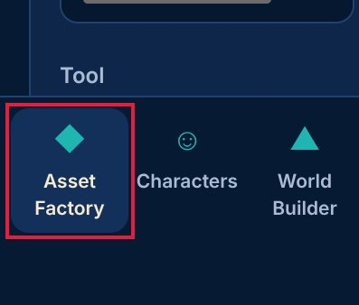
- `#tabs > a:nth-of-type(2)` on home @ iphone17: style_changed_when_pressed=false — 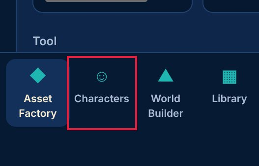
- `#main > div.grid2:nth-of-type(2) > section.panel:nth-of-type(1) > label` on home @ iphone17: style_changed_when_pressed=false
### Clickable element is not a real control — major · Measured (rendered DOM)

This element responds to clicks (pointer cursor) but is not a button or link, so keyboard and screen-reader users cannot use it.

**Fix:** Use <button> (or <a href>) instead of a clickable 
/.

Seen 4× — screens: characters, home, pipeline, world-builder; viewports: desktop · priority 10.0 (fix now)

- `#ex > span.chip:nth-of-type(1)` on home @ desktop:  — 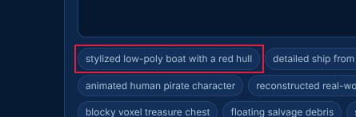
- `#ex > span.chip:nth-of-type(2)` on home @ desktop:  — 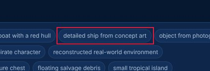
- `#clips > span.chip.on:nth-of-type(1)` on characters @ desktop: 
### Accessibility: Scrollable region must have keyboard access — major · Accessibility (axe-core)

axe-core rule scrollable-region-focusable (wcag2a, wcag211, wcag213): Scrollable region must have keyboard access.

**Fix:** See https://dequeuniversity.com/rules/axe/4.10/scrollable-region-focusable?application=axeAPI — Fix any of the following:   Element should have focusable content   Element should be focusable

Seen 1× — screens: pipeline; viewports: narrow · priority 3.08 (polish)

- `section:nth-child(1)` on pipeline @ narrow: axe="Fix any of the following:\n  Element should have focusable content\n  Element should be focusable", nodes_on_screen=1 — 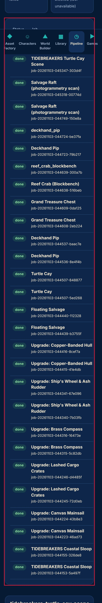

## 6. Spacing and layout defects

### Text is too small to read comfortably — major · Measured (rendered DOM)

10.5-px text is below the 12-px minimum for phones; secondary information (dates, tags, captions) becomes hard to read.

**Fix:** Use at least 12 px (13-14 px preferred) for secondary text and keep hierarchy with weight and colour rather than very small sizes.

Seen 31× — screens: characters, games, home, library, pipeline, world-builder; viewports: desktop, iphone13, iphone17, landscape, narrow, tablet · priority 33.24 (fix now)

- `#tabs > a.on:nth-of-type(1) > span` on home @ iphone17: font_size_px=10.5 — 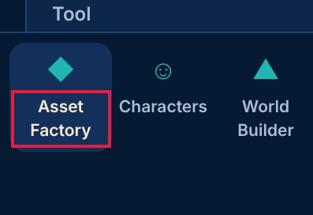
- `#tabs > a:nth-of-type(2) > span` on home @ iphone17: font_size_px=10.5 — 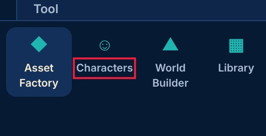
- `#tabs > a:nth-of-type(3) > span` on home @ iphone17: font_size_px=10.5
### Page scrolls sideways (horizontal overflow) — critical · Measured (rendered DOM)

The page is 331 px wide in a 320 px viewport: content is cut off and the whole page wobbles sideways when scrolled with a thumb.

**Fix:** Let the offending element shrink (max-width: 100%, min-width: 0 on flex children) or scroll it inside its own container (overflow-x: auto).

Seen 11× — screens: characters, home, library, pipeline, world-builder; viewports: landscape, narrow, tablet · priority 29.11 (fix now)

- `—` on pipeline @ narrow: overflow_px=11 — 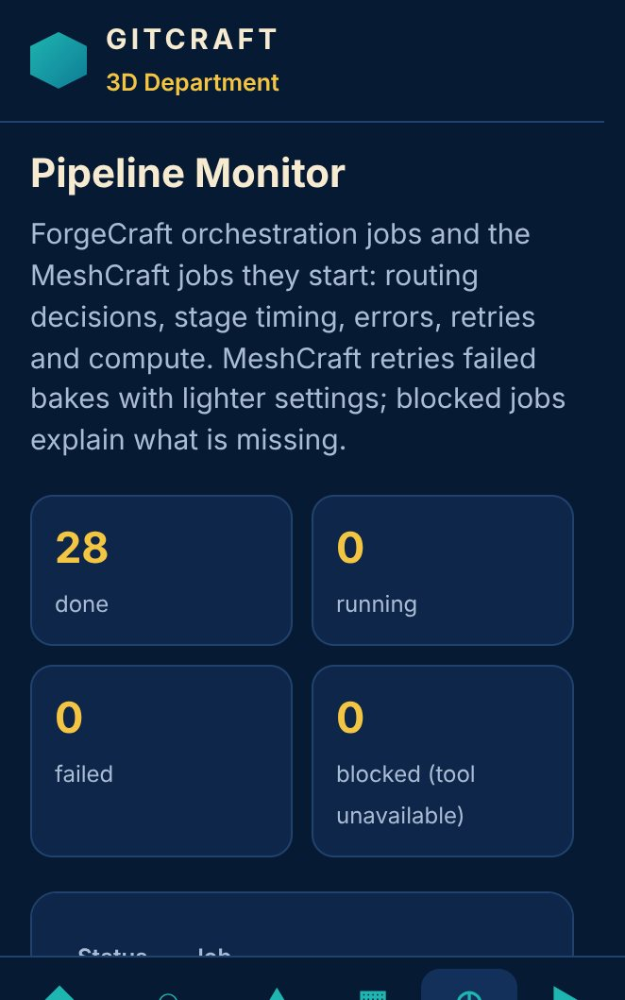
- `#mode` on home @ tablet: page_width_px=927, viewport_px=820, overflow_px=107 — 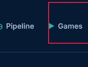
- `#mode` on characters @ tablet: page_width_px=927, viewport_px=820, overflow_px=107
### Lines of text are too long — minor · Measured (rendered DOM)

About 100 characters per line; beyond ~80 the eye loses its place.

**Fix:** Cap text columns at 60-75ch (max-width: 70ch).

Seen 17× — screens: characters, games, home, library, pipeline, world-builder; viewports: desktop, landscape, tablet · priority 14.98 (fix now)

- `#main > div.hero:nth-of-type(1) > div > p` on home @ desktop: approx_chars_per_line=100 — 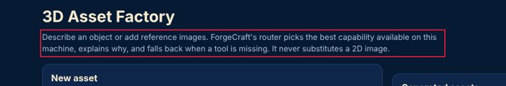
- `div:nth-of-type(2) > div.cand:nth-of-type(3) > div > small` on home @ desktop: approx_chars_per_line=103 — 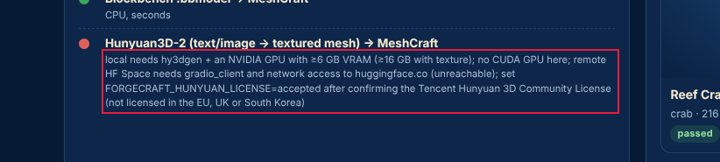
- `#main > div.hero:nth-of-type(1) > div > p` on characters @ desktop: approx_chars_per_line=101
### Uneven spacing between related elements — major · Measured (rendered DOM)

Items of the same kind in one list or stack are separated by different gaps, which reads as grouping that isn't there and makes the list look broken.

**Fix:** Give the container one gap (flex/grid `gap`, or one margin rule for all items) instead of per-item margins.

Seen 6× — screens: home; viewports: desktop, iphone13, iphone17, landscape, narrow, tablet · priority 12.55 (fix now)

- `#main > div.grid2:nth-of-type(2) > section.panel:nth-of-type(1)` on home @ iphone17: gaps_px=[0, 13, 18], spread_px=18 — 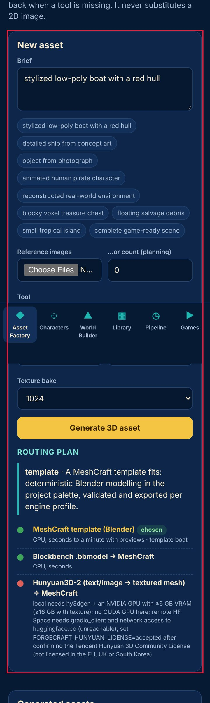
- `#main > div.grid2:nth-of-type(2) > section.panel:nth-of-type(1)` on home @ iphone13: gaps_px=[0, 14, 17], spread_px=17 — 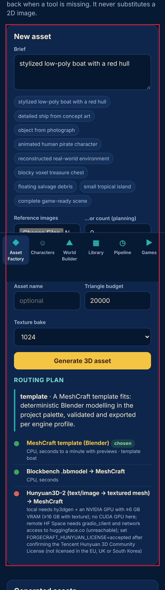
- `#main > div.grid2:nth-of-type(2) > section.panel:nth-of-type(1)` on home @ desktop: gaps_px=[0, 15, 17], spread_px=17
### Text is truncated — minor · Measured (rendered DOM)

Content is cut off with an ellipsis or clipped; on phones important words (task names, prices) disappear.

**Fix:** Allow two lines (line-clamp: 2) for primary labels, or give the label the space the trailing controls take.

Seen 11× — screens: home, library; viewports: desktop, iphone13, iphone17, landscape, narrow, tablet · priority 11.64 (fix now)

- `#recent > button.card:nth-of-type(1) > div > b` on home @ iphone17: content_width_px=252, visible_width_px=140 — 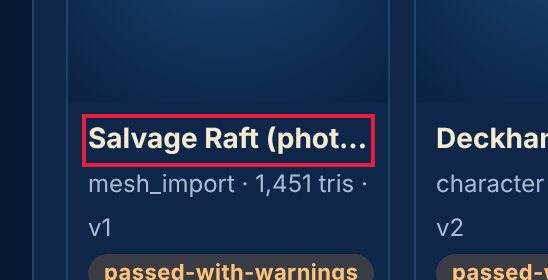
- `#recent > button.card:nth-of-type(3) > div > b` on home @ iphone17: content_width_px=162, visible_width_px=140 — 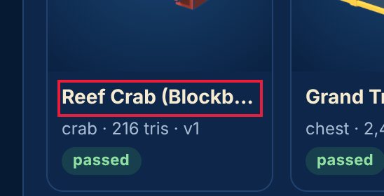
- `#recent > button.card:nth-of-type(4) > div > b` on home @ iphone17: content_width_px=149, visible_width_px=140
### Text is cramped against the edge of its box — minor · Measured (rendered DOM)

Text inside a filled or bordered box sits within a few pixels of the edge, which looks unfinished.

**Fix:** Give boxed text at least 8 px horizontal and 4 px vertical padding (12-16 px for cards).

Seen 10× — screens: characters, pipeline, world-builder; viewports: iphone13, iphone17, landscape, narrow, tablet · priority 11.04 (fix now)

- `#main > section.panel > h2 > span.pill.passed-with-warnings` on world-builder @ iphone17: horizontal_padding_px=8, vertical_padding_px=1 — 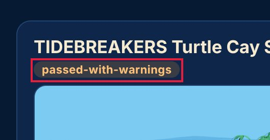
- `div.hw:nth-of-type(4) > div.panel:nth-of-type(2) > h3 > span.pill.available` on pipeline @ iphone17: horizontal_padding_px=8, vertical_padding_px=1 — 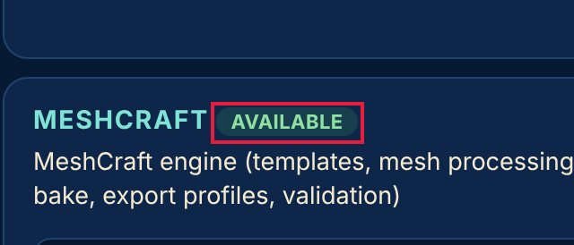
- `div.hw:nth-of-type(4) > div.panel:nth-of-type(3) > h3 > span.pill.available` on pipeline @ iphone17: horizontal_padding_px=8, vertical_padding_px=1
### Spacing does not follow a consistent scale — minor · Measured (rendered DOM)

Paddings, gaps and margins use many unrelated values, so the rhythm between elements looks accidental rather than designed.

**Fix:** Adopt a spacing scale (4/8-px steps: 4, 8, 12, 16, 24, 32) as tokens and replace one-off values with the nearest step.

Seen 10× — screens: characters, games, world-builder; viewports: desktop, iphone13, iphone17, landscape, narrow, tablet · priority 7.89 (next)

- `—` on characters @ iphone17: on_scale_share=0.68, distinct_values=19, off_scale_values_px=[10, 6, 14, 18] — 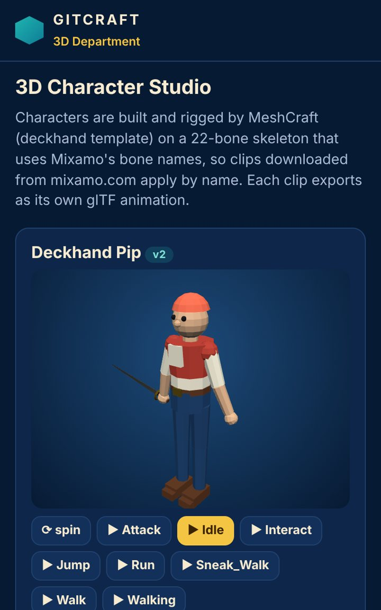
- `—` on games @ iphone17: on_scale_share=0.59, distinct_values=19, off_scale_values_px=[10, 6, 14, 18, 22, 34] — 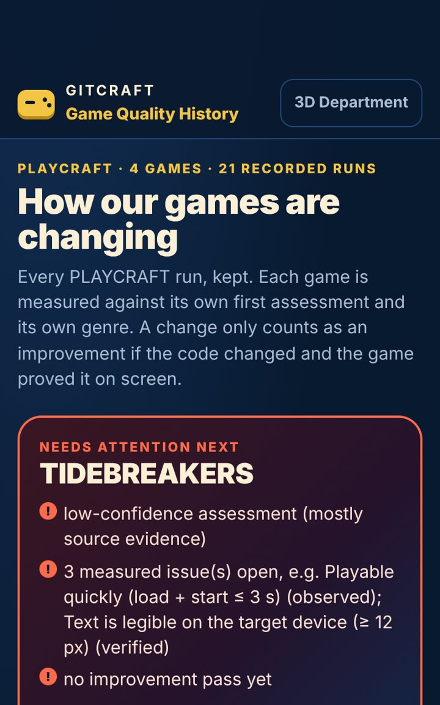
- `—` on characters @ iphone13: on_scale_share=0.68, distinct_values=19, off_scale_values_px=[10, 6, 14, 18]
### Controls stretch across the desktop window — minor · Measured (rendered DOM)

A 1086-px-wide button on a 1440-px screen: the mobile full-width style was never adapted, so the control looks bloated and the eye travels far.

**Fix:** Cap form and button widths on desktop (max-width 480-560 px) or lay forms out in a constrained column.

Seen 1× — screens: games; viewports: desktop · priority 2.06 (polish)

- `#app > div.qa:nth-of-type(3) > details:nth-of-type(1) > summary` on games @ desktop: width_px=1086 — 
- `#app > div.qa:nth-of-type(3) > details:nth-of-type(2) > summary` on games @ desktop: width_px=1086 — 

## 7. Button and control defects

### Touch target is too small — major · Measured (rendered DOM)

228×27 px: under the 44×44 pt Apple HIG minimum (24 px is the WCAG 2.2 floor); thumbs miss and hit neighbours.

**Fix:** Enlarge the hit area to 44×44 (padding, min-height/min-width, or an ::after hit-area) while keeping the visible glyph size.

Seen 29× — screens: characters, games, home, library, pipeline, world-builder; viewports: iphone13, iphone17, landscape, narrow, tablet · priority 31.73 (fix now)

- `#ex > span.chip:nth-of-type(1)` on home @ iphone17: width_px=228, height_px=27, minimum_px=44 — 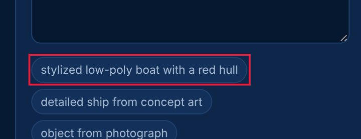
- `#ex > span.chip:nth-of-type(2)` on home @ iphone17: width_px=191, height_px=27, minimum_px=44 — 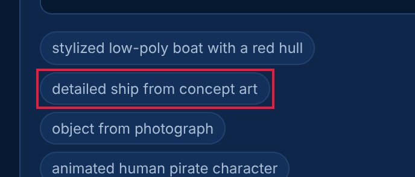
- `#ex > span.chip:nth-of-type(3)` on home @ iphone17: width_px=154, height_px=27, minimum_px=44
### No pressed (active) state — major · Measured (rendered DOM)

Pressing this control changes nothing visually until the action completes; on touch screens there is no hover, so this is the only immediate confirmation of a tap.

**Fix:** Add an :active style (darker tone, scale 0.97, or ripple) to every button and link variant.

Seen 12× — screens: characters, games, home, library, pipeline, world-builder; viewports: desktop, iphone17 · priority 18.34 (fix now)

- `#tabs > a.on:nth-of-type(1)` on home @ iphone17: style_changed_when_pressed=false — 
- `#tabs > a:nth-of-type(2)` on home @ iphone17: style_changed_when_pressed=false — 
- `#main > div.grid2:nth-of-type(2) > section.panel:nth-of-type(1) > label` on home @ iphone17: style_changed_when_pressed=false
### No hover state — minor · Measured (rendered DOM)

The pointer over this control changes nothing (colour, shadow, underline), so it does not signal that it is clickable.

**Fix:** Add a hover style (tone shift, underline, elevation) for every interactive component variant.

Seen 6× — screens: characters, games, home, library, pipeline, world-builder; viewports: desktop · priority 8.36 (next)

- `#tabs > a.on:nth-of-type(1)` on home @ desktop: style_changed_on_hover=false — 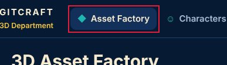
- `#tabs > a:nth-of-type(2)` on home @ desktop: style_changed_on_hover=false — 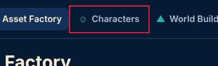
- `#main > div.grid2:nth-of-type(2) > section.panel:nth-of-type(1) > label` on home @ desktop: style_changed_on_hover=false
### Two primary actions compete — minor · Measured (rendered DOM)

'Interact' and 'Attack' are both strongly filled, similar in size and side by side, so neither reads as the main action.

**Fix:** Keep one filled primary button per group; make the other secondary (outline or tonal).

Seen 5× — screens: characters, games, pipeline; viewports: desktop, tablet · priority 7.57 (next)

- `#clips > span.chip.on:nth-of-type(5)` on characters @ desktop: fill_a=[31, 181, 176, 1], fill_b=[31, 181, 176, 1], other="Attack" — 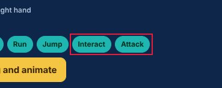
- `#clips > span.chip.on:nth-of-type(5)` on characters @ desktop: fill_a=[31, 181, 176, 1], fill_b=[31, 181, 176, 1], other="Jump" — 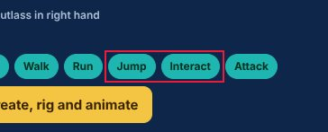
- `table.jobs > tbody > tr.sel:nth-of-type(1) > td:nth-of-type(2)` on pipeline @ desktop: fill_a=[18, 48, 90, 1], fill_b=[18, 48, 90, 1], other="compose_scene"
### Buttons side by side have different heights — major · Measured (rendered DOM)

Buttons in one row are 64, 85 px tall; equivalent controls look like different components and the row looks unbalanced.

**Fix:** Use one button size per row (a size token: e.g. 44 px on mobile) and change emphasis with fill/outline, not padding.

Seen 2× — screens: characters; viewports: iphone13, iphone17 · priority 6.33 (next)

- `div.grid2:nth-of-type(2) > section:nth-of-type(2) > div.panel:nth-of-type(2) > div.row` on characters @ iphone17: heights_px=[64, 85], buttons=["Prepare Mixamo upload (FBX)", "Apply downloaded clips\u2026"] — 
- `div.grid2:nth-of-type(2) > section:nth-of-type(2) > div.panel:nth-of-type(2) > div.row` on characters @ iphone13: heights_px=[64, 85], buttons=["Prepare Mixamo upload (FBX)", "Apply downloaded clips\u2026"] — 
### Click target is below 24 px — minor · Measured (rendered DOM)

13×13 px: under the WCAG 2.2 24×24 px minimum target size.

**Fix:** Enlarge the hit area to 44×44 (padding, min-height/min-width, or an ::after hit-area) while keeping the visible glyph size.

Seen 2× — screens: characters, pipeline; viewports: desktop · priority 4.22 (polish)

- `#cw` on characters @ desktop: width_px=13, height_px=13, minimum_px=24 — 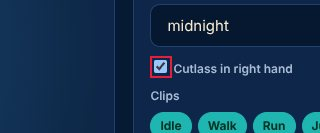
- `tbody > tr.sel:nth-of-type(1) > td:nth-of-type(2) > small` on pipeline @ desktop: width_px=164, height_px=14, minimum_px=24 — 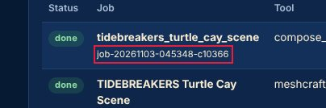
- `tbody > tr:nth-of-type(2) > td:nth-of-type(2) > small` on pipeline @ desktop: width_px=163, height_px=14, minimum_px=24

## 8. Mobile-specific findings

### Touch target is too small — major · Measured (rendered DOM)

228×27 px: under the 44×44 pt Apple HIG minimum (24 px is the WCAG 2.2 floor); thumbs miss and hit neighbours.

**Fix:** Enlarge the hit area to 44×44 (padding, min-height/min-width, or an ::after hit-area) while keeping the visible glyph size.

Seen 29× — screens: characters, games, home, library, pipeline, world-builder; viewports: iphone13, iphone17, landscape, narrow, tablet · priority 31.73 (fix now)

- `#ex > span.chip:nth-of-type(1)` on home @ iphone17: width_px=228, height_px=27, minimum_px=44 — 
- `#ex > span.chip:nth-of-type(2)` on home @ iphone17: width_px=191, height_px=27, minimum_px=44 — 
- `#ex > span.chip:nth-of-type(3)` on home @ iphone17: width_px=154, height_px=27, minimum_px=44
### Page scrolls sideways (horizontal overflow) — critical · Measured (rendered DOM)

The page is 331 px wide in a 320 px viewport: content is cut off and the whole page wobbles sideways when scrolled with a thumb.

**Fix:** Let the offending element shrink (max-width: 100%, min-width: 0 on flex children) or scroll it inside its own container (overflow-x: auto).

Seen 11× — screens: characters, home, library, pipeline, world-builder; viewports: landscape, narrow, tablet · priority 29.11 (fix now)

- `—` on pipeline @ narrow: overflow_px=11 — 
- `#mode` on home @ tablet: page_width_px=927, viewport_px=820, overflow_px=107 — 
- `#mode` on characters @ tablet: page_width_px=927, viewport_px=820, overflow_px=107
### Focusing a field zooms the page on iPhone — major · Measured (rendered DOM)

The field's font-size is 15 px; iOS Safari zooms in on any input under 16 px and leaves the page zoomed after typing.

**Fix:** Use font-size: 16px (1rem) for inputs, selects and textareas on mobile.

Seen 20× — screens: characters, home, library, world-builder; viewports: iphone13, iphone17, landscape, narrow, tablet · priority 24.84 (fix now)

- `#brief` on home @ iphone17: font_size_px=15 — 
- `#nimg` on home @ iphone17: font_size_px=15 — 
- `#tool` on home @ iphone17: font_size_px=15
### Controls are too close together — minor · Measured (rendered DOM)

'stylized low-poly boat with a red hull' and 'detailed ship from concept art' are 7 px apart and at least one is under 44 px: an easy mis-tap.

**Fix:** Keep at least 8 px between targets (more next to destructive actions), or merge rarely used actions into one overflow menu.

Seen 30× — screens: characters, home, library, pipeline, world-builder; viewports: desktop, iphone13, iphone17, landscape, narrow, tablet · priority 21.66 (fix now)

- `#ex > span.chip:nth-of-type(1)` on home @ iphone17: gap_px=7, neighbour="#ex > span.chip:nth-of-type(2)" — 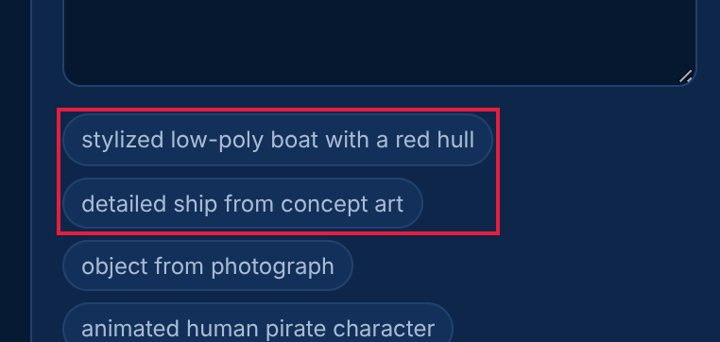
- `#ex > span.chip:nth-of-type(2)` on home @ iphone17: gap_px=6, neighbour="#ex > span.chip:nth-of-type(3)" — 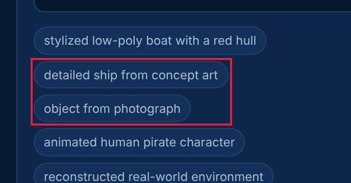
- `#ex > span.chip:nth-of-type(3)` on home @ iphone17: gap_px=6, neighbour="#ex > span.chip:nth-of-type(4)"
### Text is cramped against the edge of its box — minor · Measured (rendered DOM)

Text inside a filled or bordered box sits within a few pixels of the edge, which looks unfinished.

**Fix:** Give boxed text at least 8 px horizontal and 4 px vertical padding (12-16 px for cards).

Seen 10× — screens: characters, pipeline, world-builder; viewports: iphone13, iphone17, landscape, narrow, tablet · priority 11.04 (fix now)

- `#main > section.panel > h2 > span.pill.passed-with-warnings` on world-builder @ iphone17: horizontal_padding_px=8, vertical_padding_px=1 — 
- `div.hw:nth-of-type(4) > div.panel:nth-of-type(2) > h3 > span.pill.available` on pipeline @ iphone17: horizontal_padding_px=8, vertical_padding_px=1 — 
- `div.hw:nth-of-type(4) > div.panel:nth-of-type(3) > h3 > span.pill.available` on pipeline @ iphone17: horizontal_padding_px=8, vertical_padding_px=1
### Buttons side by side have different heights — major · Measured (rendered DOM)

Buttons in one row are 64, 85 px tall; equivalent controls look like different components and the row looks unbalanced.

**Fix:** Use one button size per row (a size token: e.g. 44 px on mobile) and change emphasis with fill/outline, not padding.

Seen 2× — screens: characters; viewports: iphone13, iphone17 · priority 6.33 (next)

- `div.grid2:nth-of-type(2) > section:nth-of-type(2) > div.panel:nth-of-type(2) > div.row` on characters @ iphone17: heights_px=[64, 85], buttons=["Prepare Mixamo upload (FBX)", "Apply downloaded clips\u2026"] — 
- `div.grid2:nth-of-type(2) > section:nth-of-type(2) > div.panel:nth-of-type(2) > div.row` on characters @ iphone13: heights_px=[64, 85], buttons=["Prepare Mixamo upload (FBX)", "Apply downloaded clips\u2026"] — 
### Main action is at the top of the phone screen — minor · Measured (rendered DOM)

The primary action sits in the top fifth of a tall phone screen, the hardest zone to reach one-handed.

**Fix:** Repeat or move the main action to the lower half (a bottom action bar or floating button).

Seen 5× — screens: characters, home, library, pipeline, world-builder; viewports: tablet · priority 5.4 (next)

- `#tabs > a.on:nth-of-type(1)` on home @ tablet: centre_y_share=0.05 — 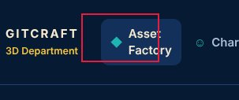
- `#tabs > a.on:nth-of-type(2)` on characters @ tablet: centre_y_share=0.05 — 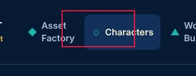
- `#tabs > a.on:nth-of-type(3)` on world-builder @ tablet: centre_y_share=0.05
### Too many button variants — minor · Measured (rendered DOM)

6 distinct button size/shape combinations (heights 32, 40, 64, 84, 248, 268 px) at iphone17: buttons were styled one by one, not from a component.

**Fix:** Define 2-3 button sizes and 3 emphasis levels (primary, secondary, tertiary) as one component and use it everywhere.

Seen 2× — screens: all; viewports: iphone13, iphone17 · priority 3.02 (polish)

- `—` on all @ iphone17: variants=6, heights_px=[32, 40, 64, 84, 248, 268], examples=["home: Generate 3D asset (336\u00d742)", "home: Salvage Raft (photogrammetry scan) mesh_import \u00b7 1,451 tris  (162\u00d7269)", "home: Reef Crab (Blockbench) crab \u00b7 216 tris \u00b7 v1 passed (162\u00d7247)", "characters: \u27f3 spi
- `—` on all @ iphone13: variants=6, heights_px=[32, 40, 64, 84, 240, 264], examples=["home: Generate 3D asset (324\u00d742)", "home: Salvage Raft (photogrammetry scan) mesh_import \u00b7 1,451 tris  (156\u00d7263)", "home: Reef Crab (Blockbench) crab \u00b7 216 tris \u00b7 v1 passed (156\u00d7241)", "characters: \u27f3 spi

## 9. Screenshot gallery

Browser emulation (Playwright + Chromium); safe-area insets emulated through CDP. No physical-device evidence.

- home @ iphone17: 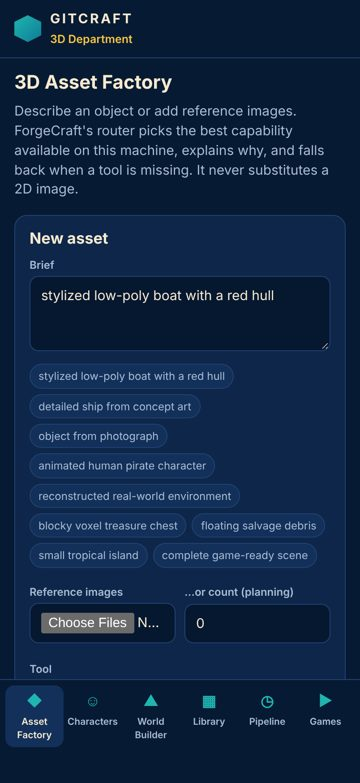
- characters @ iphone17: 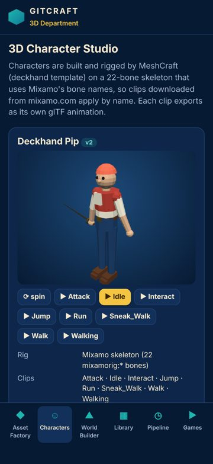
- world-builder @ iphone17: 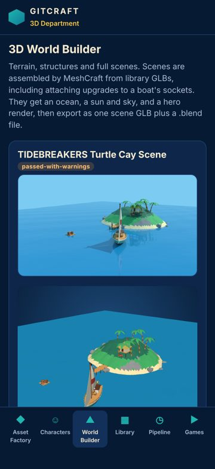
- library @ iphone17: 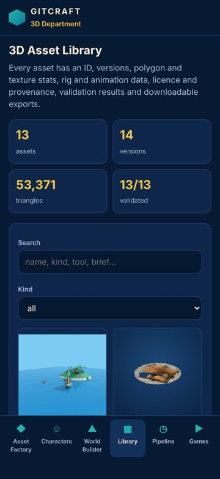
- pipeline @ iphone17: 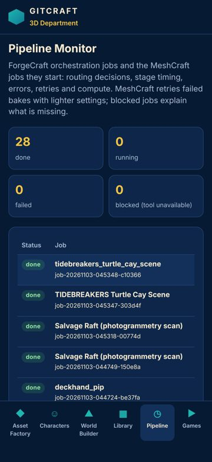
- games @ iphone17: 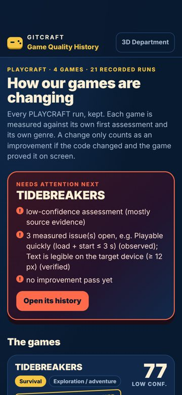
- home @ iphone13: 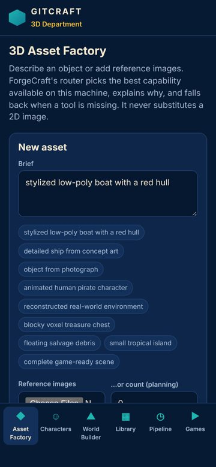
- characters @ iphone13: 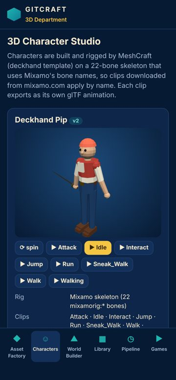
- world-builder @ iphone13: 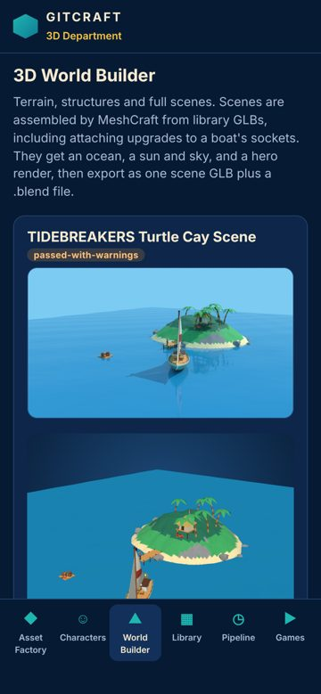
- library @ iphone13: 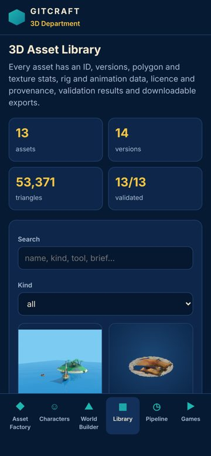
- pipeline @ iphone13: 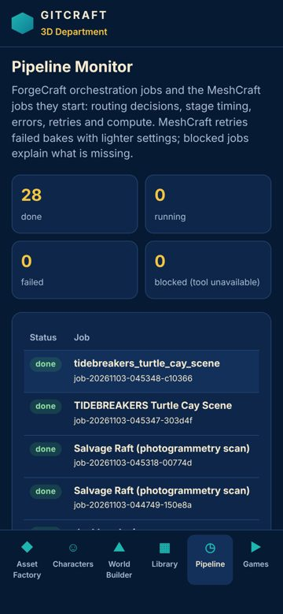
- games @ iphone13: 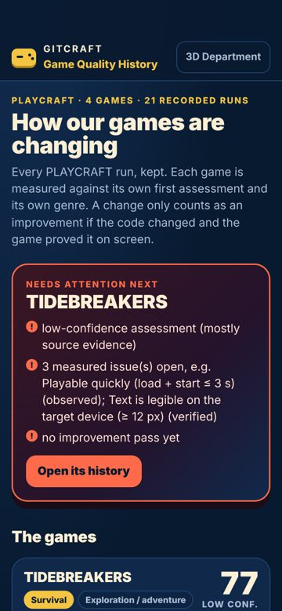
- home @ desktop: 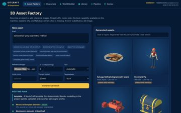
- characters @ desktop: 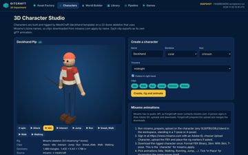
- world-builder @ desktop: 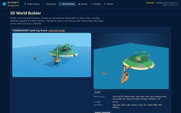
- library @ desktop: 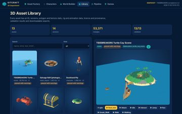
- pipeline @ desktop: 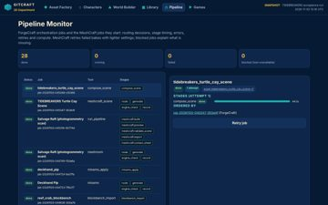
- games @ desktop: 
- home @ narrow: 
- characters @ narrow: 
- world-builder @ narrow: 
- library @ narrow: 
- pipeline @ narrow: 
- games @ narrow: 
- home @ tablet: 
- characters @ tablet: 
- world-builder @ tablet: 
- library @ tablet: 
- pipeline @ tablet: 
- games @ tablet: 
- home @ landscape: 
- characters @ landscape: 
- world-builder @ landscape: 
- library @ landscape: 
- pipeline @ landscape: 
- games @ landscape: 

## 10. Prioritised improvement plan

| # | Tier | Fix | Severity | Seen | Cost | Area |
|---|---|---|---|---|---|---|
| 1 | fix now | **Text is too small to read comfortably** — Use at least 12 px (13-14 px preferred) for secondary text and keep hierarchy with weight and colour rather than very small sizes. | major | 31× | low | typography |
| 2 | fix now | **Touch target is too small** — Enlarge the hit area to 44×44 (padding, min-height/min-width, or an ::after hit-area) while keeping the visible glyph size. | major | 29× | low | controls |
| 3 | fix now | **Page scrolls sideways (horizontal overflow)** — Let the offending element shrink (max-width: 100%, min-width: 0 on flex children) or scroll it inside its own container (overflow-x: auto). | critical | 11× | low | layout |
| 4 | fix now | **Focusing a field zooms the page on iPhone** — Use font-size: 16px (1rem) for inputs, selects and textareas on mobile. | major | 20× | low | mobile |
| 5 | fix now | **Controls are too close together** — Keep at least 8 px between targets (more next to destructive actions), or merge rarely used actions into one overflow menu. | minor | 30× | low | mobile |
| 6 | fix now | **No pressed (active) state** — Add an :active style (darker tone, scale 0.97, or ripple) to every button and link variant. | major | 12× | low | feedback |
| 7 | fix now | **Lines of text are too long** — Cap text columns at 60-75ch (max-width: 70ch). | minor | 17× | low | typography |
| 8 | fix now | **Uneven spacing between related elements** — Give the container one gap (flex/grid `gap`, or one margin rule for all items) instead of per-item margins. | major | 6× | low | spacing |
| 9 | fix now | **Text is truncated** — Allow two lines (line-clamp: 2) for primary labels, or give the label the space the trailing controls take. | minor | 11× | low | layout |
| 10 | fix now | **Text is cramped against the edge of its box** — Give boxed text at least 8 px horizontal and 4 px vertical padding (12-16 px for cards). | minor | 10× | low | spacing |
| 11 | fix now | **Clickable element is not a real control** — Use <button> (or <a href>) instead of a clickable 
/. | major | 4× | low | accessibility |
| 12 | next | **The same heading level has different sizes on different screens** — Style headings once, globally, from the type scale. | minor | 6× | low | cross_screen |
| 13 | next | **No hover state** — Add a hover style (tone shift, underline, elevation) for every interactive component variant. | minor | 6× | low | feedback |
| 14 | next | **Spacing does not follow a consistent scale** — Adopt a spacing scale (4/8-px steps: 4, 8, 12, 16, 24, 32) as tokens and replace one-off values with the nearest step. | minor | 10× | medium | spacing |
| 15 | next | **Two primary actions compete** — Keep one filled primary button per group; make the other secondary (outline or tonal). | minor | 5× | low | controls |

Lower-priority items not listed: 7 (in audit.json).

## Journeys

| Journey | Viewport | Result | Taps | Expected | Confirmations | Feedback (ms) |
|---|---|---|---|---|---|---|
| reach characters (auto) | iphone17 | ok | 1 | — | 0 | 115 |
| reach world-builder (auto) | iphone17 | ok | 1 | — | 0 | 115 |
| reach library (auto) | iphone17 | ok | 1 | — | 0 | 126 |
| reach pipeline (auto) | iphone17 | ok | 1 | — | 0 | 124 |
| reach games (auto) | iphone17 | ok | 1 | — | 0 | None |
| reach characters (auto) | desktop | ok | 1 | — | 0 | 104 |
| reach world-builder (auto) | desktop | ok | 1 | — | 0 | 107 |
| reach library (auto) | desktop | ok | 1 | — | 0 | 107 |
| reach pipeline (auto) | desktop | ok | 1 | — | 0 | 135 |
| reach games (auto) | desktop | ok | 1 | — | 0 | None |

## Evidence and limits

- Every viewport is browser emulation (Playwright + Chromium 153.0.8010.12); iPhone sizes are CSS pixels and safe-area insets are emulated through CDP (Emulation.setSafeAreaInsetsOverride). Safari-specific rendering (WebKit), the real on-screen keyboard and physical reach are not reproduced.
- Browser chrome: the first screen is re-measured with the viewport shortened by 120 px (Safari's toolbars); dynamic toolbar collapse is not reproduced.
- Keyboard interference: fields that would zoom on focus (font-size < 16 px) are measured; whether the on-screen keyboard covers a field is not testable in emulation.
- Hover/pressed/focus states are sampled once per visual variant of control; focus visibility comes from real Tab presses (desktop).
- Canvas-drawn interfaces (games): the DOM does not describe what is drawn, so DOM-geometry metrics cover only the HTML overlay (HUD, menus); use judgements for the canvas.
- No physical-device evidence: findings are emulation results, not device results.
