# PIXELCRAFT audit: GITCRAFT 3D Department UI (/)

Target: `/home/user/GITCRAFT/forgecraft/ui/dist` · method pixelcraft-1.0 · 2026-11-10T06:30:02+00:00

## 1. Overall PIXELCRAFT score: **83.5** / 100 (good)

Evidence coverage 100% · confidence **medium** — only automatic journeys (no task-specific journeys with expected taps); canvas-rendered screens: the DOM does not describe what is drawn; browser emulation only (no physical-device evidence)

Coverage and confidence are reported separately from quality: an area with no evidence is *not tested*, never zero and never capped.

## 2. Category scores

| Category | Score | Coverage | Not tested |
|---|---|---|---|
| Visual Quality | **92** | 100% | — |
| Usability | **94.9** | 100% | — |
| Consistency | **63.6** | 100% | — |

### Visual Quality

| Area | Points | Awarded | Evidence | Weakest metric |
|---|---|---|---|---|
| Spacing and rhythm | 25 | 20.3 | measured ×129 | related elements evenly spaced (51%) |
| Layout and composition | 25 | 25 | measured ×237 | no horizontal overflow (100%) |
| Typography and hierarchy | 20 | 17.9 | measured ×144 | a small set of font sizes (65%) |
| Buttons and controls | 20 | 18.8 | measured ×161 | one clear primary action per group (73%) |
| Visual consistency | 10 | 10 | measured ×66 | controls share radii and a small palette (100%) |

### Usability

| Area | Points | Awarded | Evidence | Weakest metric |
|---|---|---|---|---|
| Interaction efficiency | 25 | 25 | measured ×20 | journeys complete (100%) |
| Navigation and discoverability | 20 | 16 | measured ×19 | navigation stays in the same place on every screen (0%) |
| Mobile ergonomics | 25 | 25 | measured ×135 | responsive viewport meta (100%) |
| Feedback and interaction states | 15 | 13.9 | measured ×38 | controls react to hover (81%) |
| Accessibility | 15 | 15 | accessibility ×36, measured ×12 | axe-core WCAG 2.2 AA checks (100%) |

### Consistency

| Area | Points | Awarded | Evidence | Weakest metric |
|---|---|---|---|---|
| Cross-screen consistency | 25 | 4.8 | measured ×12 | primary buttons look the same on every screen (15%) |
| Component consistency | 25 | 19.8 | measured ×12 | inputs share one height (70%) |
| Responsive consistency | 20 | 19.7 | measured ×12 | the same content at every size (96%) |
| Design system adherence | 20 | 10.1 | measured ×24 | a small set of corner radii (6%) |
| State consistency | 10 | 9.2 | measured ×4 | pressed treatment applied consistently (88%) |

## 3. Strongest screens

- **library** — 99.7
- **world-builder** — 99.3
- **pipeline** — 99.3

## 4. Weakest screens

- **games** — 96.0
- **home** — 96.8
- **characters** — 99.0

## 5. Critical usability defects

### No pressed (active) state — major · Measured (rendered DOM)

Pressing this control changes nothing visually until the action completes; on touch screens there is no hover, so this is the only immediate confirmation of a tap.

**Fix:** Add an :active style (darker tone, scale 0.97, or ripple) to every button and link variant.

Seen 3× — screens: characters, home, world-builder; viewports: iphone17 · priority 8.4 (next)

- `#go` on home @ iphone17: style_changed_when_pressed=false — 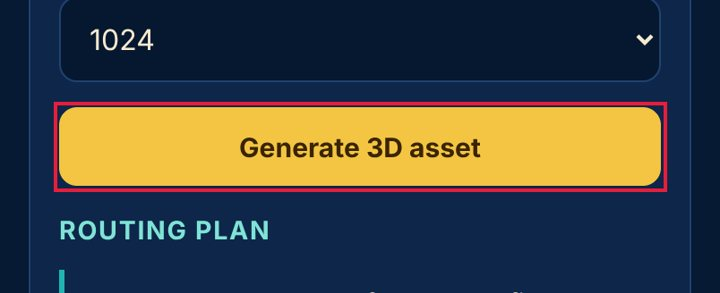
- `#cb` on characters @ iphone17: style_changed_when_pressed=false — 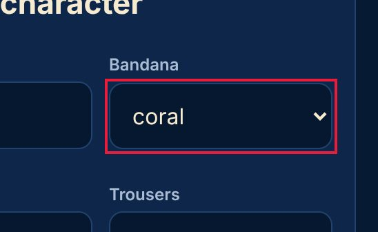
- `div > div > div.hud:nth-of-type(2) > button.btn.small` on world-builder @ iphone17: style_changed_when_pressed=false

## 6. Spacing and layout defects

### Uneven spacing between related elements — major · Measured (rendered DOM)

Items of the same kind in one list or stack are separated by different gaps, which reads as grouping that isn't there and makes the list look broken.

**Fix:** Give the container one gap (flex/grid `gap`, or one margin rule for all items) instead of per-item margins.

Seen 4× — screens: home; viewports: desktop, landscape, narrow, tablet · priority 10.0 (fix now)

- `#main > div.grid2:nth-of-type(2) > section.panel:nth-of-type(1)` on home @ desktop: gaps_px=[1, 13, 18], spread_px=17 — 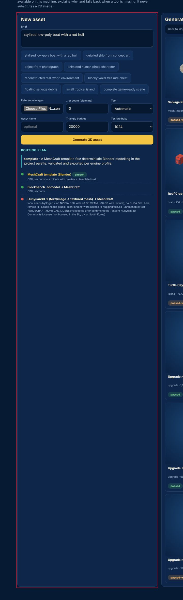
- `#main > div.grid2:nth-of-type(2) > section.panel:nth-of-type(1)` on home @ narrow: gaps_px=[1, 13, 18], spread_px=17 — 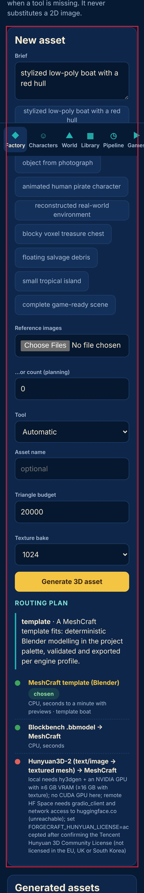
- `#main > div.grid2:nth-of-type(2) > section.panel:nth-of-type(1)` on home @ tablet: gaps_px=[0, 14, 18], spread_px=18
### Lines of text are too long — minor · Measured (rendered DOM)

About 99 characters per line; beyond ~80 the eye loses its place.

**Fix:** Cap text columns at 60-75ch (max-width: 70ch).

Seen 2× — screens: characters, home; viewports: landscape · priority 4.22 (polish)

- `#plan > div.route:nth-of-type(1)` on home @ landscape: approx_chars_per_line=99 — 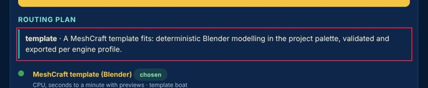
- `section:nth-of-type(2) > div.panel:nth-of-type(2) > ol > li:nth-of-type(1)` on characters @ landscape: approx_chars_per_line=101 — 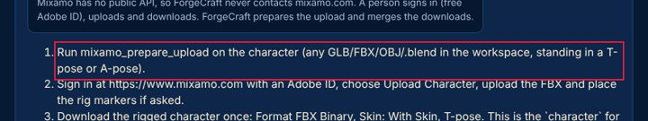
- `section:nth-of-type(2) > div.panel:nth-of-type(2) > ol > li:nth-of-type(2)` on characters @ landscape: approx_chars_per_line=101

## 7. Button and control defects

### No pressed (active) state — major · Measured (rendered DOM)

Pressing this control changes nothing visually until the action completes; on touch screens there is no hover, so this is the only immediate confirmation of a tap.

**Fix:** Add an :active style (darker tone, scale 0.97, or ripple) to every button and link variant.

Seen 3× — screens: characters, home, world-builder; viewports: iphone17 · priority 8.4 (next)

- `#go` on home @ iphone17: style_changed_when_pressed=false — 
- `#cb` on characters @ iphone17: style_changed_when_pressed=false — 
- `div > div > div.hud:nth-of-type(2) > button.btn.small` on world-builder @ iphone17: style_changed_when_pressed=false
### Controls are too close together — minor · Measured (rendered DOM)

'▲ World Builder' and '▦ Library' are 7 px apart and at least one is under 44 px: an easy mis-tap.

**Fix:** Keep at least 8 px between targets (more next to destructive actions), or merge rarely used actions into one overflow menu.

Seen 5× — screens: characters, home, library, pipeline, world-builder; viewports: desktop · priority 7.57 (next)

- `#tabs > a:nth-of-type(3)` on home @ desktop: gap_px=7, neighbour="#tabs > a:nth-of-type(4)" — 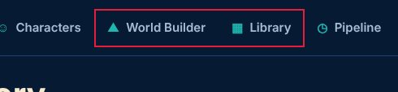
- `#tabs > a:nth-of-type(5)` on home @ desktop: gap_px=7, neighbour="#tabs > a:nth-of-type(6)" — 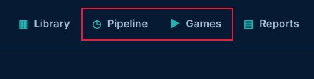
- `#tabs > a:nth-of-type(3)` on characters @ desktop: gap_px=7, neighbour="#tabs > a:nth-of-type(4)"
### Two primary actions compete — minor · Measured (rendered DOM)

'Interact' and 'Jump' are both strongly filled, similar in size and side by side, so neither reads as the main action.

**Fix:** Keep one filled primary button per group; make the other secondary (outline or tonal).

Seen 3× — screens: characters, games; viewports: desktop, tablet · priority 5.6 (next)

- `#clips > button.chip.on:nth-of-type(5)` on characters @ desktop: fill_a=[31, 181, 176, 0.18], fill_b=[31, 181, 176, 0.18], other="Jump" — 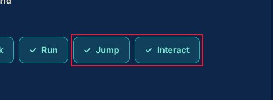
- `#clips > button.chip.on:nth-of-type(5)` on characters @ desktop: fill_a=[31, 181, 176, 0.18], fill_b=[31, 181, 176, 0.18], other="Walk" — 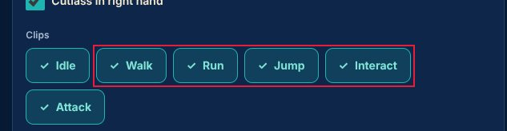
- `#app > div.carts:nth-of-type(2) > a.cart:nth-of-type(1)` on games @ desktop: fill_a=[16, 41, 75, 1], fill_b=[16, 41, 75, 1], other="DEMO DAY Physics puzzle / destruction Sports 78 LOW CONF. ME"
### No hover state — minor · Measured (rendered DOM)

The pointer over this control changes nothing (colour, shadow, underline), so it does not signal that it is clickable.

**Fix:** Add a hover style (tone shift, underline, elevation) for every interactive component variant.

Seen 1× — screens: pipeline; viewports: desktop · priority 2.06 (polish)

- `div.grid2:nth-of-type(3) > section.panel:nth-of-type(1) > div.subtabs > button.btn.small:nth-of-type(1)` on pipeline @ desktop: style_changed_on_hover=false — 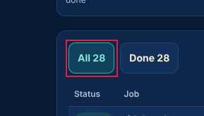
- `#jrows > tr.sel:nth-of-type(1) > td:nth-of-type(2) > a` on pipeline @ desktop: style_changed_on_hover=false — 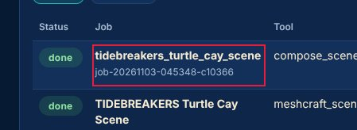
- `#jrows > tr:nth-of-type(2) > td:nth-of-type(2) > a` on pipeline @ desktop: style_changed_on_hover=false

## 8. Mobile-specific findings

### No pressed (active) state — major · Measured (rendered DOM)

Pressing this control changes nothing visually until the action completes; on touch screens there is no hover, so this is the only immediate confirmation of a tap.

**Fix:** Add an :active style (darker tone, scale 0.97, or ripple) to every button and link variant.

Seen 3× — screens: characters, home, world-builder; viewports: iphone17 · priority 8.4 (next)

- `#go` on home @ iphone17: style_changed_when_pressed=false — 
- `#cb` on characters @ iphone17: style_changed_when_pressed=false — 
- `div > div > div.hud:nth-of-type(2) > button.btn.small` on world-builder @ iphone17: style_changed_when_pressed=false
### Lines of text are too long — minor · Measured (rendered DOM)

About 99 characters per line; beyond ~80 the eye loses its place.

**Fix:** Cap text columns at 60-75ch (max-width: 70ch).

Seen 2× — screens: characters, home; viewports: landscape · priority 4.22 (polish)

- `#plan > div.route:nth-of-type(1)` on home @ landscape: approx_chars_per_line=99 — 
- `section:nth-of-type(2) > div.panel:nth-of-type(2) > ol > li:nth-of-type(1)` on characters @ landscape: approx_chars_per_line=101 — 
- `section:nth-of-type(2) > div.panel:nth-of-type(2) > ol > li:nth-of-type(2)` on characters @ landscape: approx_chars_per_line=101
### Too many button variants — minor · Measured (rendered DOM)

6 distinct button size/shape combinations (heights 44, 64, 84, 288, 304 px) at iphone17: buttons were styled one by one, not from a component.

**Fix:** Define 2-3 button sizes and 3 emphasis levels (primary, secondary, tertiary) as one component and use it everywhere.

Seen 2× — screens: all; viewports: iphone13, iphone17 · priority 3.02 (polish)

- `—` on all @ iphone17: variants=6, heights_px=[44, 64, 84, 288, 304], examples=["home: stylized low-poly boat with a red hull (277\u00d744)", "home: Generate 3D asset (336\u00d744)", "home: Salvage Raft (photogrammetry scan) mesh_import \u00b7 1,451 tris  (162\u00d7304)", "home: Reef Crab (Blockbench) crab \u00b7 216 tris
- `—` on all @ iphone13: variants=6, heights_px=[44, 64, 84, 280, 296], examples=["home: stylized low-poly boat with a red hull (277\u00d744)", "home: Generate 3D asset (324\u00d744)", "home: Salvage Raft (photogrammetry scan) mesh_import \u00b7 1,451 tris  (156\u00d7298)", "home: Reef Crab (Blockbench) crab \u00b7 216 tris

## 9. Screenshot gallery

Browser emulation (Playwright + Chromium); safe-area insets emulated through CDP. No physical-device evidence.

- home @ iphone17: 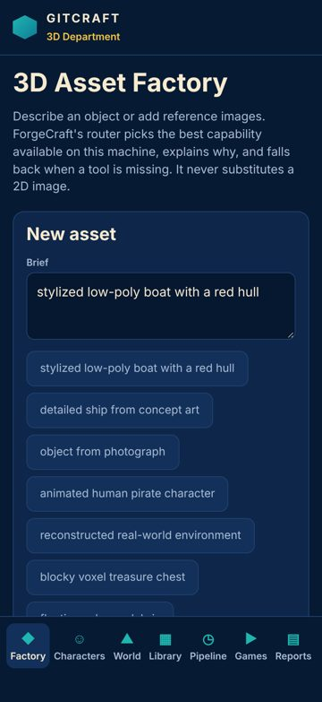
- characters @ iphone17: 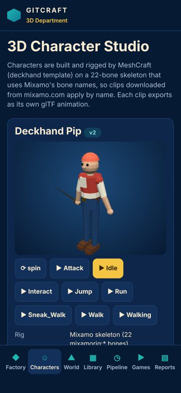
- world-builder @ iphone17: 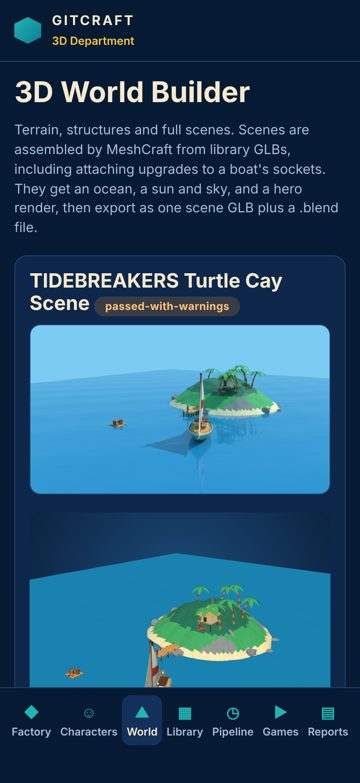
- library @ iphone17: 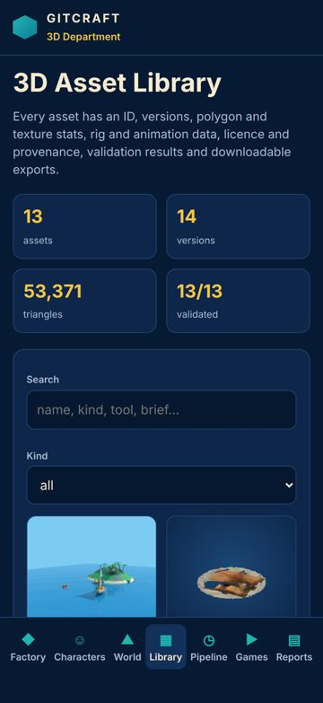
- pipeline @ iphone17: 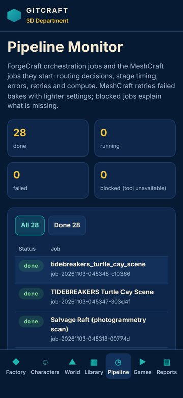
- games @ iphone17: 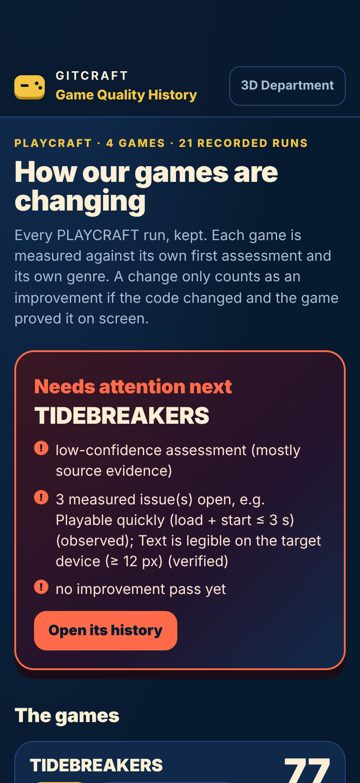
- home @ iphone13: 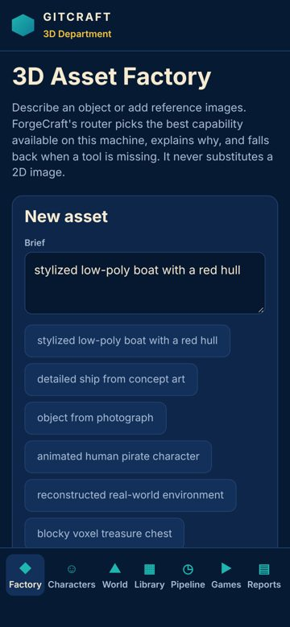
- characters @ iphone13: 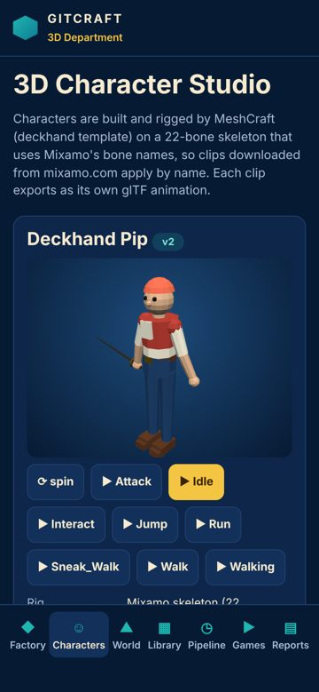
- world-builder @ iphone13: 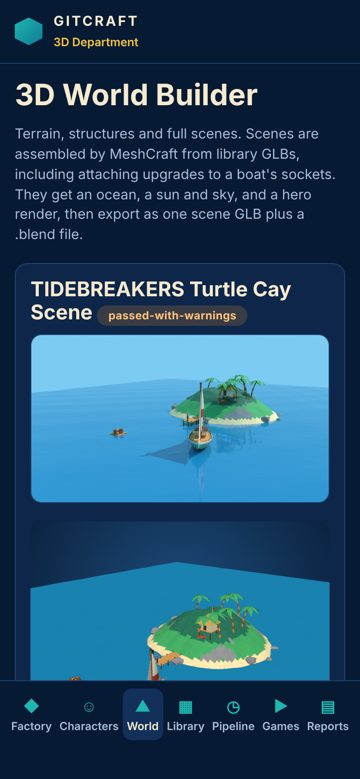
- library @ iphone13: 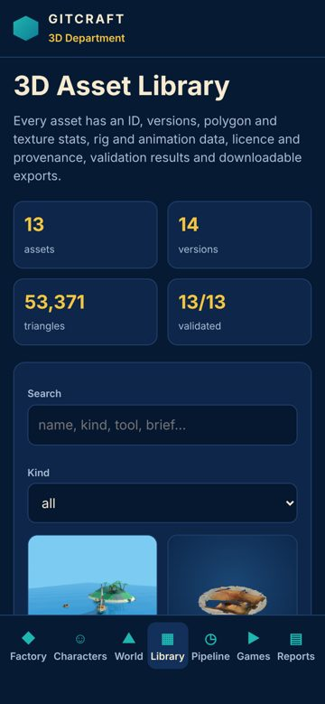
- pipeline @ iphone13: 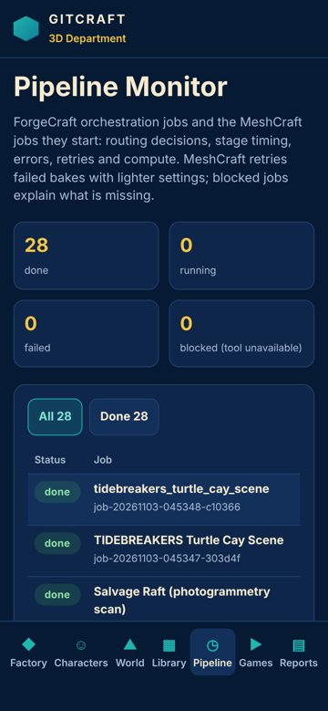
- games @ iphone13: 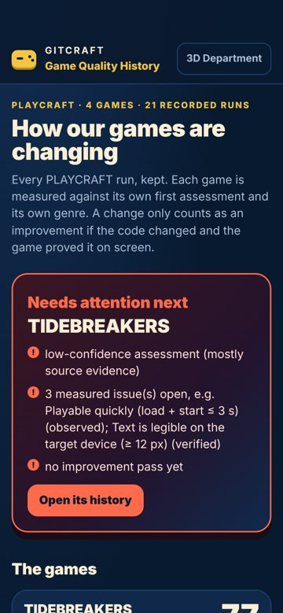
- home @ desktop: 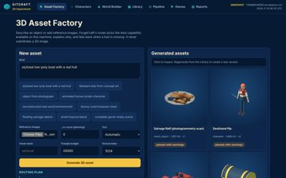
- characters @ desktop: 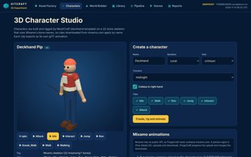
- world-builder @ desktop: 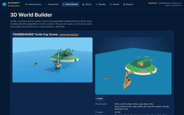
- library @ desktop: 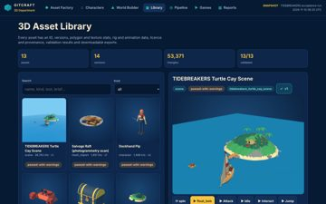
- pipeline @ desktop: 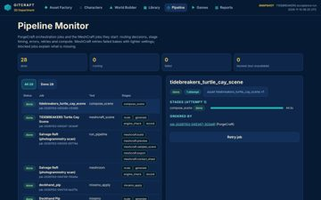
- games @ desktop: 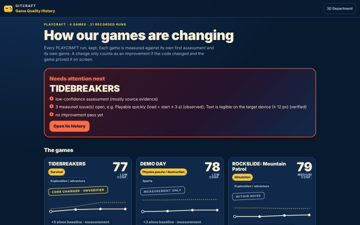
- home @ narrow: 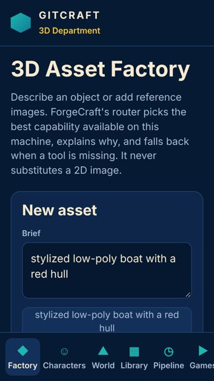
- characters @ narrow: 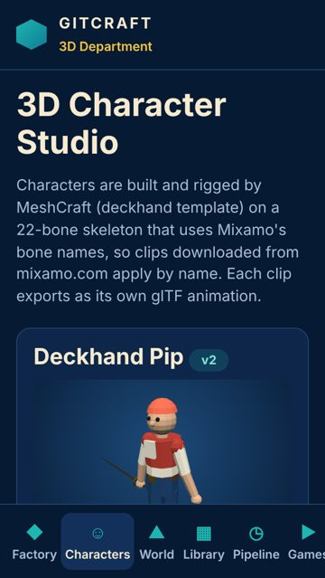
- world-builder @ narrow: 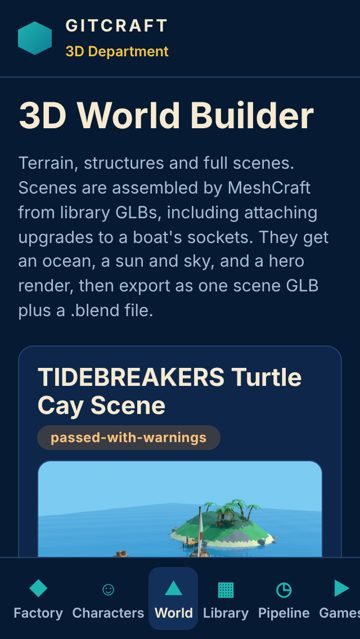
- library @ narrow: 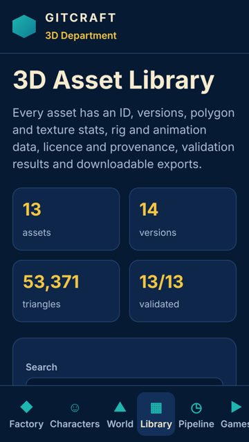
- pipeline @ narrow: 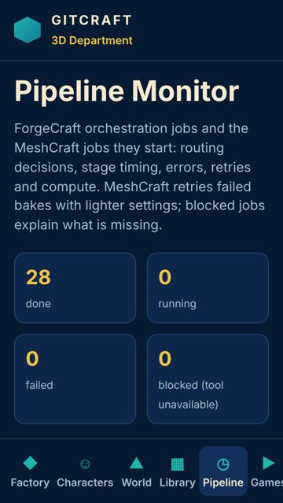
- games @ narrow: 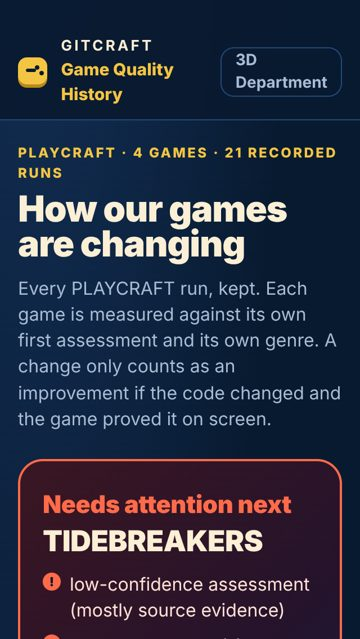
- home @ tablet: 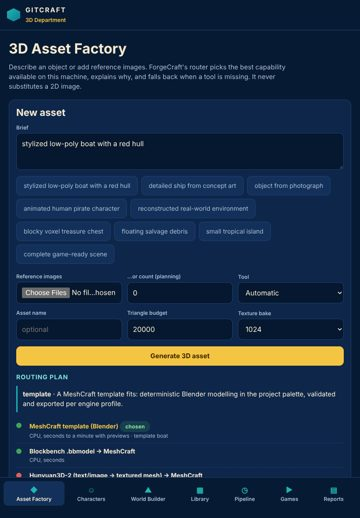
- characters @ tablet: 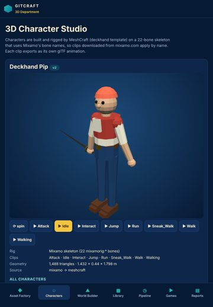
- world-builder @ tablet: 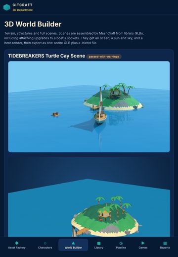
- library @ tablet: 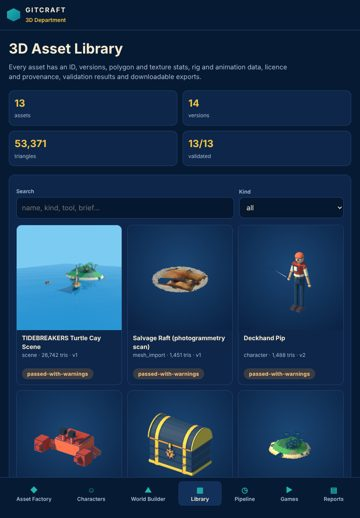
- pipeline @ tablet: 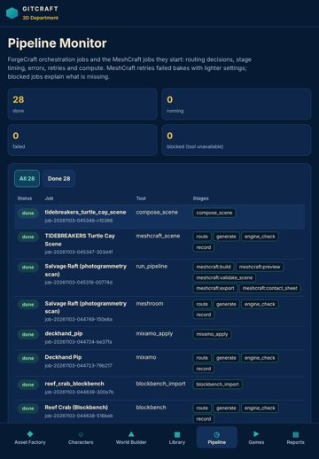
- games @ tablet: 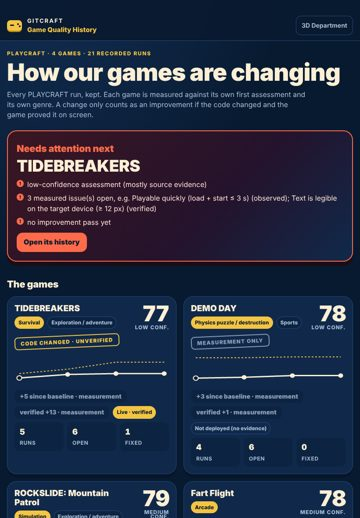
- home @ landscape: 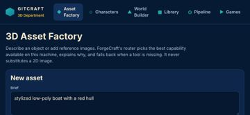
- characters @ landscape: 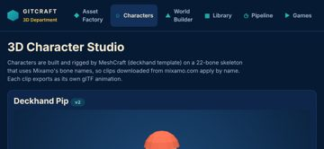
- world-builder @ landscape: 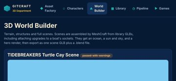
- library @ landscape: 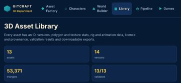
- pipeline @ landscape: 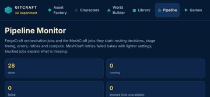
- games @ landscape: 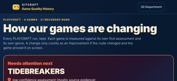

## 10. Prioritised improvement plan

| # | Tier | Fix | Severity | Seen | Cost | Area |
|---|---|---|---|---|---|---|
| 1 | fix now | **Uneven spacing between related elements** — Give the container one gap (flex/grid `gap`, or one margin rule for all items) instead of per-item margins. | major | 4× | low | spacing |
| 2 | next | **No pressed (active) state** — Add an :active style (darker tone, scale 0.97, or ripple) to every button and link variant. | major | 3× | low | feedback |
| 3 | next | **The same heading level has different sizes on different screens** — Style headings once, globally, from the type scale. | minor | 6× | low | cross_screen |
| 4 | next | **Controls are too close together** — Keep at least 8 px between targets (more next to destructive actions), or merge rarely used actions into one overflow menu. | minor | 5× | low | controls |
| 5 | next | **Two primary actions compete** — Keep one filled primary button per group; make the other secondary (outline or tonal). | minor | 3× | low | controls |
| 6 | polish | **Lines of text are too long** — Cap text columns at 60-75ch (max-width: 70ch). | minor | 2× | low | typography |
| 7 | polish | **Too many button variants** — Define 2-3 button sizes and 3 emphasis levels (primary, secondary, tertiary) as one component and use it everywhere. | minor | 2× | medium | component |
| 8 | polish | **No hover state** — Add a hover style (tone shift, underline, elevation) for every interactive component variant. | minor | 1× | low | feedback |

## Journeys

| Journey | Viewport | Result | Taps | Expected | Confirmations | Feedback (ms) |
|---|---|---|---|---|---|---|
| reach characters (auto) | iphone17 | ok | 1 | — | 0 | 129 |
| reach world-builder (auto) | iphone17 | ok | 1 | — | 0 | 147 |
| reach library (auto) | iphone17 | ok | 1 | — | 0 | 144 |
| reach pipeline (auto) | iphone17 | ok | 1 | — | 0 | 122 |
| reach games (auto) | iphone17 | ok | 1 | — | 0 | None |
| reach characters (auto) | desktop | ok | 1 | — | 0 | 123 |
| reach world-builder (auto) | desktop | ok | 1 | — | 0 | 103 |
| reach library (auto) | desktop | ok | 1 | — | 0 | 126 |
| reach pipeline (auto) | desktop | ok | 1 | — | 0 | 113 |
| reach games (auto) | desktop | ok | 1 | — | 0 | None |

## Generic design tells (advisory, not scored)

Defaults that unguided builds reach for, read from the rendered page. Each is a question, not a defect: the project's own art direction wins. Accept a deliberate one with `accept_tells: [{id, reason}]`.

- **Thick coloured stripe on one side** — 6× across 6 captures (home). A 3 px+ coloured border down one edge of cards, list items or alerts is a template habit. *Ask:* Mark state or category with an icon, a label or the surface colour; if a stripe is part of the identity, accept it. Examples: `div.route` "template · A MeshCraft template fits: deterministi" (home @ iphone17).
- **Cards nested in cards** — 57× across 27 captures (characters, home, library, pipeline, world-builder). A padded, rounded, bordered box inside another one adds frames without adding structure. *Ask:* Flatten the inner level: separate with spacing, a divider or a heading instead of a second container. Examples: `p.note` "Click to inspect. Regenerate from the Library to c" (home @ iphone17); `p.note` "Mixamo has no public API, so ForgeCraft never cont" (characters @ iphone17); `p.note` "Pick library assets. Upgrades attach to the first " (world-builder @ iphone17).
- **Emoji standing in for icons** — 162× across 30 captures (characters, home, library, pipeline, world-builder). Emoji render differently on every platform and never match the interface's stroke, weight or palette. *Ask:* Use one drawn icon set (authored SVG in the project's style, e.g. made with VectorCraft) at one stroke weight. Examples: `a` "☺ Characters" (home @ iphone17); `a` "▶ Games" (home @ iphone17); `a.on` "☺ Characters" (characters @ iphone17).
- **Eyebrow label above a heading** — 6× across 6 captures (games). A small tracked-out uppercase kicker over every heading is a template rhythm, and the heading usually says it already. *Ask:* Delete the label and let the heading carry the section; keep a label only when it carries information the heading does not. Examples: `div.eyebrow` "PLAYCRAFT · 4 GAMES · 21 RECORDED RUNS" (games @ iphone17).
- **One default sans for everything** — 30× across 30 captures (characters, home, library, pipeline, world-builder). Nearly all text is set in a default UI face (Inter, Roboto, Arial, the system font): no typographic voice of its own. *Ask:* Choose a display face that belongs to the product's world and pair it with a readable text face; keep the default only if the identity calls for it. Examples: `body` (home @ iphone17).

Tells since the baseline (informational): resolved none · persisting none · new accent_stripe, default_type, emoji_icons, eyebrow, nested_cards.

## Evidence and limits

- Every viewport is browser emulation (Playwright + Chromium 153.0.8010.12); iPhone sizes are CSS pixels and safe-area insets are emulated through CDP (Emulation.setSafeAreaInsetsOverride). Safari-specific rendering (WebKit), the real on-screen keyboard and physical reach are not reproduced.
- Browser chrome: the first screen is re-measured with the viewport shortened by 120 px (Safari's toolbars); dynamic toolbar collapse is not reproduced.
- Keyboard interference: fields that would zoom on focus (font-size < 16 px) are measured; whether the on-screen keyboard covers a field is not testable in emulation.
- Hover/pressed/focus states are sampled once per visual variant of control; focus visibility comes from real Tab presses (desktop).
- Canvas-drawn interfaces (games): the DOM does not describe what is drawn, so DOM-geometry metrics cover only the HTML overlay (HUD, menus); use judgements for the canvas.
- No physical-device evidence: findings are emulation results, not device results.

## Before / after

Comparable: **yes** (same method, same screens, viewports and journeys; deltas use only metrics measured in both runs)

| | Before | After | Δ (same metrics) |
|---|---|---|---|
| Visual Quality | 74.4 | 91.9 | +17.5 |
| Usability | 82.1 | 94.9 | +12.8 |
| Consistency | 50.7 | 63.6 | +12.9 |
| Overall | 69.1 | 83.5 | +14.4 |

Resolved: 13 · persisting: 8 · new: 0 · regressions: 0 · coverage lost: none

- ✅ resolved: Text is too small to read comfortably (31× before)
- ✅ resolved: Touch target is too small (29× before)
- ✅ resolved: Focusing a field zooms the page on iPhone (20× before)
- ✅ resolved: Text is truncated (11× before)
- ✅ resolved: Text is cramped against the edge of its box (10× before)
- ✅ resolved: Clickable element is not a real control (4× before)
- ✅ resolved: Spacing does not follow a consistent scale (10× before)
- ✅ resolved: Buttons side by side have different heights (2× before)
- ✅ resolved: Main action is at the top of the phone screen (5× before)
- ✅ resolved: Click target is below 24 px (2× before)
- ✅ resolved: Accessibility: Scrollable region must have keyboard access (1× before)
- ✅ resolved: Controls stretch across the desktop window (1× before)
- ✅ resolved: Content disappears at one screen size (1× before)

| Screen @ viewport | Pixels changed | Diff |
|---|---|---|
