# PIXELCRAFT audit: GITCRAFT Game Quality History (/games/)

Target: `/home/user/GITCRAFT/forgecraft/ui/dist/games` · method pixelcraft-1.0 · 2026-11-09T00:50:11+00:00

## 1. Overall PIXELCRAFT score: **86.2** / 100 (good)

Evidence coverage 100% · confidence **high** — only automatic journeys (no task-specific journeys with expected taps); browser emulation only (no physical-device evidence)

Coverage and confidence are reported separately from quality: an area with no evidence is *not tested*, never zero and never capped.

## 2. Category scores

| Category | Score | Coverage | Not tested |
|---|---|---|---|
| Visual Quality | **84.2** | 100% | — |
| Usability | **90.7** | 100% | — |
| Consistency | **83.6** | 100% | — |

### Visual Quality

| Area | Points | Awarded | Evidence | Weakest metric |
|---|---|---|---|---|
| Spacing and rhythm | 25 | 21.4 | measured ×120 | spacing values on a 4-px scale (54%) |
| Layout and composition | 25 | 25 | measured ×200 | no horizontal overflow (100%) |
| Typography and hierarchy | 20 | 14.5 | measured ×120 | a small set of font sizes (41%) |
| Buttons and controls | 20 | 13.3 | measured ×106 | neighbouring targets not crowded (25%) |
| Visual consistency | 10 | 10 | measured ×54 | few font families (100%) |

### Usability

| Area | Points | Awarded | Evidence | Weakest metric |
|---|---|---|---|---|
| Interaction efficiency | 25 | 25 | measured ×16 | journeys complete (100%) |
| Navigation and discoverability | 20 | 19.2 | measured ×19 | the current location is indicated (80%) |
| Mobile ergonomics | 25 | 25 | measured ×80 | responsive viewport meta (100%) |
| Feedback and interaction states | 15 | 8.5 | measured ×31 | controls react to hover (4%) |
| Accessibility | 15 | 13 | accessibility ×30, measured ×10 | axe-core WCAG 2.2 AA checks (67%) |

### Consistency

| Area | Points | Awarded | Evidence | Weakest metric |
|---|---|---|---|---|
| Cross-screen consistency | 25 | 21.2 | measured ×12 | headers, heading sizes and fonts match across screens (70%) |
| Component consistency | 25 | 25 | measured ×6 | few button variants (100%) |
| Responsive consistency | 20 | 20 | measured ×10 | the same content at every size (100%) |
| Design system adherence | 20 | 8.6 | measured ×24 | a small set of corner radii (0%) |
| State consistency | 10 | 8.7 | measured ×4 | pressed treatment applied consistently (76%) |

## 3. Strongest screens

- **home** — 90.9
- **fart-flight-arcade-78-medium-conf-genuin** — 87.9

## 4. Weakest screens

- **rockslide-mountain-patrol-simulation-exp** — 87.5
- **open-its-history** — 87.5
- **demo-day-physics-puzzle-destruction-spor** — 87.8

## 5. Critical usability defects

### Accessibility: Elements must meet minimum color contrast ratio thresholds — major · Accessibility (axe-core)

axe-core rule color-contrast (wcag2aa, wcag143): Elements must meet minimum color contrast ratio thresholds.

**Fix:** See https://dequeuniversity.com/rules/axe/4.10/color-contrast?application=axeAPI — Fix any of the following:   Element has insufficient color contrast of 3.99 (foreground color: #6f88a8, background color: #10294b, font size: 9.0pt (12px), font weight: normal). Expected contrast rati

Seen 24× — screens: demo-day-physics-puzzle-destruction-spor, fart-flight-arcade-78-medium-conf-genuin, open-its-history, rockslide-mountain-patrol-simulation-exp; viewports: desktop, iphone13, iphone17, landscape, narrow, tablet · priority 30.16 (fix now)

- `.cat:nth-child(1) > .note` on open-its-history @ iphone17: axe="Fix any of the following:\n  Element has insufficient color contrast of 3.99 (foreground color: #6f88a8, background color: #10294b, font size: 9.0pt (12px), font", nodes_on_screen=13 — 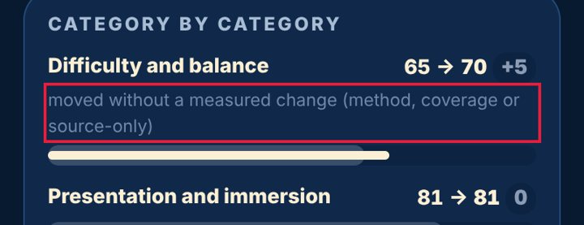
- `.cat:nth-child(3) > .note` on open-its-history @ iphone17: axe="Fix any of the following:\n  Element has insufficient color contrast of 3.99 (foreground color: #6f88a8, background color: #10294b, font size: 9.0pt (12px), font", nodes_on_screen=13 — 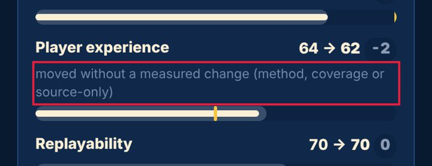
- `.cat:nth-child(5) > .note` on open-its-history @ iphone17: axe="Fix any of the following:\n  Element has insufficient color contrast of 3.99 (foreground color: #6f88a8, background color: #10294b, font size: 9.0pt (12px), font", nodes_on_screen=13
### Accessibility: Scrollable region must have keyboard access — major · Accessibility (axe-core)

axe-core rule scrollable-region-focusable (wcag2a, wcag211, wcag213): Scrollable region must have keyboard access.

**Fix:** See https://dequeuniversity.com/rules/axe/4.10/scrollable-region-focusable?application=axeAPI — Fix any of the following:   Element should have focusable content   Element should be focusable

Seen 12× — screens: demo-day-physics-puzzle-destruction-spor, fart-flight-arcade-78-medium-conf-genuin, open-its-history, rockslide-mountain-patrol-simulation-exp; viewports: iphone13, iphone17, narrow · priority 19.26 (fix now)

- `.scroll` on open-its-history @ iphone17: axe="Fix any of the following:\n  Element should have focusable content\n  Element should be focusable", nodes_on_screen=1 — 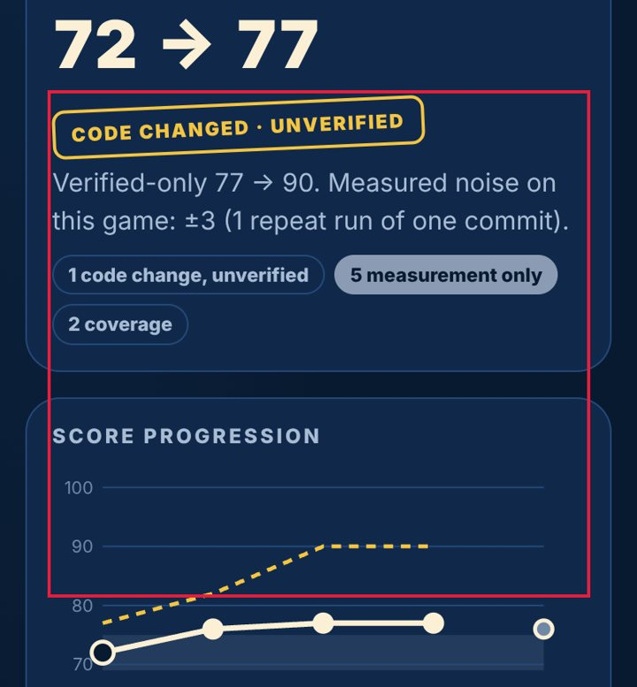
- `.scroll` on demo-day-physics-puzzle-destruction-spor @ iphone17: axe="Fix any of the following:\n  Element should have focusable content\n  Element should be focusable", nodes_on_screen=1 — 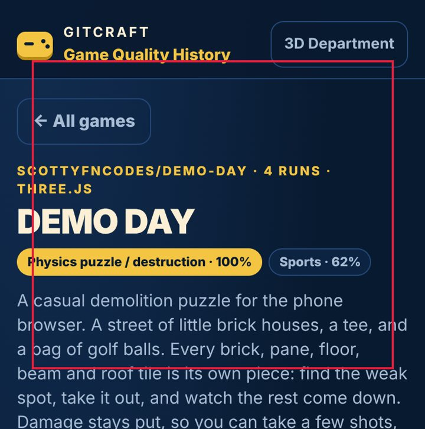
- `.scroll` on rockslide-mountain-patrol-simulation-exp @ iphone17: axe="Fix any of the following:\n  Element should have focusable content\n  Element should be focusable", nodes_on_screen=1
### No pressed (active) state — major · Measured (rendered DOM)

Pressing this control changes nothing visually until the action completes; on touch screens there is no hover, so this is the only immediate confirmation of a tap.

**Fix:** Add an :active style (darker tone, scale 0.97, or ripple) to every button and link variant.

Seen 10× — screens: demo-day-physics-puzzle-destruction-spor, fart-flight-arcade-78-medium-conf-genuin, home, open-its-history, rockslide-mountain-patrol-simulation-exp; viewports: desktop, iphone17 · priority 17.29 (fix now)

- `header.bar > a.mark` on home @ iphone17: style_changed_when_pressed=false — 
- `header.bar > nav > a` on home @ iphone17: style_changed_when_pressed=false — 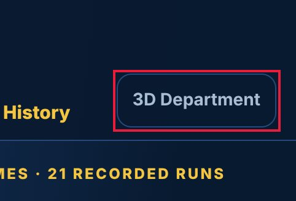
- `#app > section.next > a.go` on home @ iphone17: style_changed_when_pressed=false

## 6. Spacing and layout defects

### Text is too small to read comfortably — minor · Measured (rendered DOM)

11-px text is below the 12-px minimum for phones; secondary information (dates, tags, captions) becomes hard to read.

**Fix:** Use at least 12 px (13-14 px preferred) for secondary text and keep hierarchy with weight and colour rather than very small sizes.

Seen 25× — screens: demo-day-physics-puzzle-destruction-spor, fart-flight-arcade-78-medium-conf-genuin, home, open-its-history, rockslide-mountain-patrol-simulation-exp; viewports: iphone13, iphone17, landscape, narrow, tablet · priority 20.69 (fix now)

- `a.cart:nth-of-type(1) > div.meta:nth-of-type(3) > div:nth-of-type(1) > span` on home @ iphone17: font_size_px=11 — 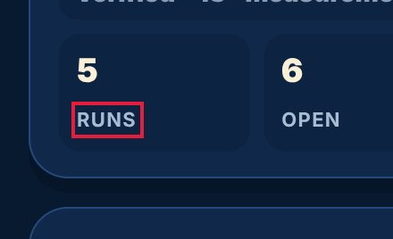
- `a.cart:nth-of-type(1) > div.meta:nth-of-type(3) > div:nth-of-type(2) > span` on home @ iphone17: font_size_px=11 — 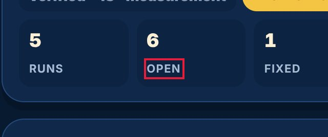
- `a.cart:nth-of-type(1) > div.meta:nth-of-type(3) > div:nth-of-type(3) > span` on home @ iphone17: font_size_px=11
### Uneven spacing between related elements — major · Measured (rendered DOM)

Items of the same kind in one list or stack are separated by different gaps, which reads as grouping that isn't there and makes the list look broken.

**Fix:** Give the container one gap (flex/grid `gap`, or one margin rule for all items) instead of per-item margins.

Seen 13× — screens: demo-day-physics-puzzle-destruction-spor, fart-flight-arcade-78-medium-conf-genuin, open-its-history, rockslide-mountain-patrol-simulation-exp; viewports: desktop, iphone13, iphone17, landscape, narrow, tablet · priority 20.21 (fix now)

- `#app` on demo-day-physics-puzzle-destruction-spor @ iphone17: gaps_px=[16, 16, 0, 0], spread_px=16 — 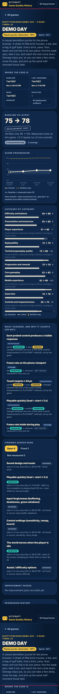
- `#app` on rockslide-mountain-patrol-simulation-exp @ iphone17: gaps_px=[17, 16, 0, 0], spread_px=17 — 
- `#app` on fart-flight-arcade-78-medium-conf-genuin @ iphone17: gaps_px=[16, 16, 0, 0], spread_px=16
### Lines of text are too long — minor · Measured (rendered DOM)

About 154 characters per line; beyond ~80 the eye loses its place.

**Fix:** Cap text columns at 60-75ch (max-width: 70ch).

Seen 11× — screens: demo-day-physics-puzzle-destruction-spor, fart-flight-arcade-78-medium-conf-genuin, home, open-its-history, rockslide-mountain-patrol-simulation-exp; viewports: desktop, landscape, tablet · priority 12.19 (fix now)

- `#flist > li:nth-of-type(4) > p` on open-its-history @ desktop: approx_chars_per_line=154 — 
- `#foot > p:nth-of-type(1)` on home @ tablet: approx_chars_per_line=126 — 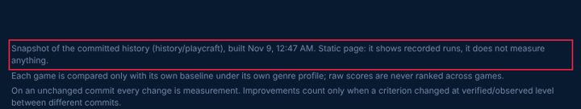
- `#foot > p:nth-of-type(3)` on home @ tablet: approx_chars_per_line=128
### Spacing does not follow a consistent scale — minor · Measured (rendered DOM)

Paddings, gaps and margins use many unrelated values, so the rhythm between elements looks accidental rather than designed.

**Fix:** Adopt a spacing scale (4/8-px steps: 4, 8, 12, 16, 24, 32) as tokens and replace one-off values with the nearest step.

Seen 9× — screens: fart-flight-arcade-78-medium-conf-genuin, home; viewports: desktop, iphone13, iphone17, landscape, narrow, tablet · priority 7.74 (next)

- `—` on home @ iphone17: on_scale_share=0.59, distinct_values=19, off_scale_values_px=[10, 6, 14, 18, 22, 34] — 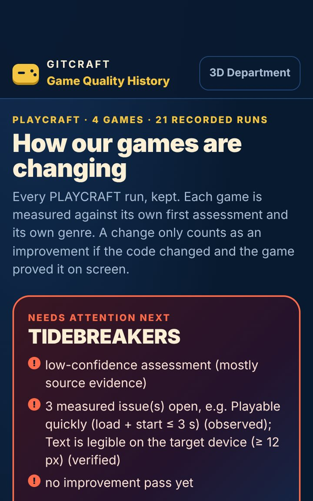
- `—` on home @ iphone13: on_scale_share=0.59, distinct_values=19, off_scale_values_px=[10, 6, 14, 18, 22, 34] — 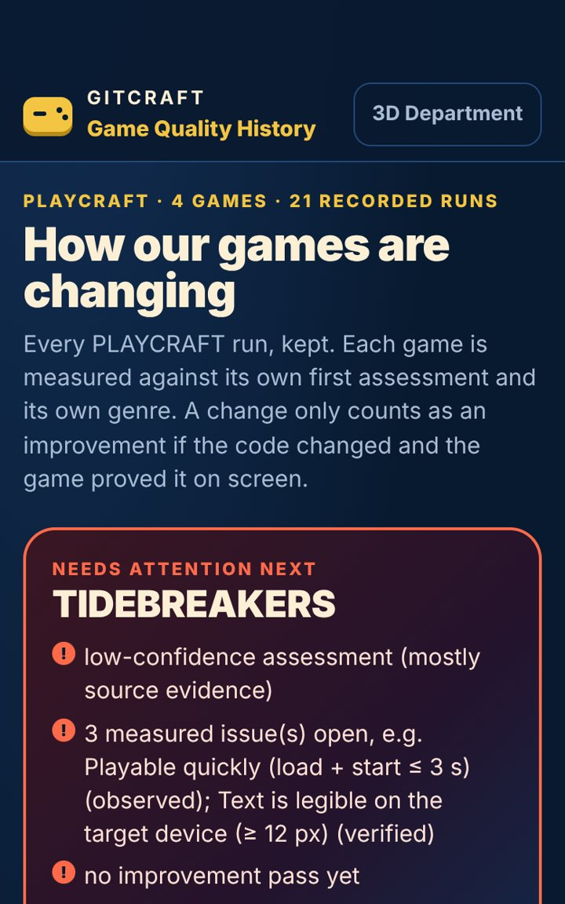
- `—` on home @ desktop: on_scale_share=0.58, distinct_values=18, off_scale_values_px=[10, 6, 14, 18, 22, 34, 30]
### Controls stretch across the desktop window — minor · Measured (rendered DOM)

A 1086-px-wide button on a 1440-px screen: the mobile full-width style was never adapted, so the control looks bloated and the eye travels far.

**Fix:** Cap form and button widths on desktop (max-width 480-560 px) or lay forms out in a constrained column.

Seen 1× — screens: home; viewports: desktop · priority 2.07 (polish)

- `#app > div.qa:nth-of-type(3) > details:nth-of-type(1) > summary` on home @ desktop: width_px=1086 — 
- `#app > div.qa:nth-of-type(3) > details:nth-of-type(2) > summary` on home @ desktop: width_px=1086 — 

## 7. Button and control defects

### Touch target is too small — major · Measured (rendered DOM)

202×41 px: under the 44×44 pt Apple HIG minimum (24 px is the WCAG 2.2 floor); thumbs miss and hit neighbours.

**Fix:** Enlarge the hit area to 44×44 (padding, min-height/min-width, or an ::after hit-area) while keeping the visible glyph size.

Seen 24× — screens: demo-day-physics-puzzle-destruction-spor, fart-flight-arcade-78-medium-conf-genuin, home, open-its-history, rockslide-mountain-patrol-simulation-exp; viewports: iphone13, iphone17, landscape, narrow, tablet · priority 30.16 (fix now)

- `header.bar > a.mark` on home @ iphone17: width_px=202, height_px=41, minimum_px=44 — 
- `#app > section.panel:nth-of-type(1) > p.mono > a` on open-its-history @ iphone17: width_px=231, height_px=14, minimum_px=44 — 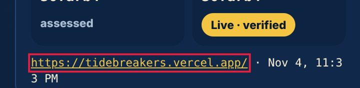
- `#app > section.panel:nth-of-type(4) > div.tabs2 > button.on:nth-of-type(1)` on open-its-history @ iphone17: width_px=86, height_px=40, minimum_px=44
### No pressed (active) state — major · Measured (rendered DOM)

Pressing this control changes nothing visually until the action completes; on touch screens there is no hover, so this is the only immediate confirmation of a tap.

**Fix:** Add an :active style (darker tone, scale 0.97, or ripple) to every button and link variant.

Seen 10× — screens: demo-day-physics-puzzle-destruction-spor, fart-flight-arcade-78-medium-conf-genuin, home, open-its-history, rockslide-mountain-patrol-simulation-exp; viewports: desktop, iphone17 · priority 17.29 (fix now)

- `header.bar > a.mark` on home @ iphone17: style_changed_when_pressed=false — 
- `header.bar > nav > a` on home @ iphone17: style_changed_when_pressed=false — 
- `#app > section.next > a.go` on home @ iphone17: style_changed_when_pressed=false
### No hover state — minor · Measured (rendered DOM)

The pointer over this control changes nothing (colour, shadow, underline), so it does not signal that it is clickable.

**Fix:** Add a hover style (tone shift, underline, elevation) for every interactive component variant.

Seen 5× — screens: demo-day-physics-puzzle-destruction-spor, fart-flight-arcade-78-medium-conf-genuin, home, open-its-history, rockslide-mountain-patrol-simulation-exp; viewports: desktop · priority 7.75 (next)

- `header.bar > a.mark` on home @ desktop: style_changed_on_hover=false — 
- `header.bar > nav > a` on home @ desktop: style_changed_on_hover=false — 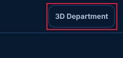
- `#app > section.next > a.go` on home @ desktop: style_changed_on_hover=false
### Click target is below 24 px — minor · Measured (rendered DOM)

231×14 px: under the WCAG 2.2 24×24 px minimum target size.

**Fix:** Enlarge the hit area to 44×44 (padding, min-height/min-width, or an ::after hit-area) while keeping the visible glyph size.

Seen 3× — screens: fart-flight-arcade-78-medium-conf-genuin, open-its-history, rockslide-mountain-patrol-simulation-exp; viewports: desktop · priority 5.69 (next)

- `#app > section.panel:nth-of-type(1) > p.mono > a` on open-its-history @ desktop: width_px=231, height_px=14, minimum_px=24 — 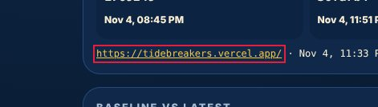
- `#app > section.panel:nth-of-type(1) > p.mono > a` on rockslide-mountain-patrol-simulation-exp @ desktop: width_px=246, height_px=14, minimum_px=24 — 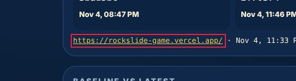
- `#app > section.panel:nth-of-type(1) > p.mono > a` on fart-flight-arcade-78-medium-conf-genuin @ desktop: width_px=318, height_px=14, minimum_px=24
### Two primary actions compete — minor · Measured (rendered DOM)

'TIDEBREAKERS Survival Exploration / adventure 77 LOW CONF. C' and 'DEMO DAY Physics puzzle / destruction Sports 78 LOW CONF. ME' are both strongly filled, similar in size and side by side, so neither reads as the main action.

**Fix:** Keep one filled primary button per group; make the other secondary (outline or tonal).

Seen 2× — screens: home; viewports: desktop, tablet · priority 4.27 (polish)

- `#app > div.carts:nth-of-type(2) > a.cart:nth-of-type(1)` on home @ desktop: fill_a=[16, 41, 75, 1], fill_b=[16, 41, 75, 1], other="DEMO DAY Physics puzzle / destruction Sports 78 LOW CONF. ME" — 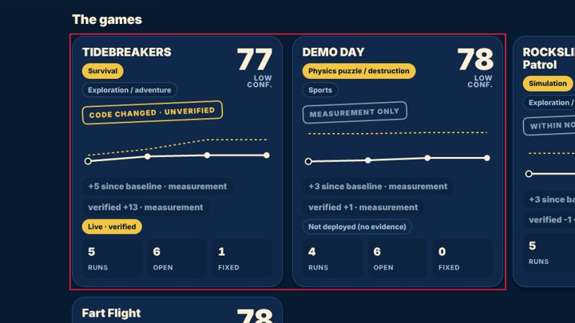
- `#app > div.carts:nth-of-type(2) > a.cart:nth-of-type(1)` on home @ desktop: fill_a=[16, 41, 75, 1], fill_b=[16, 41, 75, 1], other="ROCKSLIDE: Mountain Patrol Simulation Exploration / adventur" — 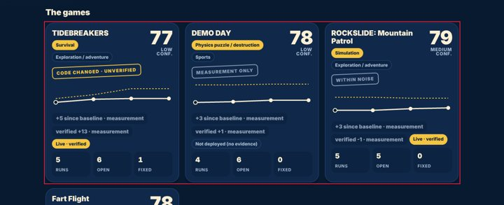
- `#app > div.carts:nth-of-type(2) > a.cart:nth-of-type(1)` on home @ tablet: fill_a=[16, 41, 75, 1], fill_b=[16, 41, 75, 1], other="DEMO DAY Physics puzzle / destruction Sports 78 LOW CONF. ME"

## 8. Mobile-specific findings

### Touch target is too small — major · Measured (rendered DOM)

202×41 px: under the 44×44 pt Apple HIG minimum (24 px is the WCAG 2.2 floor); thumbs miss and hit neighbours.

**Fix:** Enlarge the hit area to 44×44 (padding, min-height/min-width, or an ::after hit-area) while keeping the visible glyph size.

Seen 24× — screens: demo-day-physics-puzzle-destruction-spor, fart-flight-arcade-78-medium-conf-genuin, home, open-its-history, rockslide-mountain-patrol-simulation-exp; viewports: iphone13, iphone17, landscape, narrow, tablet · priority 30.16 (fix now)

- `header.bar > a.mark` on home @ iphone17: width_px=202, height_px=41, minimum_px=44 — 
- `#app > section.panel:nth-of-type(1) > p.mono > a` on open-its-history @ iphone17: width_px=231, height_px=14, minimum_px=44 — 
- `#app > section.panel:nth-of-type(4) > div.tabs2 > button.on:nth-of-type(1)` on open-its-history @ iphone17: width_px=86, height_px=40, minimum_px=44
### Text is too small to read comfortably — minor · Measured (rendered DOM)

11-px text is below the 12-px minimum for phones; secondary information (dates, tags, captions) becomes hard to read.

**Fix:** Use at least 12 px (13-14 px preferred) for secondary text and keep hierarchy with weight and colour rather than very small sizes.

Seen 25× — screens: demo-day-physics-puzzle-destruction-spor, fart-flight-arcade-78-medium-conf-genuin, home, open-its-history, rockslide-mountain-patrol-simulation-exp; viewports: iphone13, iphone17, landscape, narrow, tablet · priority 20.69 (fix now)

- `a.cart:nth-of-type(1) > div.meta:nth-of-type(3) > div:nth-of-type(1) > span` on home @ iphone17: font_size_px=11 — 
- `a.cart:nth-of-type(1) > div.meta:nth-of-type(3) > div:nth-of-type(2) > span` on home @ iphone17: font_size_px=11 — 
- `a.cart:nth-of-type(1) > div.meta:nth-of-type(3) > div:nth-of-type(3) > span` on home @ iphone17: font_size_px=11
### Controls are too close together — minor · Measured (rendered DOM)

'Open 6' and 'Fixed 5' are 6 px apart and at least one is under 44 px: an easy mis-tap.

**Fix:** Keep at least 8 px between targets (more next to destructive actions), or merge rarely used actions into one overflow menu.

Seen 24× — screens: demo-day-physics-puzzle-destruction-spor, fart-flight-arcade-78-medium-conf-genuin, open-its-history, rockslide-mountain-patrol-simulation-exp; viewports: desktop, iphone13, iphone17, landscape, narrow, tablet · priority 20.11 (fix now)

- `#app > section.panel:nth-of-type(4) > div.tabs2 > button.on:nth-of-type(1)` on open-its-history @ iphone17: gap_px=6, neighbour="#app > section.panel:nth-of-type(4) > div.tabs2 > button:nth-of-type(2)" — 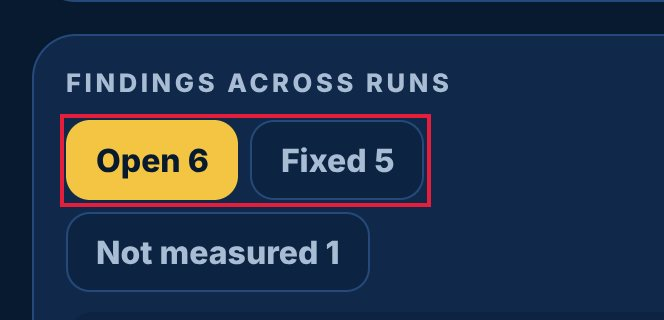
- `#app > section.panel:nth-of-type(4) > div.tabs2 > button.on:nth-of-type(1)` on open-its-history @ iphone17: gap_px=6, neighbour="#app > section.panel:nth-of-type(4) > div.tabs2 > button:nth-of-type(3)" — 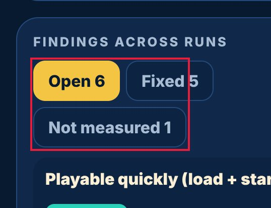
- `#app > section.panel:nth-of-type(4) > div.tabs2 > button:nth-of-type(2)` on open-its-history @ iphone17: gap_px=6, neighbour="#app > section.panel:nth-of-type(4) > div.tabs2 > button:nth-of-type(3)"

## 9. Screenshot gallery

Browser emulation (Playwright + Chromium); safe-area insets emulated through CDP. No physical-device evidence.

- home @ iphone17: 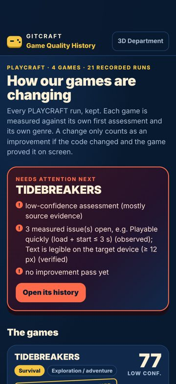
- open-its-history @ iphone17: 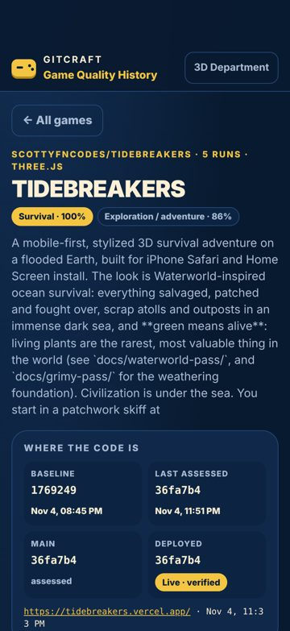
- demo-day-physics-puzzle-destruction-spor @ iphone17: 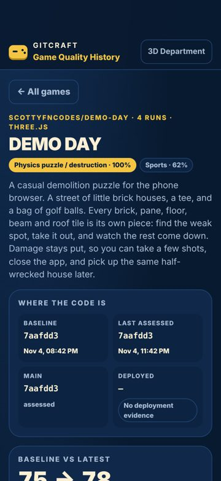
- rockslide-mountain-patrol-simulation-exp @ iphone17: 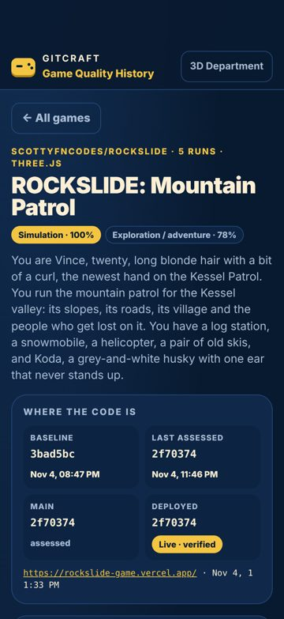
- fart-flight-arcade-78-medium-conf-genuin @ iphone17: 
- home @ iphone13: 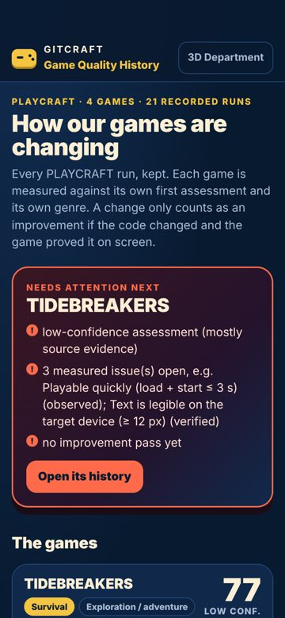
- open-its-history @ iphone13: 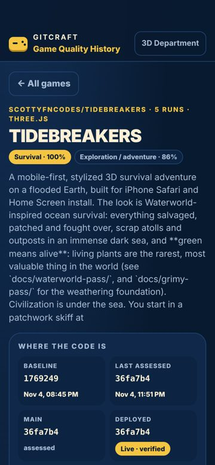
- demo-day-physics-puzzle-destruction-spor @ iphone13: 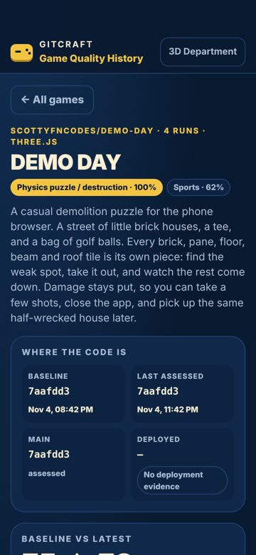
- rockslide-mountain-patrol-simulation-exp @ iphone13: 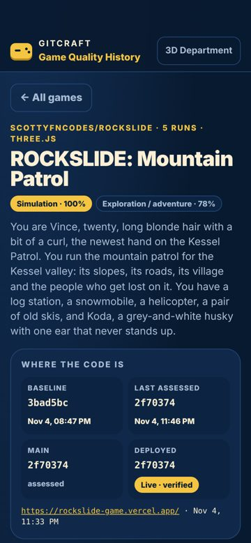
- fart-flight-arcade-78-medium-conf-genuin @ iphone13: 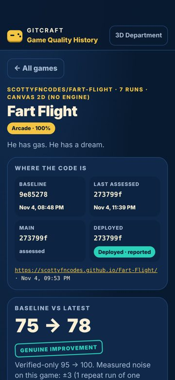
- home @ desktop: 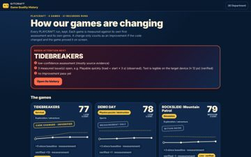
- open-its-history @ desktop: 
- demo-day-physics-puzzle-destruction-spor @ desktop: 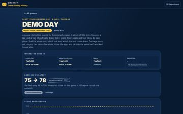
- rockslide-mountain-patrol-simulation-exp @ desktop: 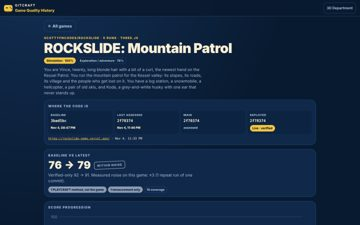
- fart-flight-arcade-78-medium-conf-genuin @ desktop: 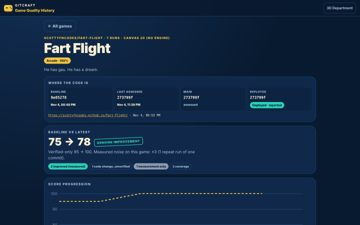
- home @ narrow: 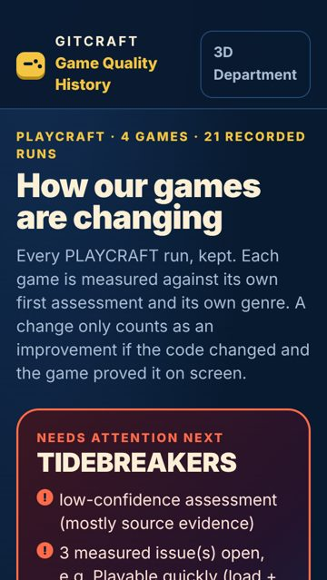
- open-its-history @ narrow: 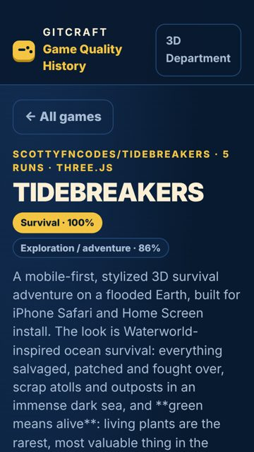
- demo-day-physics-puzzle-destruction-spor @ narrow: 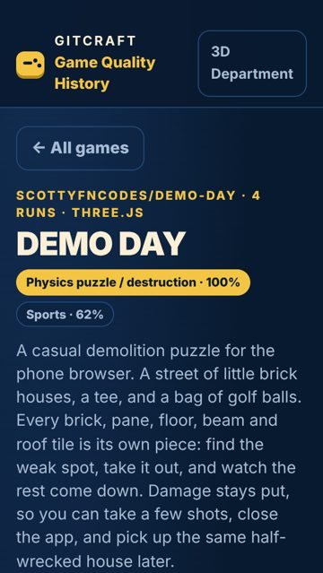
- rockslide-mountain-patrol-simulation-exp @ narrow: 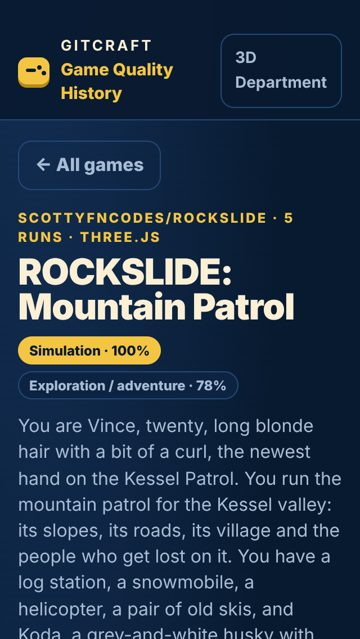
- fart-flight-arcade-78-medium-conf-genuin @ narrow: 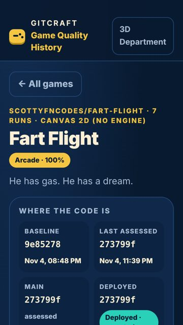
- home @ tablet: 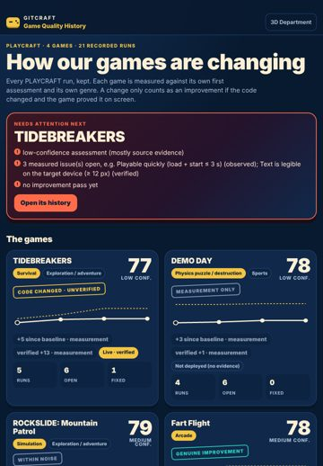
- open-its-history @ tablet: 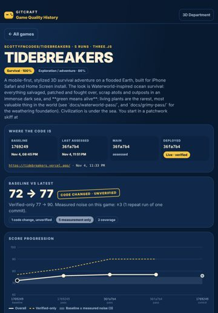
- demo-day-physics-puzzle-destruction-spor @ tablet: 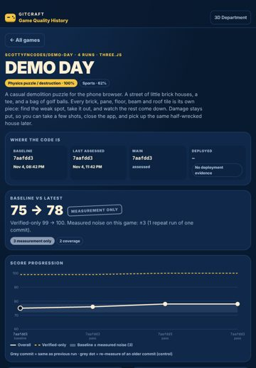
- rockslide-mountain-patrol-simulation-exp @ tablet: 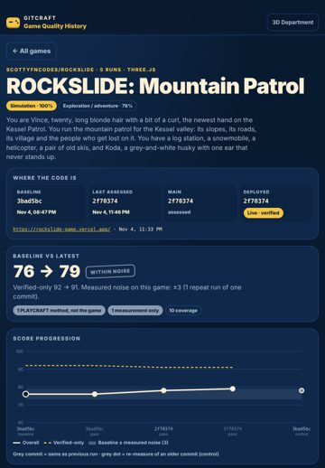
- fart-flight-arcade-78-medium-conf-genuin @ tablet: 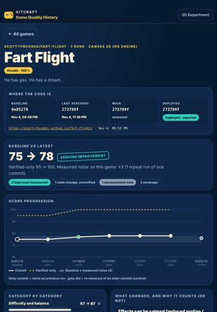
- home @ landscape: 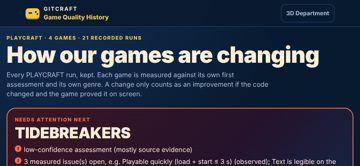
- open-its-history @ landscape: 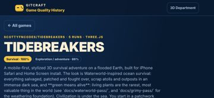
- demo-day-physics-puzzle-destruction-spor @ landscape: 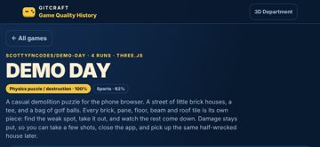
- rockslide-mountain-patrol-simulation-exp @ landscape: 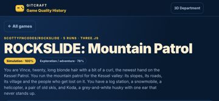
- fart-flight-arcade-78-medium-conf-genuin @ landscape: 

## 10. Prioritised improvement plan

| # | Tier | Fix | Severity | Seen | Cost | Area |
|---|---|---|---|---|---|---|
| 1 | fix now | **Accessibility: Elements must meet minimum color contrast ratio thresholds** — See https://dequeuniversity.com/rules/axe/4.10/color-contrast?application=axeAPI — Fix any of the following:   Element has insufficient color contrast of 3.99 (foreground color: #6f88a8, background color: #10294b, font size: 9.0pt (12px), font weight: normal). Expected contrast rati | major | 24× | low | accessibility |
| 2 | fix now | **Touch target is too small** — Enlarge the hit area to 44×44 (padding, min-height/min-width, or an ::after hit-area) while keeping the visible glyph size. | major | 24× | low | controls |
| 3 | fix now | **Text is too small to read comfortably** — Use at least 12 px (13-14 px preferred) for secondary text and keep hierarchy with weight and colour rather than very small sizes. | minor | 25× | low | typography |
| 4 | fix now | **Uneven spacing between related elements** — Give the container one gap (flex/grid `gap`, or one margin rule for all items) instead of per-item margins. | major | 13× | low | spacing |
| 5 | fix now | **Accessibility: Heading levels should only increase by one** — See https://dequeuniversity.com/rules/axe/4.10/heading-order?application=axeAPI — Fix any of the following:   Heading order invalid | minor | 24× | low | accessibility |
| 6 | fix now | **Controls are too close together** — Keep at least 8 px between targets (more next to destructive actions), or merge rarely used actions into one overflow menu. | minor | 24× | low | mobile |
| 7 | fix now | **Accessibility: Scrollable region must have keyboard access** — See https://dequeuniversity.com/rules/axe/4.10/scrollable-region-focusable?application=axeAPI — Fix any of the following:   Element should have focusable content   Element should be focusable | major | 12× | low | accessibility |
| 8 | fix now | **No pressed (active) state** — Add an :active style (darker tone, scale 0.97, or ripple) to every button and link variant. | major | 10× | low | feedback |
| 9 | fix now | **Lines of text are too long** — Cap text columns at 60-75ch (max-width: 70ch). | minor | 11× | low | typography |
| 10 | next | **The same heading level has different sizes on different screens** — Style headings once, globally, from the type scale. | minor | 6× | low | cross_screen |
| 11 | next | **Navigation does not show where you are** — Mark the current item with aria-current="page" and a visible active style. | minor | 6× | low | navigation |
| 12 | next | **No hover state** — Add a hover style (tone shift, underline, elevation) for every interactive component variant. | minor | 5× | low | feedback |
| 13 | next | **Spacing does not follow a consistent scale** — Adopt a spacing scale (4/8-px steps: 4, 8, 12, 16, 24, 32) as tokens and replace one-off values with the nearest step. | minor | 9× | medium | spacing |
| 14 | next | **Click target is below 24 px** — Enlarge the hit area to 44×44 (padding, min-height/min-width, or an ::after hit-area) while keeping the visible glyph size. | minor | 3× | low | controls |
| 15 | polish | **Two primary actions compete** — Keep one filled primary button per group; make the other secondary (outline or tonal). | minor | 2× | low | controls |

Lower-priority items not listed: 1 (in audit.json).

## Journeys

| Journey | Viewport | Result | Taps | Expected | Confirmations | Feedback (ms) |
|---|---|---|---|---|---|---|
| reach open-its-history (auto) | iphone17 | ok | 1 | — | 0 | 135 |
| reach demo-day-physics-puzzle-destruction-spor (auto) | iphone17 | ok | 1 | — | 0 | 137 |
| reach rockslide-mountain-patrol-simulation-exp (auto) | iphone17 | ok | 1 | — | 0 | 133 |
| reach fart-flight-arcade-78-medium-conf-genuin (auto) | iphone17 | ok | 1 | — | 0 | 130 |
| reach open-its-history (auto) | desktop | ok | 1 | — | 0 | 123 |
| reach demo-day-physics-puzzle-destruction-spor (auto) | desktop | ok | 1 | — | 0 | 110 |
| reach rockslide-mountain-patrol-simulation-exp (auto) | desktop | ok | 1 | — | 0 | 121 |
| reach fart-flight-arcade-78-medium-conf-genuin (auto) | desktop | ok | 1 | — | 0 | 121 |

## Evidence and limits

- Every viewport is browser emulation (Playwright + Chromium 153.0.8010.12); iPhone sizes are CSS pixels and safe-area insets are emulated through CDP (Emulation.setSafeAreaInsetsOverride). Safari-specific rendering (WebKit), the real on-screen keyboard and physical reach are not reproduced.
- Browser chrome: the first screen is re-measured with the viewport shortened by 120 px (Safari's toolbars); dynamic toolbar collapse is not reproduced.
- Keyboard interference: fields that would zoom on focus (font-size < 16 px) are measured; whether the on-screen keyboard covers a field is not testable in emulation.
- Hover/pressed/focus states are sampled once per visual variant of control; focus visibility comes from real Tab presses (desktop).
- Canvas-drawn interfaces (games): the DOM does not describe what is drawn, so DOM-geometry metrics cover only the HTML overlay (HUD, menus); use judgements for the canvas.
- No physical-device evidence: findings are emulation results, not device results.

## Before / after

Comparable: **yes** (same method, same screens, viewports and journeys; deltas use only metrics measured in both runs)

| | Before | After | Δ (same metrics) |
|---|---|---|---|
| Visual Quality | 84.2 | 84.2 | 0 |
| Usability | 86.7 | 90.7 | +4 |
| Consistency | 83.6 | 83.6 | 0 |
| Overall | 84.8 | 86.2 | +1.4 |

Resolved: 1 · persisting: 16 · new: 0 · regressions: 0 · coverage lost: none

- ✅ resolved: Accessibility: Certain ARIA roles must contain particular children (24× before)

| Screen @ viewport | Pixels changed | Diff |
|---|---|---|
