# PIXELCRAFT audit: GITCRAFT Game Quality History (/games/)

Target: `/home/user/GITCRAFT/forgecraft/ui/dist/games` · method pixelcraft-1.0 · 2026-11-10T06:28:11+00:00

## 1. Overall PIXELCRAFT score: **95.7** / 100 (excellent)

Evidence coverage 100% · confidence **high** — only automatic journeys (no task-specific journeys with expected taps); browser emulation only (no physical-device evidence)

Coverage and confidence are reported separately from quality: an area with no evidence is *not tested*, never zero and never capped.

## 2. Category scores

| Category | Score | Coverage | Not tested |
|---|---|---|---|
| Visual Quality | **95.8** | 100% | — |
| Usability | **100** | 100% | — |
| Consistency | **91.4** | 100% | — |

### Visual Quality

| Area | Points | Awarded | Evidence | Weakest metric |
|---|---|---|---|---|
| Spacing and rhythm | 25 | 24.3 | measured ×120 | spacing values on a 4-px scale (88%) |
| Layout and composition | 25 | 25 | measured ×200 | no horizontal overflow (100%) |
| Typography and hierarchy | 20 | 17.7 | measured ×120 | a small set of font sizes (49%) |
| Buttons and controls | 20 | 18.7 | measured ×106 | one clear primary action per group (58%) |
| Visual consistency | 10 | 10 | measured ×54 | few font families (100%) |

### Usability

| Area | Points | Awarded | Evidence | Weakest metric |
|---|---|---|---|---|
| Interaction efficiency | 25 | 25 | measured ×16 | journeys complete (100%) |
| Navigation and discoverability | 20 | 20 | measured ×19 | every screen within 2 taps (100%) |
| Mobile ergonomics | 25 | 25 | measured ×80 | responsive viewport meta (100%) |
| Feedback and interaction states | 15 | 15 | measured ×31 | controls show a pressed state (100%) |
| Accessibility | 15 | 15 | accessibility ×30, measured ×10 | axe-core WCAG 2.2 AA checks (100%) |

### Consistency

| Area | Points | Awarded | Evidence | Weakest metric |
|---|---|---|---|---|
| Cross-screen consistency | 25 | 25 | measured ×12 | headers, heading sizes and fonts match across screens (100%) |
| Component consistency | 25 | 25 | measured ×6 | few button variants (100%) |
| Responsive consistency | 20 | 20 | measured ×10 | the same content at every size (100%) |
| Design system adherence | 20 | 11.4 | measured ×24 | a small set of corner radii (0%) |
| State consistency | 10 | 10 | measured ×4 | pressed treatment applied consistently (100%) |

## 3. Strongest screens

- **open-its-history** — 98.2
- **demo-day-physics-puzzle-destruction-spor** — 98.2

## 4. Weakest screens

- **home** — 96.0
- **fart-flight-arcade-78-medium-conf-genuin** — 98.1
- **rockslide-mountain-patrol-simulation-exp** — 98.2

## 5. Critical usability defects

None found.

## 6. Spacing and layout defects

None found.

## 7. Button and control defects

### Two primary actions compete — minor · Measured (rendered DOM)

'TIDEBREAKERS Survival Exploration / adventure 77 LOW CONF. C' and 'DEMO DAY Physics puzzle / destruction Sports 78 LOW CONF. ME' are both strongly filled, similar in size and side by side, so neither reads as the main action.

**Fix:** Keep one filled primary button per group; make the other secondary (outline or tonal).

Seen 2× — screens: home; viewports: desktop, tablet · priority 4.27 (polish)

- `#app > div.carts:nth-of-type(2) > a.cart:nth-of-type(1)` on home @ desktop: fill_a=[16, 41, 75, 1], fill_b=[16, 41, 75, 1], other="DEMO DAY Physics puzzle / destruction Sports 78 LOW CONF. ME" — 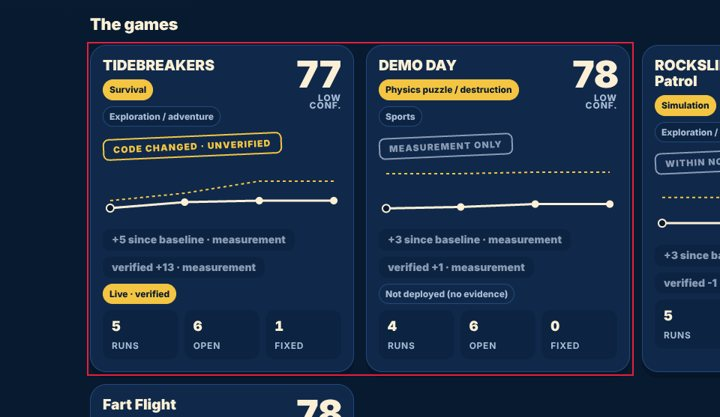
- `#app > div.carts:nth-of-type(2) > a.cart:nth-of-type(1)` on home @ desktop: fill_a=[16, 41, 75, 1], fill_b=[16, 41, 75, 1], other="ROCKSLIDE: Mountain Patrol Simulation Exploration / adventur" — 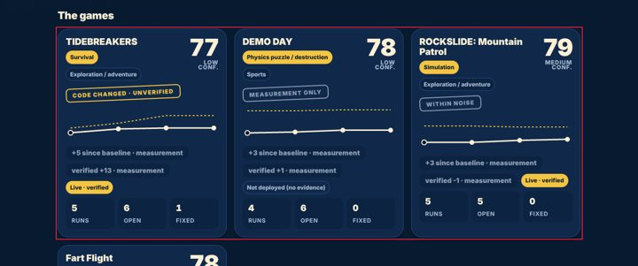
- `#app > div.carts:nth-of-type(2) > a.cart:nth-of-type(1)` on home @ tablet: fill_a=[16, 41, 75, 1], fill_b=[16, 41, 75, 1], other="DEMO DAY Physics puzzle / destruction Sports 78 LOW CONF. ME"

## 8. Mobile-specific findings

None found.

## 9. Screenshot gallery

Browser emulation (Playwright + Chromium); safe-area insets emulated through CDP. No physical-device evidence.

- home @ iphone17: 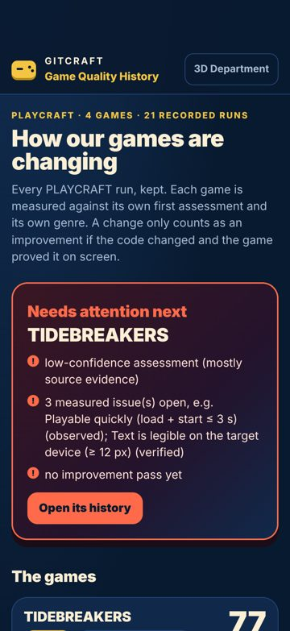
- open-its-history @ iphone17: 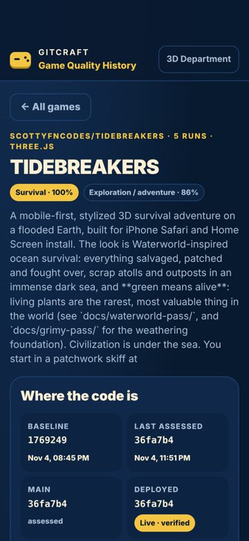
- demo-day-physics-puzzle-destruction-spor @ iphone17: 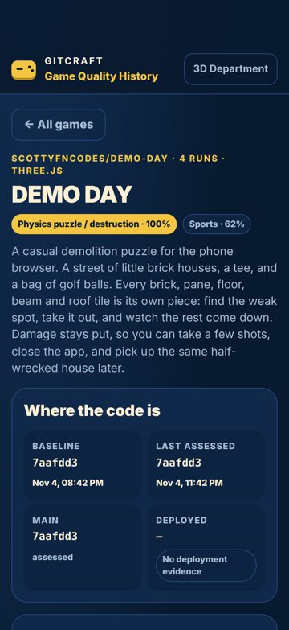
- rockslide-mountain-patrol-simulation-exp @ iphone17: 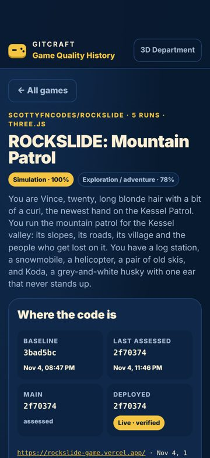
- fart-flight-arcade-78-medium-conf-genuin @ iphone17: 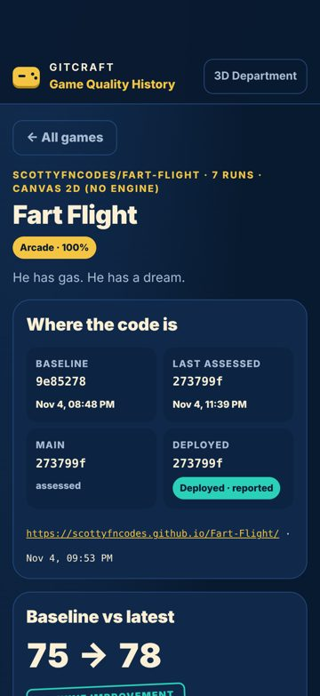
- home @ iphone13: 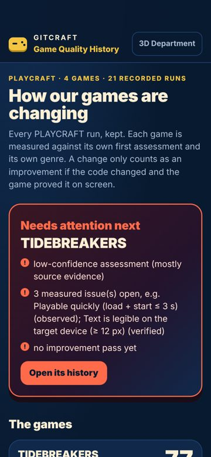
- open-its-history @ iphone13: 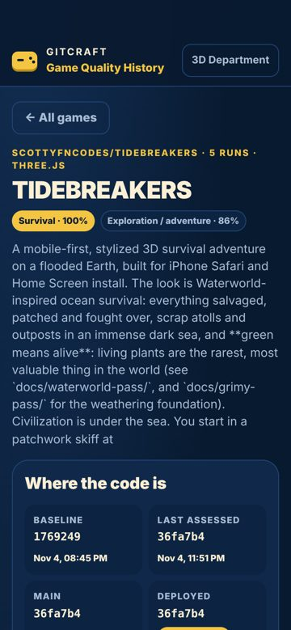
- demo-day-physics-puzzle-destruction-spor @ iphone13: 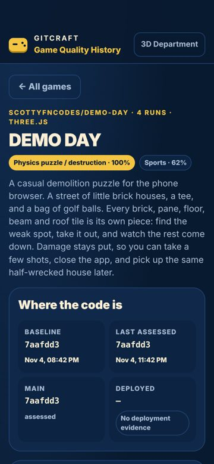
- rockslide-mountain-patrol-simulation-exp @ iphone13: 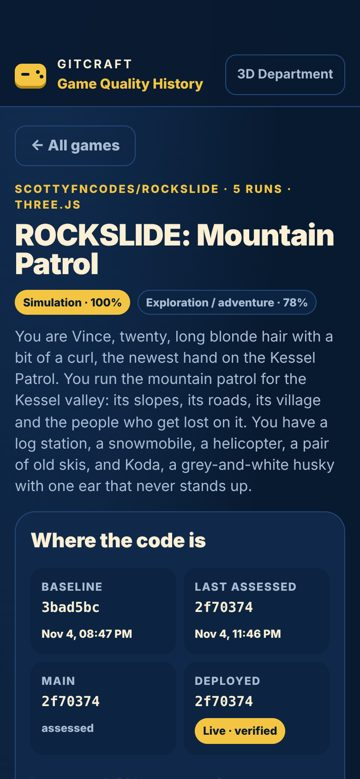
- fart-flight-arcade-78-medium-conf-genuin @ iphone13: 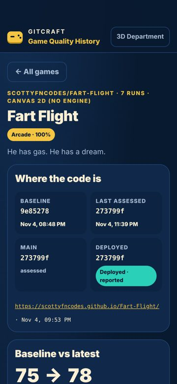
- home @ desktop: 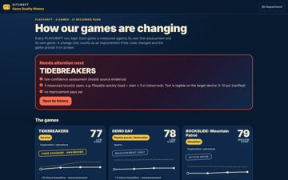
- open-its-history @ desktop: 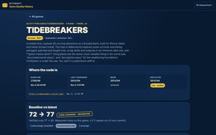
- demo-day-physics-puzzle-destruction-spor @ desktop: 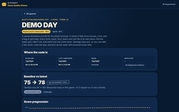
- rockslide-mountain-patrol-simulation-exp @ desktop: 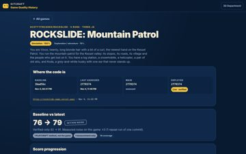
- fart-flight-arcade-78-medium-conf-genuin @ desktop: 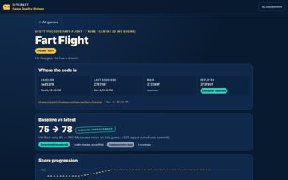
- home @ narrow: 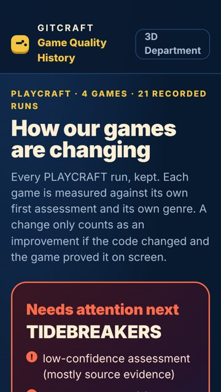
- open-its-history @ narrow: 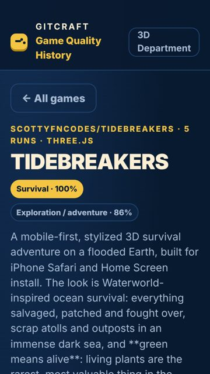
- demo-day-physics-puzzle-destruction-spor @ narrow: 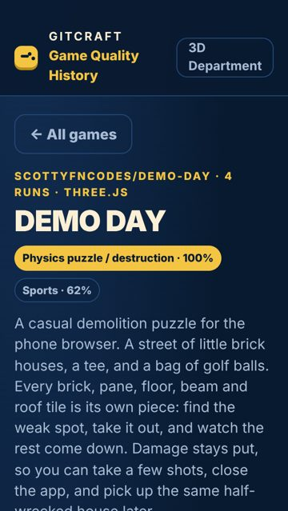
- rockslide-mountain-patrol-simulation-exp @ narrow: 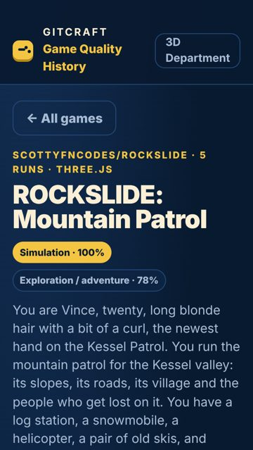
- fart-flight-arcade-78-medium-conf-genuin @ narrow: 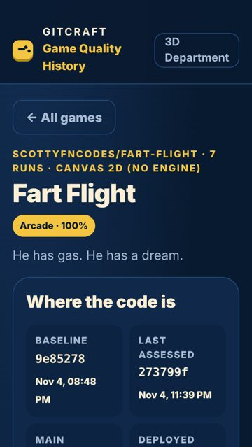
- home @ tablet: 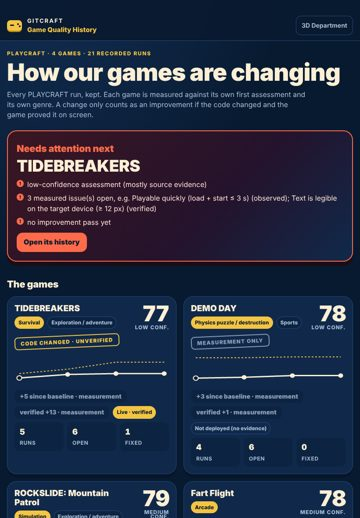
- open-its-history @ tablet: 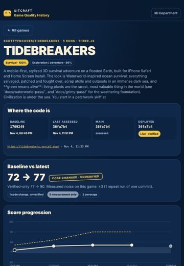
- demo-day-physics-puzzle-destruction-spor @ tablet: 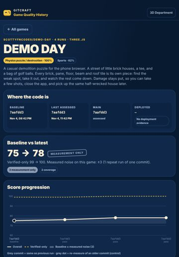
- rockslide-mountain-patrol-simulation-exp @ tablet: 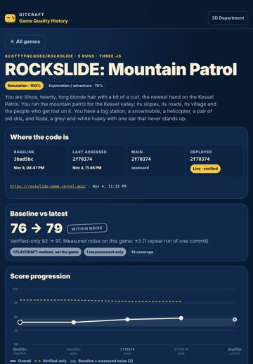
- fart-flight-arcade-78-medium-conf-genuin @ tablet: 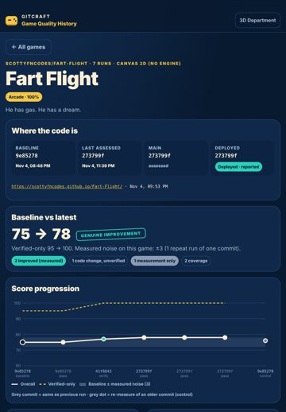
- home @ landscape: 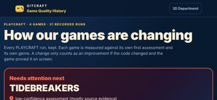
- open-its-history @ landscape: 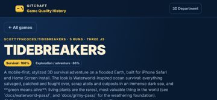
- demo-day-physics-puzzle-destruction-spor @ landscape: 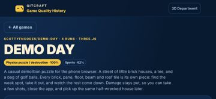
- rockslide-mountain-patrol-simulation-exp @ landscape: 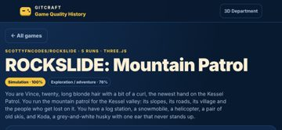
- fart-flight-arcade-78-medium-conf-genuin @ landscape: 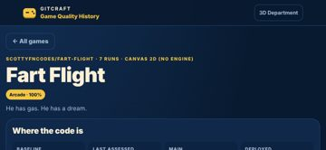

## 10. Prioritised improvement plan

| # | Tier | Fix | Severity | Seen | Cost | Area |
|---|---|---|---|---|---|---|
| 1 | polish | **Two primary actions compete** — Keep one filled primary button per group; make the other secondary (outline or tonal). | minor | 2× | low | controls |

## Journeys

| Journey | Viewport | Result | Taps | Expected | Confirmations | Feedback (ms) |
|---|---|---|---|---|---|---|
| reach open-its-history (auto) | iphone17 | ok | 1 | — | 0 | 153 |
| reach demo-day-physics-puzzle-destruction-spor (auto) | iphone17 | ok | 1 | — | 0 | 146 |
| reach rockslide-mountain-patrol-simulation-exp (auto) | iphone17 | ok | 1 | — | 0 | 174 |
| reach fart-flight-arcade-78-medium-conf-genuin (auto) | iphone17 | ok | 1 | — | 0 | 146 |
| reach open-its-history (auto) | desktop | ok | 1 | — | 0 | 124 |
| reach demo-day-physics-puzzle-destruction-spor (auto) | desktop | ok | 1 | — | 0 | 124 |
| reach rockslide-mountain-patrol-simulation-exp (auto) | desktop | ok | 1 | — | 0 | 176 |
| reach fart-flight-arcade-78-medium-conf-genuin (auto) | desktop | ok | 1 | — | 0 | 179 |

## Generic design tells (advisory, not scored)

Defaults that unguided builds reach for, read from the rendered page. Each is a question, not a defect: the project's own art direction wins. Accept a deliberate one with `accept_tells: [{id, reason}]`.

- **Eyebrow label above a heading** — 6× across 6 captures (home). A small tracked-out uppercase kicker over every heading is a template rhythm, and the heading usually says it already. *Ask:* Delete the label and let the heading carry the section; keep a label only when it carries information the heading does not. Examples: `div.eyebrow` "PLAYCRAFT · 4 GAMES · 21 RECORDED RUNS" (home @ iphone17).

Tells since the baseline (informational): resolved none · persisting none · new eyebrow.

## Evidence and limits

- Every viewport is browser emulation (Playwright + Chromium 153.0.8010.12); iPhone sizes are CSS pixels and safe-area insets are emulated through CDP (Emulation.setSafeAreaInsetsOverride). Safari-specific rendering (WebKit), the real on-screen keyboard and physical reach are not reproduced.
- Browser chrome: the first screen is re-measured with the viewport shortened by 120 px (Safari's toolbars); dynamic toolbar collapse is not reproduced.
- Keyboard interference: fields that would zoom on focus (font-size < 16 px) are measured; whether the on-screen keyboard covers a field is not testable in emulation.
- Hover/pressed/focus states are sampled once per visual variant of control; focus visibility comes from real Tab presses (desktop).
- Canvas-drawn interfaces (games): the DOM does not describe what is drawn, so DOM-geometry metrics cover only the HTML overlay (HUD, menus); use judgements for the canvas.
- No physical-device evidence: findings are emulation results, not device results.

## Before / after

Comparable: **yes** (same method, same screens, viewports and journeys; deltas use only metrics measured in both runs)

| | Before | After | Δ (same metrics) |
|---|---|---|---|
| Visual Quality | 84.2 | 95.8 | +11.6 |
| Usability | 90.7 | 100 | +9.3 |
| Consistency | 83.6 | 91.4 | +7.8 |
| Overall | 86.2 | 95.7 | +9.5 |

Resolved: 15 · persisting: 1 · new: 0 · regressions: 0 · coverage lost: none

- ✅ resolved: Accessibility: Elements must meet minimum color contrast ratio thresholds (24× before)
- ✅ resolved: Touch target is too small (24× before)
- ✅ resolved: Text is too small to read comfortably (25× before)
- ✅ resolved: Uneven spacing between related elements (13× before)
- ✅ resolved: Accessibility: Heading levels should only increase by one (24× before)
- ✅ resolved: Controls are too close together (24× before)
- ✅ resolved: Accessibility: Scrollable region must have keyboard access (12× before)
- ✅ resolved: No pressed (active) state (10× before)
- ✅ resolved: Lines of text are too long (11× before)
- ✅ resolved: The same heading level has different sizes on different screens (6× before)
- ✅ resolved: Navigation does not show where you are (6× before)
- ✅ resolved: No hover state (5× before)
- ✅ resolved: Spacing does not follow a consistent scale (9× before)
- ✅ resolved: Click target is below 24 px (3× before)
- ✅ resolved: Controls stretch across the desktop window (1× before)

| Screen @ viewport | Pixels changed | Diff |
|---|---|---|
