# PIXELCRAFT audit: Taskboard (PIXELCRAFT sample app)

Target: `GITCRAFT/tests/fixtures/pixelcraft/taskboard` · method pixelcraft-1.0 · 2026-11-05T13:38:30+00:00 · commit `1530d7e950`

## 1. Overall PIXELCRAFT score: **69.9** / 100 (fair)

Evidence coverage 100% · confidence **high** — browser emulation only (no physical-device evidence)

Coverage and confidence are reported separately from quality: an area with no evidence is *not tested*, never zero and never capped.

## 2. Category scores

| Category | Score | Coverage | Not tested |
|---|---|---|---|
| Visual Quality | **71.2** | 100% | — |
| Usability | **73.7** | 100% | — |
| Consistency | **64.7** | 100% | — |

### Visual Quality

| Area | Points | Awarded | Evidence | Weakest metric |
|---|---|---|---|---|
| Spacing and rhythm | 25 | 15.1 | measured ×81 | related elements evenly spaced (20%) |
| Layout and composition | 25 | 20.9 | measured ×148 | no horizontal overflow (52%) |
| Typography and hierarchy | 20 | 14.2 | measured ×72 | text large enough to read (40%) |
| Buttons and controls | 20 | 11 | measured ×120 | neighbouring targets not crowded (17%) |
| Visual consistency | 10 | 10 | measured ×48 | controls share radii and a small palette (100%) |

### Usability

| Area | Points | Awarded | Evidence | Weakest metric |
|---|---|---|---|---|
| Interaction efficiency | 25 | 22.9 | measured ×18 | no unnecessary confirmation steps (58%) |
| Navigation and discoverability | 20 | 20 | measured ×19 | every screen within 2 taps (100%) |
| Mobile ergonomics | 25 | 17.6 | measured ×89 | fixed controls clear the notch and home indicator (15%) |
| Feedback and interaction states | 15 | 5.6 | measured ×26 | disabled controls look disabled (0%) |
| Accessibility | 15 | 7.6 | accessibility ×24, measured ×8 | keyboard focus is visible (2%) |

### Consistency

| Area | Points | Awarded | Evidence | Weakest metric |
|---|---|---|---|---|
| Cross-screen consistency | 25 | 13.7 | measured ×12 | primary buttons look the same on every screen (25%) |
| Component consistency | 25 | 13.6 | measured ×12 | inputs share one height (40%) |
| Responsive consistency | 20 | 16.3 | measured ×8 | fits every viewport (72%) |
| Design system adherence | 20 | 13 | measured ×24 | spacing tokens (4-px grid) (43%) |
| State consistency | 10 | 8 | measured ×4 | hover treatment applied consistently (50%) |

## 3. Strongest screens

- **settings** — 83.0
- **task-item** — 82.9

## 4. Weakest screens

- **home** — 76.2
- **projects** — 81.8

## 5. Critical usability defects

### Accessibility: Elements must meet minimum color contrast ratio thresholds — major · Accessibility (axe-core)

axe-core rule color-contrast (wcag2aa, wcag143): Elements must meet minimum color contrast ratio thresholds.

**Fix:** See https://dequeuniversity.com/rules/axe/4.10/color-contrast?application=axeAPI — Fix any of the following:   Element has insufficient color contrast of 1.98 (foreground color: #b4b8c4, background color: #ffffff, font size: 8.3pt (11px), font weight: normal). Expected contrast rati

Seen 24× — screens: home, projects, settings, task-item; viewports: desktop, iphone13, iphone17, landscape, narrow, tablet · priority 33.51 (fix now)

- `.kicker` on home @ iphone17: axe="Fix any of the following:\n  Element has insufficient color contrast of 1.98 (foreground color: #b4b8c4, background color: #ffffff, font size: 8.3pt (11px), font", nodes_on_screen=9 — 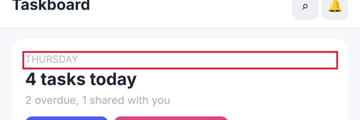
- `.muted` on home @ iphone17: axe="Fix any of the following:\n  Element has insufficient color contrast of 2.24 (foreground color: #a9adb9, background color: #ffffff, font size: 9.0pt (12px), font", nodes_on_screen=9 — 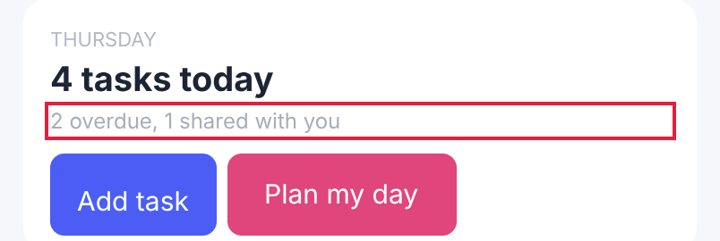
- `#plan` on home @ iphone17: axe="Fix any of the following:\n  Element has insufficient color contrast of 3.95 (foreground color: #ffffff, background color: #e0457b, font size: 11.3pt (15px), fon", nodes_on_screen=9
### Controls are too close together — major · Measured (rendered DOM)

'Search' and 'Notifications' are 3 px apart and at least one is under 44 px: an easy mis-tap.

**Fix:** Keep at least 8 px between targets (more next to destructive actions), or merge rarely used actions into one overflow menu.

Seen 24× — screens: home, projects, settings, task-item; viewports: desktop, iphone13, iphone17, landscape, narrow, tablet · priority 33.51 (fix now)

- `header.top > button.icon-btn:nth-of-type(1)` on home @ iphone17: gap_px=3, neighbour="header.top > button.icon-btn:nth-of-type(2)" — 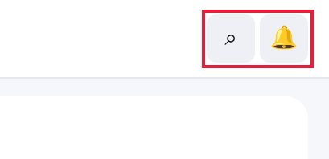
- `#q` on home @ iphone17: gap_px=5, neighbour="#view > form.quick > button.btn.small" — 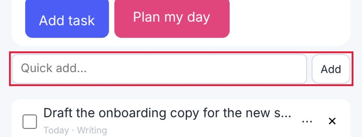
- `#view > ul.list > li.task:nth-of-type(1) > input.check` on home @ iphone17: gap_px=7, neighbour="ul.list > li.task:nth-of-type(1) > div.body > a.title"
### Bottom controls sit under the home indicator — major · Measured (rendered DOM)

With the iPhone's 34-px bottom safe area emulated, this fixed control extends 34 px into the home-indicator zone, where swipes go to the system instead of the app.

**Fix:** Pad fixed bottom bars with env(safe-area-inset-bottom): padding-bottom: calc(8px + env(safe-area-inset-bottom)).

Seen 16× — screens: home, projects, settings, task-item; viewports: iphone13, iphone17, landscape, tablet · priority 25.0 (fix now)

- `nav.tabbar > a.tab.active:nth-of-type(1)` on home @ iphone17: safe_area_bottom_px=34, overlap_px=34 — 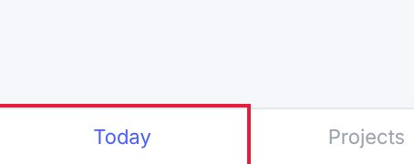
- `nav.tabbar > a.tab:nth-of-type(2)` on home @ iphone17: safe_area_bottom_px=34, overlap_px=34 — 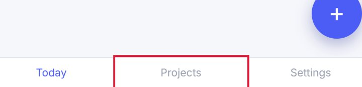
- `nav.tabbar > a.tab:nth-of-type(3)` on home @ iphone17: safe_area_bottom_px=34, overlap_px=34
### Focusing a field zooms the page on iPhone — major · Measured (rendered DOM)

The field's font-size is 13 px; iOS Safari zooms in on any input under 16 px and leaves the page zoomed after typing.

**Fix:** Use font-size: 16px (1rem) for inputs, selects and textareas on mobile.

Seen 15× — screens: home, settings, task-item; viewports: iphone13, iphone17, landscape, narrow, tablet · priority 23.92 (fix now)

- `#q` on home @ iphone17: font_size_px=13 — 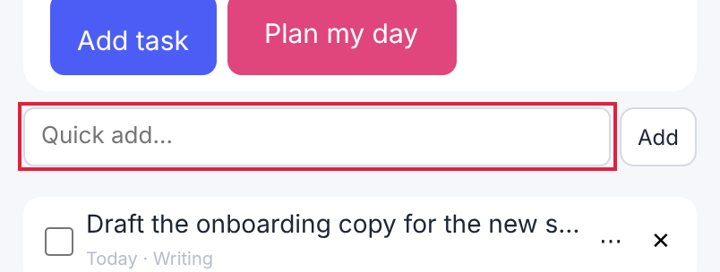
- `#view > article.detail > label.field > textarea` on task-item @ iphone17: font_size_px=13 — 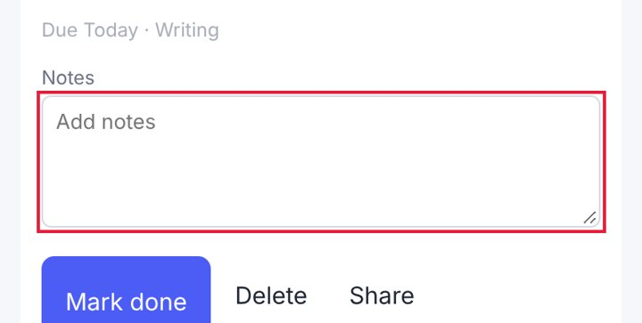
- `#view > section.settings > label.field:nth-of-type(1) > input` on settings @ iphone17: font_size_px=13
### No pressed (active) state — major · Measured (rendered DOM)

Pressing this control changes nothing visually until the action completes; on touch screens there is no hover, so this is the only immediate confirmation of a tap.

**Fix:** Add an :active style (darker tone, scale 0.97, or ripple) to every button and link variant.

Seen 8× — screens: home, projects, settings, task-item; viewports: desktop, iphone17 · priority 16.0 (fix now)

- `header.top > button.icon-btn:nth-of-type(1)` on home @ iphone17: style_changed_when_pressed=false — 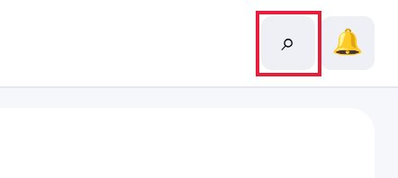
- `#add` on home @ iphone17: style_changed_when_pressed=false — 
- `#plan` on home @ iphone17: style_changed_when_pressed=false
### Keyboard focus is invisible — major · Measured (rendered DOM)

Tabbing to this control changes nothing on screen (outline removed, no replacement), so keyboard users cannot see where they are (WCAG 2.4.7).

**Fix:** Never remove outlines without a replacement: use :focus-visible { outline: 2px solid <brand>; outline-offset: 2px }.

Seen 4× — screens: home, projects, settings, task-item; viewports: desktop · priority 10.5 (fix now)

- `header.top > button.icon-btn:nth-of-type(1)` on home @ desktop: focus_style_change=false — 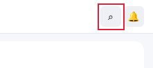
- `header.top > button.icon-btn:nth-of-type(2)` on home @ desktop: focus_style_change=false — 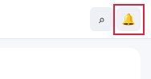
- `#add` on home @ desktop: focus_style_change=false
### Disabled control looks enabled — major · Measured (rendered DOM)

This disabled control has exactly the same colours and opacity as enabled controls of its kind; users tap it and nothing happens.

**Fix:** Give disabled controls a distinct style (reduced contrast/opacity, no shadow) and cursor: not-allowed.

Seen 2× — screens: settings; viewports: desktop, iphone17 · priority 6.5 (next)

- `#view > section.settings > div.row > button.btn:nth-of-type(2)` on settings @ iphone17: opacity=1 — 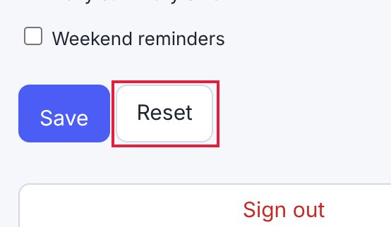
- `#view > section.settings > div.row > button.btn:nth-of-type(2)` on settings @ desktop: opacity=1 — 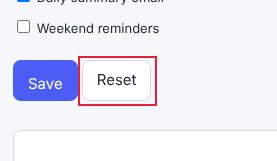
### Unnecessary confirmation steps — major · Measured (rendered DOM)

'complete a task' asked for confirmation 2 time(s) for one action: friction that trains users to click through.

**Fix:** Confirm once at most — better, act immediately and offer Undo (a snackbar for 5-8 s).

Seen 2× — screens: complete a task; viewports: desktop, iphone17 · priority 4.64 (next)

- `—` on complete a task @ iphone17: confirmations=2
- `—` on complete a task @ desktop: confirmations=2
### A tap produces no visible response — major · Measured (rendered DOM)

In 'rename myself', tapping {'click': 'Save'} changed nothing on the page within 700 ms.

**Fix:** Acknowledge every tap immediately (pressed state, spinner, toast) even when the result takes time.

Seen 2× — screens: rename myself; viewports: desktop, iphone17 · priority 4.64 (next)

- `{'click': 'Save'}` on rename myself @ iphone17: mutations=0, url_changed=false
- `{'click': 'Save'}` on rename myself @ desktop: mutations=0, url_changed=false

## 6. Spacing and layout defects

### Text is too small to read comfortably — major · Measured (rendered DOM)

10-px text is below the 12-px minimum for phones; secondary information (dates, tags, captions) becomes hard to read.

**Fix:** Use at least 12 px (13-14 px preferred) for secondary text and keep hierarchy with weight and colour rather than very small sizes.

Seen 21× — screens: home, projects, settings, task-item; viewports: desktop, iphone13, iphone17, landscape, narrow, tablet · priority 30.33 (fix now)

- `ul.list > li.task:nth-of-type(1) > div.body > span.meta` on home @ iphone17: font_size_px=10 — 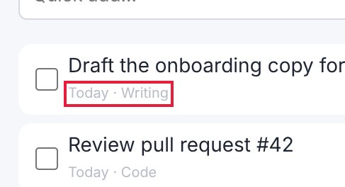
- `ul.list > li.task:nth-of-type(2) > div.body > span.meta` on home @ iphone17: font_size_px=10 — 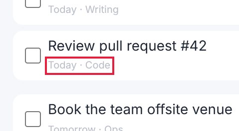
- `ul.list > li.task:nth-of-type(3) > div.body > span.meta` on home @ iphone17: font_size_px=10
### Heading levels are visually inverted — minor · Measured (rendered DOM)

An h1 (17 px) is smaller than an h2 (19 px) on the same screen, so the visual hierarchy contradicts the document structure.

**Fix:** Make heading sizes follow their level, or change the element level to match its visual role.

Seen 24× — screens: home, projects, settings, task-item; viewports: desktop, iphone13, iphone17, landscape, narrow, tablet · priority 22.34 (fix now)

- `header.top > h1.brand` on home @ iphone17: heading_px=17, lower_heading_px=19 — 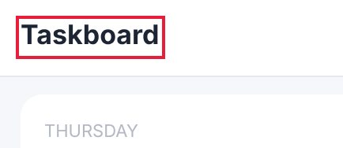
- `header.top > h1.brand` on task-item @ iphone17: heading_px=17, lower_heading_px=22.5 — 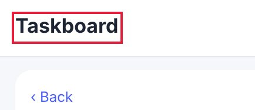
- `header.top > h1.brand` on projects @ iphone17: heading_px=17, lower_heading_px=22.5
### Page scrolls sideways (horizontal overflow) — critical · Measured (rendered DOM)

The page is 573 px wide in a 402 px viewport: content is cut off and the whole page wobbles sideways when scrolled with a thumb.

**Fix:** Let the offending element shrink (max-width: 100%, min-width: 0 on flex children) or scroll it inside its own container (overflow-x: auto).

Seen 3× — screens: projects; viewports: iphone13, iphone17, narrow · priority 14.54 (fix now)

- `#view > section.projects > table.wide` on projects @ iphone17: page_width_px=573, viewport_px=402, overflow_px=171 — 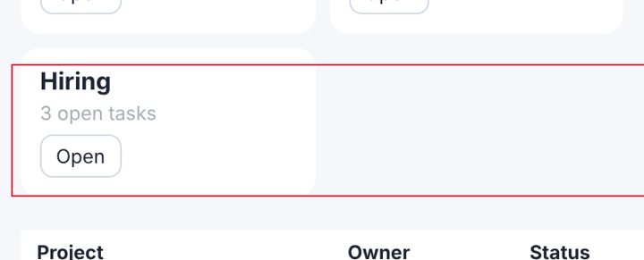
- `#view > section.projects > table.wide` on projects @ iphone13: page_width_px=573, viewport_px=390, overflow_px=183 — 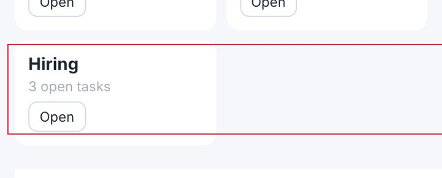
- `#view > section.projects > table.wide` on projects @ narrow: page_width_px=573, viewport_px=320, overflow_px=253
### Uneven spacing between related elements — major · Measured (rendered DOM)

Items of the same kind in one list or stack are separated by different gaps, which reads as grouping that isn't there and makes the list look broken.

**Fix:** Give the container one gap (flex/grid `gap`, or one margin rule for all items) instead of per-item margins.

Seen 6× — screens: home; viewports: desktop, iphone13, iphone17, landscape, narrow, tablet · priority 13.44 (fix now)

- `#view > ul.list` on home @ iphone17: gaps_px=[6, 14, 3], spread_px=11 — 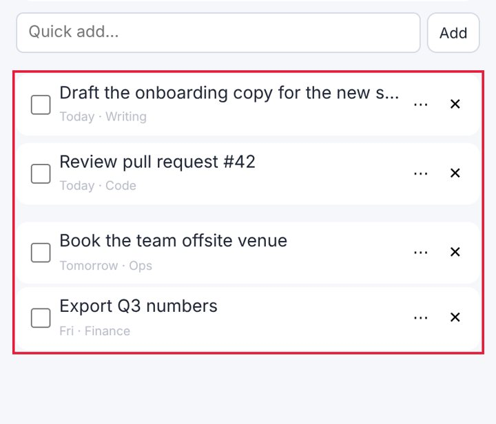
- `#view > ul.list` on home @ iphone13: gaps_px=[6, 14, 3], spread_px=11 — 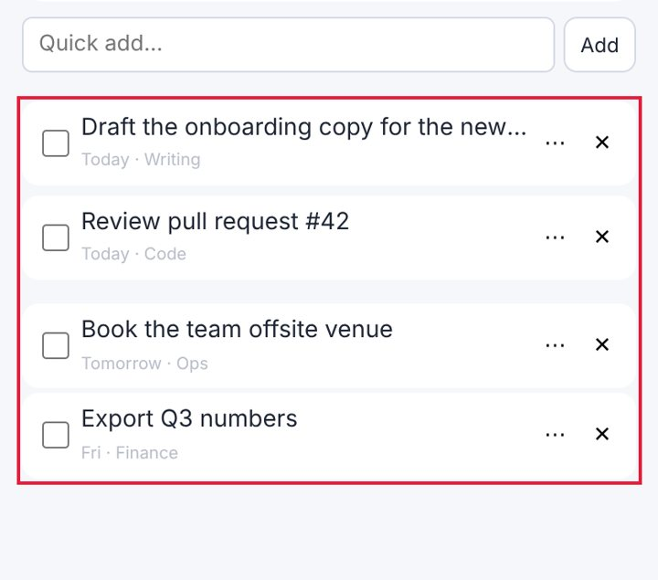
- `#view > ul.list` on home @ desktop: gaps_px=[6, 14, 3], spread_px=11
### Spacing does not follow a consistent scale — minor · Measured (rendered DOM)

Paddings, gaps and margins use many unrelated values, so the rhythm between elements looks accidental rather than designed.

**Fix:** Adopt a spacing scale (4/8-px steps: 4, 8, 12, 16, 24, 32) as tokens and replace one-off values with the nearest step.

Seen 12× — screens: projects, settings; viewports: desktop, iphone13, iphone17, landscape, narrow, tablet · priority 9.82 (fix now)

- `—` on projects @ iphone17: on_scale_share=0.39, distinct_values=14, off_scale_values_px=[6, 10, 70, 18] — 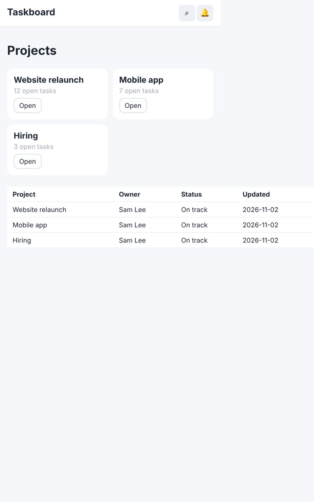
- `—` on settings @ iphone17: on_scale_share=0.6, distinct_values=13, off_scale_values_px=[6, 14, 18, 70] — 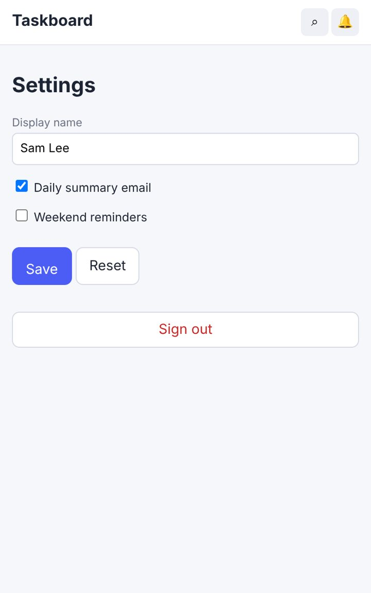
- `—` on projects @ iphone13: on_scale_share=0.39, distinct_values=14, off_scale_values_px=[6, 10, 70, 18]
### Controls stretch across the desktop window — minor · Measured (rendered DOM)

A 1366-px-wide input on a 1440-px screen: the mobile full-width style was never adapted, so the control looks bloated and the eye travels far.

**Fix:** Cap form and button widths on desktop (max-width 480-560 px) or lay forms out in a constrained column.

Seen 3× — screens: home, settings, task-item; viewports: desktop · priority 5.82 (next)

- `#q` on home @ desktop: width_px=1366 — 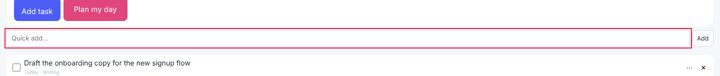
- `#view > article.detail > label.field > textarea` on task-item @ desktop: width_px=1388 — 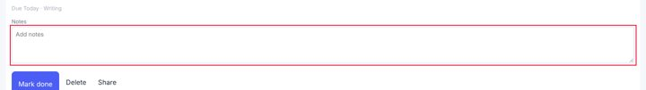
- `#view > section.settings > label.field:nth-of-type(1) > input` on settings @ desktop: width_px=1414
### Text is truncated — minor · Measured (rendered DOM)

Content is cut off with an ellipsis or clipped; on phones important words (task names, prices) disappear.

**Fix:** Allow two lines (line-clamp: 2) for primary labels, or give the label the space the trailing controls take.

Seen 3× — screens: home; viewports: iphone13, iphone17, narrow · priority 5.82 (next)

- `ul.list > li.task:nth-of-type(1) > div.body > a.title` on home @ iphone17: content_width_px=333, visible_width_px=277 — 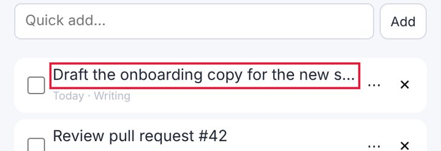
- `ul.list > li.task:nth-of-type(1) > div.body > a.title` on home @ iphone13: content_width_px=333, visible_width_px=265 — 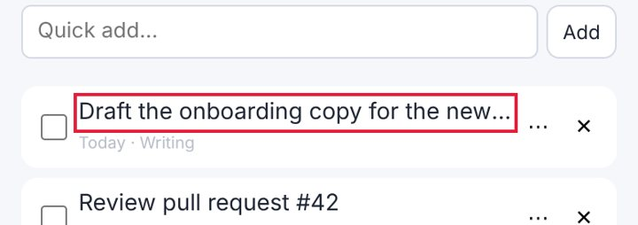
- `ul.list > li.task:nth-of-type(1) > div.body > a.title` on home @ narrow: content_width_px=333, visible_width_px=195

## 7. Button and control defects

### Touch target is too small — major · Measured (rendered DOM)

16×16 px: under the 44×44 pt Apple HIG minimum (24 px is the WCAG 2.2 floor); thumbs miss and hit neighbours.

**Fix:** Enlarge the hit area to 44×44 (padding, min-height/min-width, or an ::after hit-area) while keeping the visible glyph size.

Seen 20× — screens: home, projects, settings, task-item; viewports: iphone13, iphone17, landscape, narrow, tablet · priority 29.27 (fix now)

- `#view > ul.list > li.task:nth-of-type(1) > input.check` on home @ iphone17: width_px=16, height_px=16, minimum_px=44 — 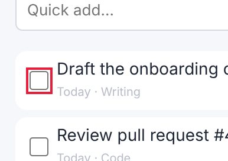
- `#view > ul.list > li.task:nth-of-type(2) > input.check` on home @ iphone17: width_px=16, height_px=16, minimum_px=44 — 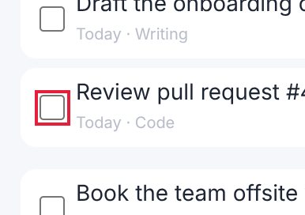
- `#view > ul.list > li.task:nth-of-type(3) > input.check` on home @ iphone17: width_px=16, height_px=16, minimum_px=44
### No pressed (active) state — major · Measured (rendered DOM)

Pressing this control changes nothing visually until the action completes; on touch screens there is no hover, so this is the only immediate confirmation of a tap.

**Fix:** Add an :active style (darker tone, scale 0.97, or ripple) to every button and link variant.

Seen 8× — screens: home, projects, settings, task-item; viewports: desktop, iphone17 · priority 16.0 (fix now)

- `header.top > button.icon-btn:nth-of-type(1)` on home @ iphone17: style_changed_when_pressed=false — 
- `#add` on home @ iphone17: style_changed_when_pressed=false — 
- `#plan` on home @ iphone17: style_changed_when_pressed=false
### Two primary actions compete — minor · Measured (rendered DOM)

'Plan my day' and 'Add task' are both strongly filled, similar in size and side by side, so neither reads as the main action.

**Fix:** Keep one filled primary button per group; make the other secondary (outline or tonal).

Seen 6× — screens: home; viewports: desktop, iphone13, iphone17, landscape, narrow, tablet · priority 8.96 (next)

- `#plan` on home @ iphone17: fill_a=[224, 69, 123, 1], fill_b=[76, 93, 245, 1], other="Add task" — 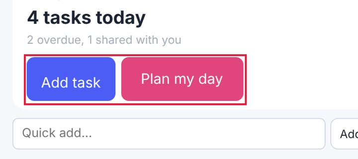
- `#plan` on home @ iphone13: fill_a=[224, 69, 123, 1], fill_b=[76, 93, 245, 1], other="Add task" — 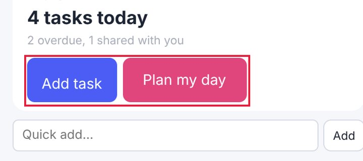
- `#plan` on home @ desktop: fill_a=[224, 69, 123, 1], fill_b=[76, 93, 245, 1], other="Add task"
### No hover state — minor · Measured (rendered DOM)

The pointer over this control changes nothing (colour, shadow, underline), so it does not signal that it is clickable.

**Fix:** Add a hover style (tone shift, underline, elevation) for every interactive component variant.

Seen 4× — screens: home, projects, settings, task-item; viewports: desktop · priority 7.0 (next)

- `header.top > button.icon-btn:nth-of-type(1)` on home @ desktop: style_changed_on_hover=false — 
- `#add` on home @ desktop: style_changed_on_hover=false — 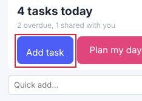
- `#plan` on home @ desktop: style_changed_on_hover=false
### Disabled control looks enabled — major · Measured (rendered DOM)

This disabled control has exactly the same colours and opacity as enabled controls of its kind; users tap it and nothing happens.

**Fix:** Give disabled controls a distinct style (reduced contrast/opacity, no shadow) and cursor: not-allowed.

Seen 2× — screens: settings; viewports: desktop, iphone17 · priority 6.5 (next)

- `#view > section.settings > div.row > button.btn:nth-of-type(2)` on settings @ iphone17: opacity=1 — 
- `#view > section.settings > div.row > button.btn:nth-of-type(2)` on settings @ desktop: opacity=1 — 
### Click target is below 24 px — minor · Measured (rendered DOM)

16×16 px: under the WCAG 2.2 24×24 px minimum target size.

**Fix:** Enlarge the hit area to 44×44 (padding, min-height/min-width, or an ::after hit-area) while keeping the visible glyph size.

Seen 2× — screens: home, task-item; viewports: desktop · priority 4.33 (polish)

- `#view > ul.list > li.task:nth-of-type(1) > input.check` on home @ desktop: width_px=16, height_px=16, minimum_px=24 — 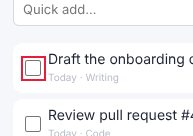
- `#view > ul.list > li.task:nth-of-type(2) > input.check` on home @ desktop: width_px=16, height_px=16, minimum_px=24 — 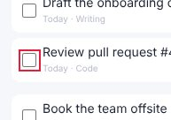
- `#view > ul.list > li.task:nth-of-type(3) > input.check` on home @ desktop: width_px=16, height_px=16, minimum_px=24
### A control is covered by another element — major · Measured (rendered DOM)

Tapping the centre of this control hits a different element (often a fixed bar or floating button), so the control is hard or impossible to use.

**Fix:** Reserve space for fixed/floating elements (padding-bottom on the scroll area equal to their height) or move the floating element.

Seen 1× — screens: home; viewports: landscape · priority 2.23 (polish)

- `#view > ul.list > li.task:nth-of-type(4) > button.del:nth-of-type(2)` on home @ landscape: covered_by="#view > button.fab" — 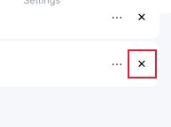

## 8. Mobile-specific findings

### Controls are too close together — major · Measured (rendered DOM)

'Search' and 'Notifications' are 3 px apart and at least one is under 44 px: an easy mis-tap.

**Fix:** Keep at least 8 px between targets (more next to destructive actions), or merge rarely used actions into one overflow menu.

Seen 24× — screens: home, projects, settings, task-item; viewports: desktop, iphone13, iphone17, landscape, narrow, tablet · priority 33.51 (fix now)

- `header.top > button.icon-btn:nth-of-type(1)` on home @ iphone17: gap_px=3, neighbour="header.top > button.icon-btn:nth-of-type(2)" — 
- `#q` on home @ iphone17: gap_px=5, neighbour="#view > form.quick > button.btn.small" — 
- `#view > ul.list > li.task:nth-of-type(1) > input.check` on home @ iphone17: gap_px=7, neighbour="ul.list > li.task:nth-of-type(1) > div.body > a.title"
### Touch target is too small — major · Measured (rendered DOM)

16×16 px: under the 44×44 pt Apple HIG minimum (24 px is the WCAG 2.2 floor); thumbs miss and hit neighbours.

**Fix:** Enlarge the hit area to 44×44 (padding, min-height/min-width, or an ::after hit-area) while keeping the visible glyph size.

Seen 20× — screens: home, projects, settings, task-item; viewports: iphone13, iphone17, landscape, narrow, tablet · priority 29.27 (fix now)

- `#view > ul.list > li.task:nth-of-type(1) > input.check` on home @ iphone17: width_px=16, height_px=16, minimum_px=44 — 
- `#view > ul.list > li.task:nth-of-type(2) > input.check` on home @ iphone17: width_px=16, height_px=16, minimum_px=44 — 
- `#view > ul.list > li.task:nth-of-type(3) > input.check` on home @ iphone17: width_px=16, height_px=16, minimum_px=44
### Bottom controls sit under the home indicator — major · Measured (rendered DOM)

With the iPhone's 34-px bottom safe area emulated, this fixed control extends 34 px into the home-indicator zone, where swipes go to the system instead of the app.

**Fix:** Pad fixed bottom bars with env(safe-area-inset-bottom): padding-bottom: calc(8px + env(safe-area-inset-bottom)).

Seen 16× — screens: home, projects, settings, task-item; viewports: iphone13, iphone17, landscape, tablet · priority 25.0 (fix now)

- `nav.tabbar > a.tab.active:nth-of-type(1)` on home @ iphone17: safe_area_bottom_px=34, overlap_px=34 — 
- `nav.tabbar > a.tab:nth-of-type(2)` on home @ iphone17: safe_area_bottom_px=34, overlap_px=34 — 
- `nav.tabbar > a.tab:nth-of-type(3)` on home @ iphone17: safe_area_bottom_px=34, overlap_px=34
### Focusing a field zooms the page on iPhone — major · Measured (rendered DOM)

The field's font-size is 13 px; iOS Safari zooms in on any input under 16 px and leaves the page zoomed after typing.

**Fix:** Use font-size: 16px (1rem) for inputs, selects and textareas on mobile.

Seen 15× — screens: home, settings, task-item; viewports: iphone13, iphone17, landscape, narrow, tablet · priority 23.92 (fix now)

- `#q` on home @ iphone17: font_size_px=13 — 
- `#view > article.detail > label.field > textarea` on task-item @ iphone17: font_size_px=13 — 
- `#view > section.settings > label.field:nth-of-type(1) > input` on settings @ iphone17: font_size_px=13
### Page scrolls sideways (horizontal overflow) — critical · Measured (rendered DOM)

The page is 573 px wide in a 402 px viewport: content is cut off and the whole page wobbles sideways when scrolled with a thumb.

**Fix:** Let the offending element shrink (max-width: 100%, min-width: 0 on flex children) or scroll it inside its own container (overflow-x: auto).

Seen 3× — screens: projects; viewports: iphone13, iphone17, narrow · priority 14.54 (fix now)

- `#view > section.projects > table.wide` on projects @ iphone17: page_width_px=573, viewport_px=402, overflow_px=171 — 
- `#view > section.projects > table.wide` on projects @ iphone13: page_width_px=573, viewport_px=390, overflow_px=183 — 
- `#view > section.projects > table.wide` on projects @ narrow: page_width_px=573, viewport_px=320, overflow_px=253
### Text is truncated — minor · Measured (rendered DOM)

Content is cut off with an ellipsis or clipped; on phones important words (task names, prices) disappear.

**Fix:** Allow two lines (line-clamp: 2) for primary labels, or give the label the space the trailing controls take.

Seen 3× — screens: home; viewports: iphone13, iphone17, narrow · priority 5.82 (next)

- `ul.list > li.task:nth-of-type(1) > div.body > a.title` on home @ iphone17: content_width_px=333, visible_width_px=277 — 
- `ul.list > li.task:nth-of-type(1) > div.body > a.title` on home @ iphone13: content_width_px=333, visible_width_px=265 — 
- `ul.list > li.task:nth-of-type(1) > div.body > a.title` on home @ narrow: content_width_px=333, visible_width_px=195
### Main action is at the top of the phone screen — minor · Measured (rendered DOM)

The primary action sits in the top fifth of a tall phone screen, the hardest zone to reach one-handed.

**Fix:** Repeat or move the main action to the lower half (a bottom action bar or floating button).

Seen 3× — screens: home; viewports: iphone13, iphone17, tablet · priority 4.15 (polish)

- `#add` on home @ iphone17: centre_y_share=0.2 — 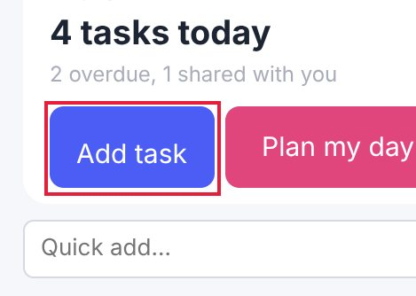
- `#plan` on home @ iphone17: centre_y_share=0.2 — 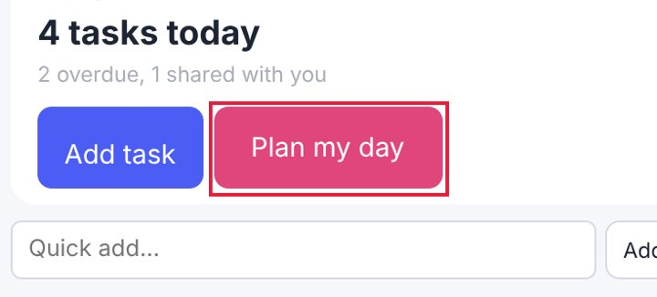
- `#add` on home @ iphone13: centre_y_share=0.2
### A control is covered by another element — major · Measured (rendered DOM)

Tapping the centre of this control hits a different element (often a fixed bar or floating button), so the control is hard or impossible to use.

**Fix:** Reserve space for fixed/floating elements (padding-bottom on the scroll area equal to their height) or move the floating element.

Seen 1× — screens: home; viewports: landscape · priority 2.23 (polish)

- `#view > ul.list > li.task:nth-of-type(4) > button.del:nth-of-type(2)` on home @ landscape: covered_by="#view > button.fab" — 

## 9. Screenshot gallery

Browser emulation (Playwright + Chromium); safe-area insets emulated through CDP. No physical-device evidence.

- home @ iphone17: 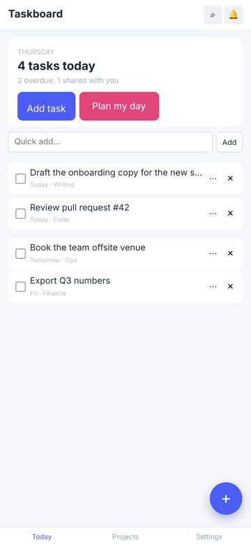
- task-item @ iphone17: 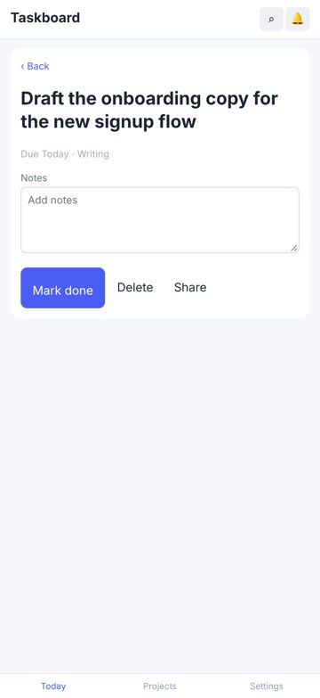
- projects @ iphone17: 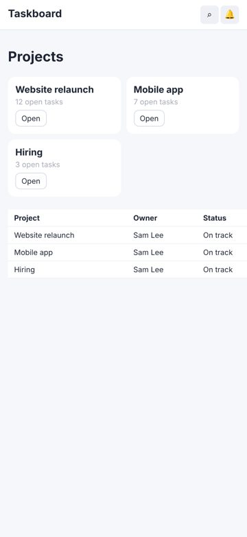
- settings @ iphone17: 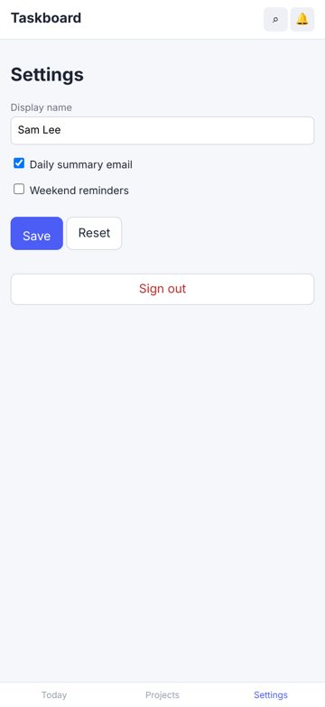
- home @ iphone13: 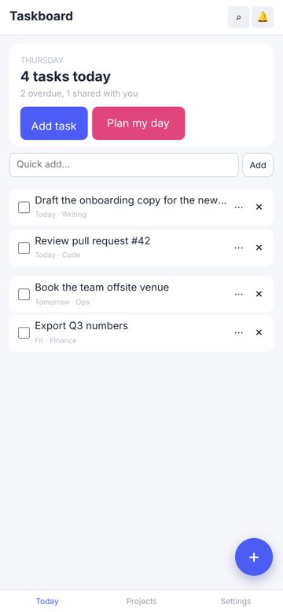
- task-item @ iphone13: 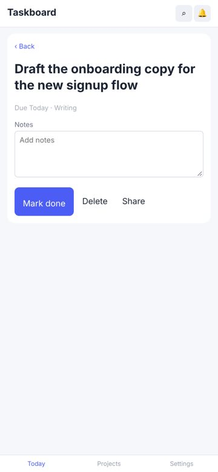
- projects @ iphone13: 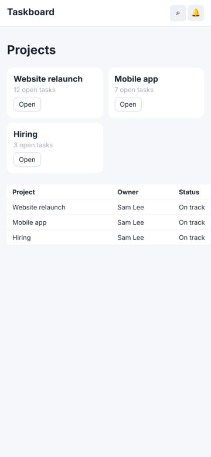
- settings @ iphone13: 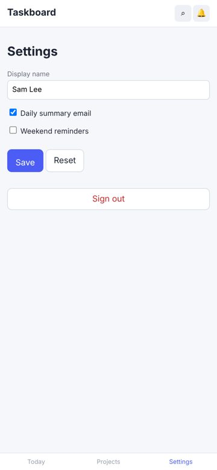
- home @ desktop: 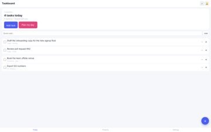
- task-item @ desktop: 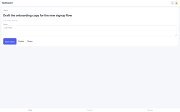
- projects @ desktop: 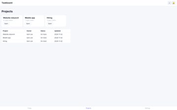
- settings @ desktop: 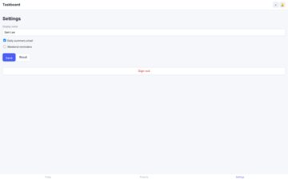
- home @ narrow: 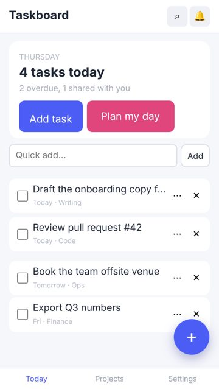
- task-item @ narrow: 
- projects @ narrow: 
- settings @ narrow: 
- home @ tablet: 
- task-item @ tablet: 
- projects @ tablet: 
- settings @ tablet: 
- home @ landscape: 
- task-item @ landscape: 
- projects @ landscape: 
- settings @ landscape: 

## 10. Prioritised improvement plan

| # | Tier | Fix | Severity | Seen | Cost | Area |
|---|---|---|---|---|---|---|
| 1 | fix now | **Accessibility: Elements must meet minimum color contrast ratio thresholds** — See https://dequeuniversity.com/rules/axe/4.10/color-contrast?application=axeAPI — Fix any of the following:   Element has insufficient color contrast of 1.98 (foreground color: #b4b8c4, background color: #ffffff, font size: 8.3pt (11px), font weight: normal). Expected contrast rati | major | 24× | low | accessibility |
| 2 | fix now | **Controls are too close together** — Keep at least 8 px between targets (more next to destructive actions), or merge rarely used actions into one overflow menu. | major | 24× | low | mobile |
| 3 | fix now | **Text is too small to read comfortably** — Use at least 12 px (13-14 px preferred) for secondary text and keep hierarchy with weight and colour rather than very small sizes. | major | 21× | low | typography |
| 4 | fix now | **Touch target is too small** — Enlarge the hit area to 44×44 (padding, min-height/min-width, or an ::after hit-area) while keeping the visible glyph size. | major | 20× | low | controls |
| 5 | fix now | **Bottom controls sit under the home indicator** — Pad fixed bottom bars with env(safe-area-inset-bottom): padding-bottom: calc(8px + env(safe-area-inset-bottom)). | major | 16× | low | mobile |
| 6 | fix now | **Focusing a field zooms the page on iPhone** — Use font-size: 16px (1rem) for inputs, selects and textareas on mobile. | major | 15× | low | mobile |
| 7 | fix now | **Heading levels are visually inverted** — Make heading sizes follow their level, or change the element level to match its visual role. | minor | 24× | low | typography |
| 8 | fix now | **No pressed (active) state** — Add an :active style (darker tone, scale 0.97, or ripple) to every button and link variant. | major | 8× | low | feedback |
| 9 | fix now | **Page scrolls sideways (horizontal overflow)** — Let the offending element shrink (max-width: 100%, min-width: 0 on flex children) or scroll it inside its own container (overflow-x: auto). | critical | 3× | low | layout |
| 10 | fix now | **Uneven spacing between related elements** — Give the container one gap (flex/grid `gap`, or one margin rule for all items) instead of per-item margins. | major | 6× | low | spacing |
| 11 | fix now | **Keyboard focus is invisible** — Never remove outlines without a replacement: use :focus-visible { outline: 2px solid <brand>; outline-offset: 2px }. | major | 4× | low | accessibility |
| 12 | fix now | **Spacing does not follow a consistent scale** — Adopt a spacing scale (4/8-px steps: 4, 8, 12, 16, 24, 32) as tokens and replace one-off values with the nearest step. | minor | 12× | medium | spacing |
| 13 | next | **Two primary actions compete** — Keep one filled primary button per group; make the other secondary (outline or tonal). | minor | 6× | low | controls |
| 14 | next | **The same heading level has different sizes on different screens** — Style headings once, globally, from the type scale. | minor | 6× | low | cross_screen |
| 15 | next | **No hover state** — Add a hover style (tone shift, underline, elevation) for every interactive component variant. | minor | 4× | low | feedback |

Lower-priority items not listed: 9 (in audit.json).

## Journeys

| Journey | Viewport | Result | Taps | Expected | Confirmations | Feedback (ms) |
|---|---|---|---|---|---|---|
| complete a task | iphone17 | ok | 2 | 2 | 2 | 116, 59 |
| quick-add a task | iphone17 | ok | 1 | 1 | 0 | 57 |
| rename myself | iphone17 | ok | 2 | 2 | 0 | 114, None |
| complete a task | desktop | ok | 2 | 2 | 2 | 115, 49 |
| quick-add a task | desktop | ok | 1 | 1 | 0 | 33 |
| rename myself | desktop | ok | 2 | 2 | 0 | 113, None |

## Evidence and limits

- Every viewport is browser emulation (Playwright + Chromium 153.0.8010.12); iPhone sizes are CSS pixels and safe-area insets are emulated through CDP (Emulation.setSafeAreaInsetsOverride). Safari-specific rendering (WebKit), the real on-screen keyboard and physical reach are not reproduced.
- Browser chrome: the first screen is re-measured with the viewport shortened by 120 px (Safari's toolbars); dynamic toolbar collapse is not reproduced.
- Keyboard interference: fields that would zoom on focus (font-size < 16 px) are measured; whether the on-screen keyboard covers a field is not testable in emulation.
- Hover/pressed/focus states are sampled once per visual variant of control; focus visibility comes from real Tab presses (desktop).
- Canvas-drawn interfaces (games): the DOM does not describe what is drawn, so DOM-geometry metrics cover only the HTML overlay (HUD, menus); use judgements for the canvas.
- No physical-device evidence: findings are emulation results, not device results.
