# PIXELCRAFT audit: Taskboard (PIXELCRAFT sample app)

Target: `GITCRAFT/tests/fixtures/pixelcraft/taskboard_fixed` · method pixelcraft-1.0 · 2026-11-05T13:39:53+00:00 · commit `1530d7e950`

## 1. Overall PIXELCRAFT score: **96.4** / 100 (excellent)

Evidence coverage 100% · confidence **high** — browser emulation only (no physical-device evidence)

Coverage and confidence are reported separately from quality: an area with no evidence is *not tested*, never zero and never capped.

## 2. Category scores

| Category | Score | Coverage | Not tested |
|---|---|---|---|
| Visual Quality | **99** | 100% | — |
| Usability | **99.3** | 100% | — |
| Consistency | **90.9** | 100% | — |

### Visual Quality

| Area | Points | Awarded | Evidence | Weakest metric |
|---|---|---|---|---|
| Spacing and rhythm | 25 | 24.4 | measured ×84 | spacing values on a 4-px scale (89%) |
| Layout and composition | 25 | 24.6 | measured ×148 | layout uses the available width (82%) |
| Typography and hierarchy | 20 | 20 | measured ×72 | text large enough to read (100%) |
| Buttons and controls | 20 | 20 | measured ×120 | touch/click targets at least 44 px (100%) |
| Visual consistency | 10 | 10 | measured ×48 | controls share radii and a small palette (100%) |

### Usability

| Area | Points | Awarded | Evidence | Weakest metric |
|---|---|---|---|---|
| Interaction efficiency | 25 | 25 | measured ×18 | journeys complete (100%) |
| Navigation and discoverability | 20 | 20 | measured ×19 | every screen within 2 taps (100%) |
| Mobile ergonomics | 25 | 24.7 | measured ×89 | main actions within thumb reach (89%) |
| Feedback and interaction states | 15 | 14.5 | measured ×26 | controls react to hover (80%) |
| Accessibility | 15 | 15 | accessibility ×24, measured ×8 | axe-core WCAG 2.2 AA checks (100%) |

### Consistency

| Area | Points | Awarded | Evidence | Weakest metric |
|---|---|---|---|---|
| Cross-screen consistency | 25 | 20.3 | measured ×12 | primary buttons look the same on every screen (62%) |
| Component consistency | 25 | 22 | measured ×12 | inputs share one height (70%) |
| Responsive consistency | 20 | 20 | measured ×8 | the same content at every size (100%) |
| Design system adherence | 20 | 19.6 | measured ×24 | spacing tokens (4-px grid) (93%) |
| State consistency | 10 | 9 | measured ×4 | hover treatment applied consistently (69%) |

## 3. Strongest screens

- **projects** — 99.8
- **settings** — 99.6

## 4. Weakest screens

- **task-item** — 99.2
- **home** — 99.2

## 5. Critical usability defects

None found.

## 6. Spacing and layout defects

None found.

## 7. Button and control defects

### No hover state — minor · Measured (rendered DOM)

The pointer over this control changes nothing (colour, shadow, underline), so it does not signal that it is clickable.

**Fix:** Add a hover style (tone shift, underline, elevation) for every interactive component variant.

Seen 4× — screens: home, projects, settings, task-item; viewports: desktop · priority 7.0 (next)

- `nav.tabbar > a.tab.active:nth-of-type(1)` on home @ desktop: style_changed_on_hover=false — 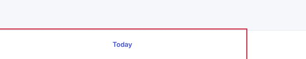
- `nav.tabbar > a.tab.active:nth-of-type(1)` on task-item @ desktop: style_changed_on_hover=false — 
- `nav.tabbar > a.tab.active:nth-of-type(2)` on projects @ desktop: style_changed_on_hover=false

## 8. Mobile-specific findings

### Main action is at the top of the phone screen — minor · Measured (rendered DOM)

The primary action sits in the top fifth of a tall phone screen, the hardest zone to reach one-handed.

**Fix:** Repeat or move the main action to the lower half (a bottom action bar or floating button).

Seen 1× — screens: home; viewports: tablet · priority 1.49 (polish)

- `#add` on home @ tablet: centre_y_share=0.19 — 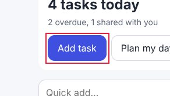

## 9. Screenshot gallery

Browser emulation (Playwright + Chromium); safe-area insets emulated through CDP. No physical-device evidence.

- home @ iphone17: 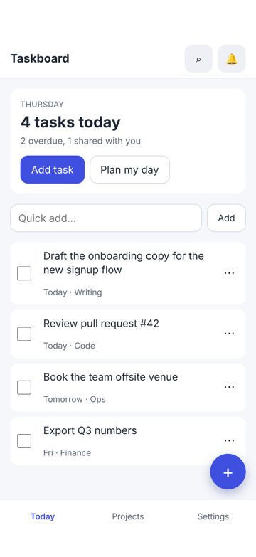
- task-item @ iphone17: 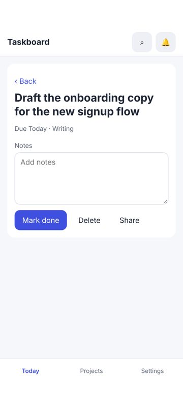
- projects @ iphone17: 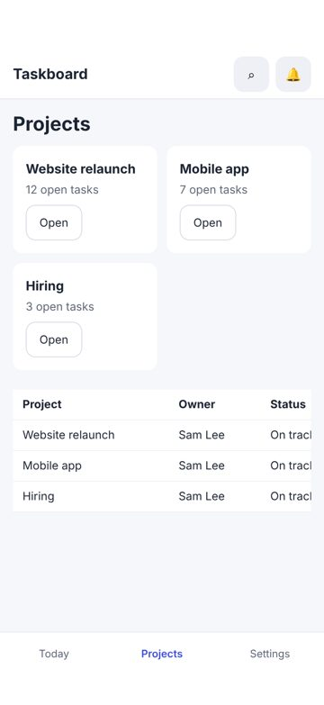
- settings @ iphone17: 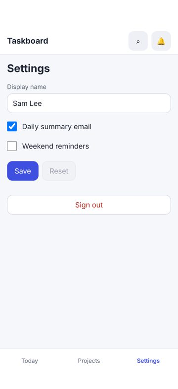
- home @ iphone13: 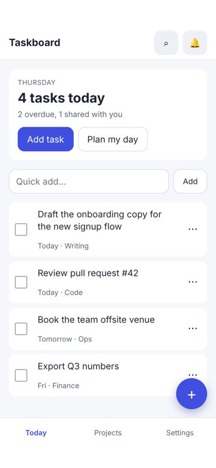
- task-item @ iphone13: 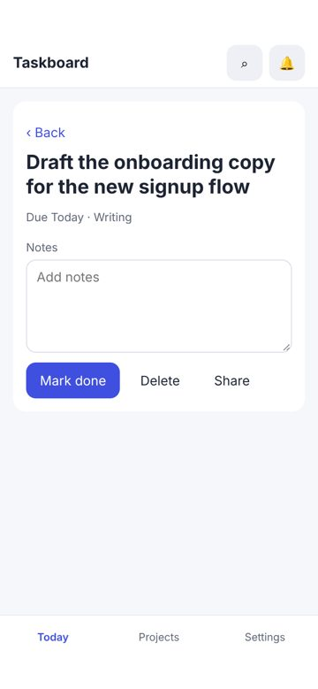
- projects @ iphone13: 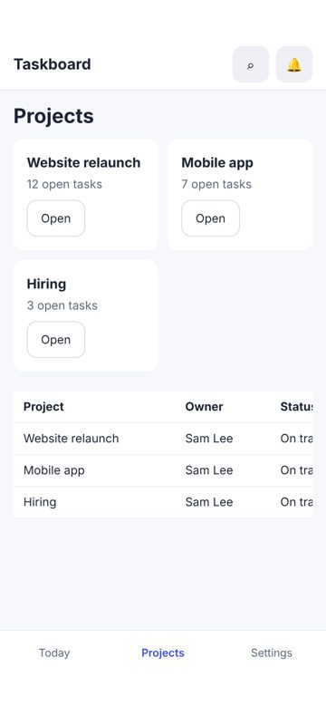
- settings @ iphone13: 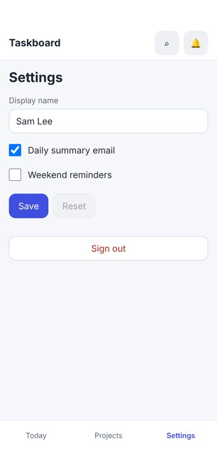
- home @ desktop: 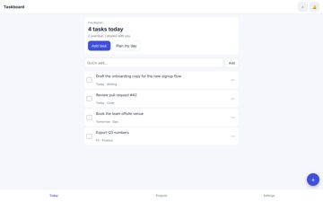
- task-item @ desktop: 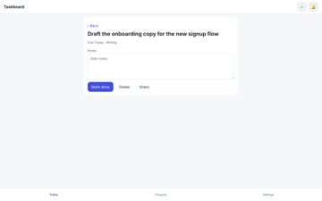
- projects @ desktop: 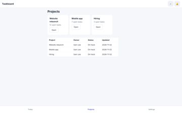
- settings @ desktop: 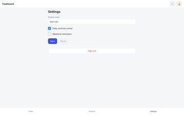
- home @ narrow: 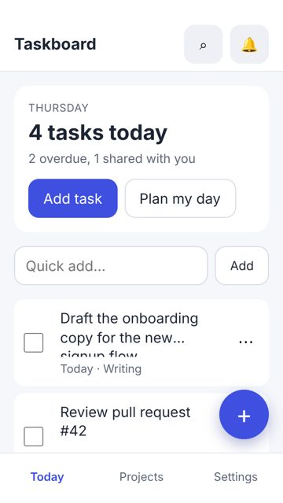
- task-item @ narrow: 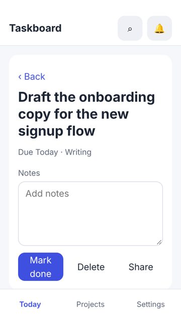
- projects @ narrow: 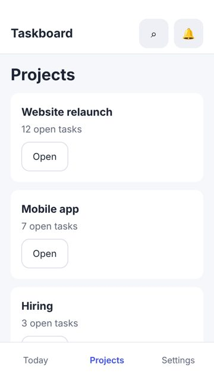
- settings @ narrow: 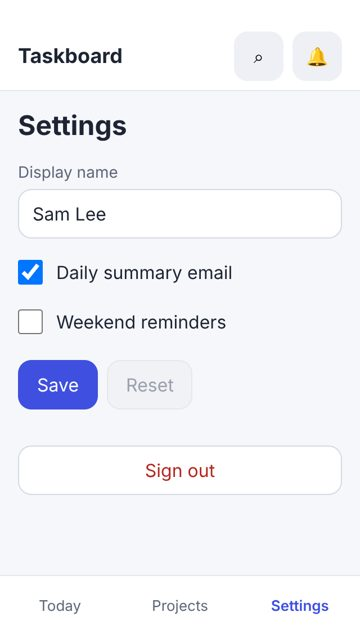
- home @ tablet: 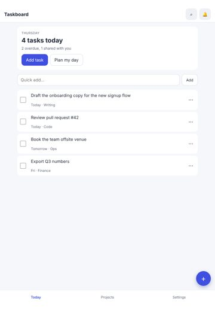
- task-item @ tablet: 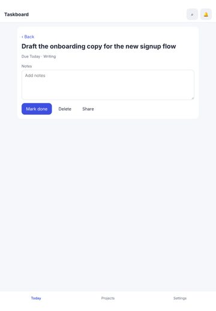
- projects @ tablet: 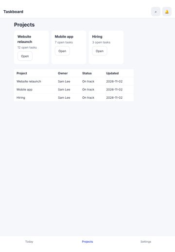
- settings @ tablet: 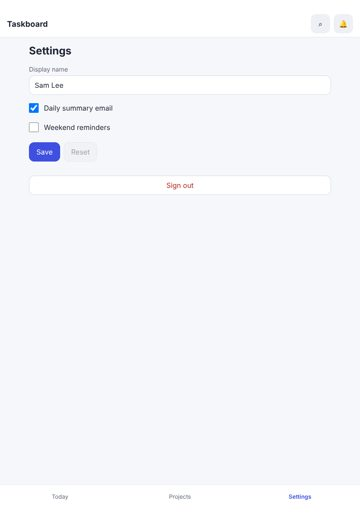
- home @ landscape: 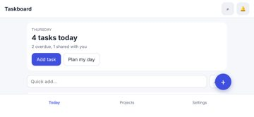
- task-item @ landscape: 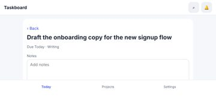
- projects @ landscape: 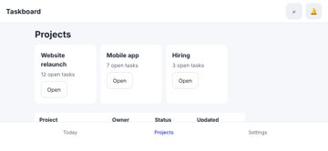
- settings @ landscape: 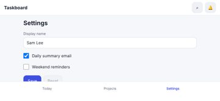

## 10. Prioritised improvement plan

| # | Tier | Fix | Severity | Seen | Cost | Area |
|---|---|---|---|---|---|---|
| 1 | next | **No hover state** — Add a hover style (tone shift, underline, elevation) for every interactive component variant. | minor | 4× | low | feedback |
| 2 | polish | **Main action is at the top of the phone screen** — Repeat or move the main action to the lower half (a bottom action bar or floating button). | minor | 1× | medium | mobile |

## Journeys

| Journey | Viewport | Result | Taps | Expected | Confirmations | Feedback (ms) |
|---|---|---|---|---|---|---|
| complete a task | iphone17 | ok | 2 | 2 | 0 | 135, 64 |
| quick-add a task | iphone17 | ok | 1 | 1 | 0 | 50 |
| rename myself | iphone17 | ok | 2 | 2 | 0 | 125, 48 |
| complete a task | desktop | ok | 2 | 2 | 0 | 87, 33 |
| quick-add a task | desktop | ok | 1 | 1 | 0 | 44 |
| rename myself | desktop | ok | 2 | 2 | 0 | 141, 37 |

## Evidence and limits

- Every viewport is browser emulation (Playwright + Chromium 153.0.8010.12); iPhone sizes are CSS pixels and safe-area insets are emulated through CDP (Emulation.setSafeAreaInsetsOverride). Safari-specific rendering (WebKit), the real on-screen keyboard and physical reach are not reproduced.
- Browser chrome: the first screen is re-measured with the viewport shortened by 120 px (Safari's toolbars); dynamic toolbar collapse is not reproduced.
- Keyboard interference: fields that would zoom on focus (font-size < 16 px) are measured; whether the on-screen keyboard covers a field is not testable in emulation.
- Hover/pressed/focus states are sampled once per visual variant of control; focus visibility comes from real Tab presses (desktop).
- Canvas-drawn interfaces (games): the DOM does not describe what is drawn, so DOM-geometry metrics cover only the HTML overlay (HUD, menus); use judgements for the canvas.
- No physical-device evidence: findings are emulation results, not device results.

## Before / after

Comparable: **yes** (same method, same screens, viewports and journeys; deltas use only metrics measured in both runs)

| | Before | After | Δ (same metrics) |
|---|---|---|---|
| Visual Quality | 71.2 | 99 | +27.8 |
| Usability | 73.7 | 99.3 | +25.6 |
| Consistency | 64.7 | 90.9 | +26.2 |
| Overall | 69.9 | 96.4 | +26.5 |

Resolved: 22 · persisting: 2 · new: 0 · regressions: 0 · coverage lost: none

- ✅ resolved: Accessibility: Elements must meet minimum color contrast ratio thresholds (24× before)
- ✅ resolved: Controls are too close together (24× before)
- ✅ resolved: Text is too small to read comfortably (21× before)
- ✅ resolved: Touch target is too small (20× before)
- ✅ resolved: Bottom controls sit under the home indicator (16× before)
- ✅ resolved: Focusing a field zooms the page on iPhone (15× before)
- ✅ resolved: Heading levels are visually inverted (24× before)
- ✅ resolved: No pressed (active) state (8× before)
- ✅ resolved: Page scrolls sideways (horizontal overflow) (3× before)
- ✅ resolved: Uneven spacing between related elements (6× before)
- ✅ resolved: Keyboard focus is invisible (4× before)
- ✅ resolved: Spacing does not follow a consistent scale (12× before)
- ✅ resolved: Two primary actions compete (6× before)
- ✅ resolved: The same heading level has different sizes on different screens (6× before)
- ✅ resolved: Disabled control looks enabled (2× before)
- ✅ resolved: Too many button variants (6× before)
- ✅ resolved: Controls stretch across the desktop window (3× before)
- ✅ resolved: Text is truncated (3× before)
- ✅ resolved: Unnecessary confirmation steps (2× before)
- ✅ resolved: A tap produces no visible response (2× before)
- ✅ resolved: Click target is below 24 px (2× before)
- ✅ resolved: A control is covered by another element (1× before)

| Screen @ viewport | Pixels changed | Diff |
|---|---|---|
| home @ narrow | 16.92% | 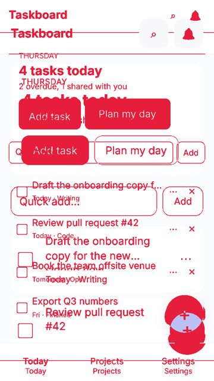 |
| task-item @ narrow | 13.63% | 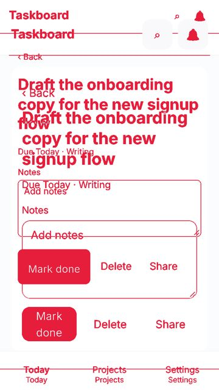 |
| home @ iphone13 | 11.25% | 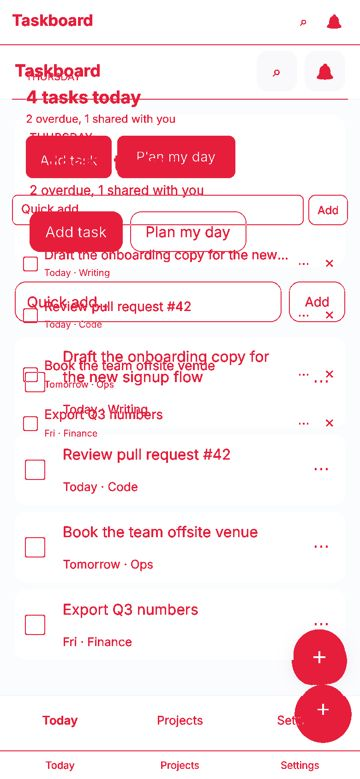 |
| home @ iphone17 | 10.71% | 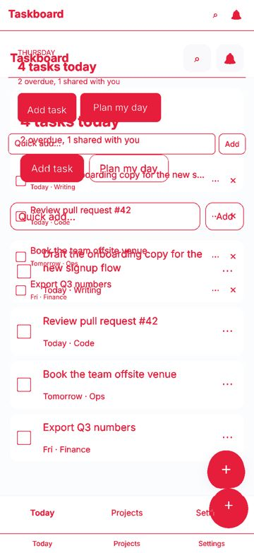 |
| home @ landscape | 10.02% | 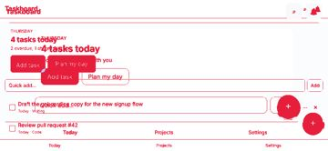 |
| settings @ narrow | 9.5% | 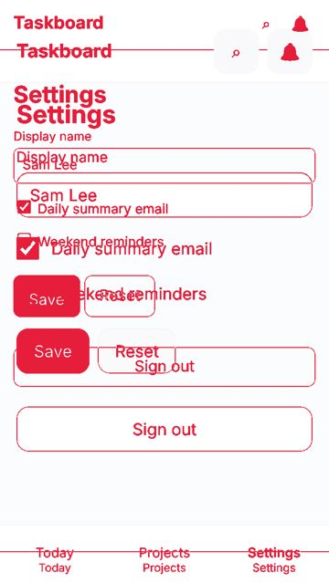 |
| task-item @ iphone13 | 7.91% | 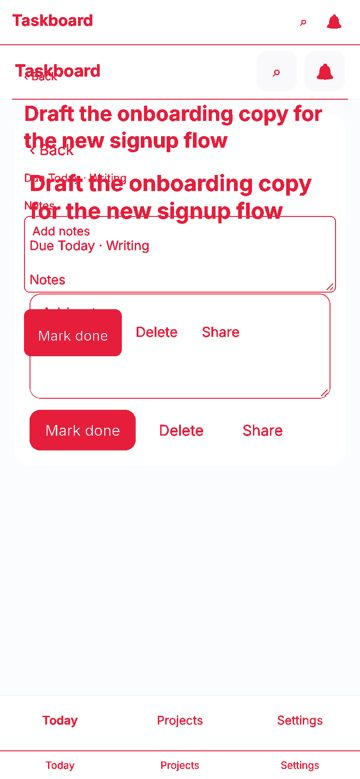 |
| task-item @ landscape | 7.47% | 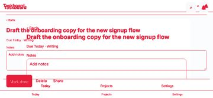 |
| task-item @ iphone17 | 7.46% | 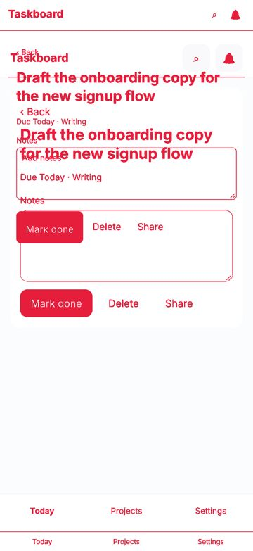 |
| projects @ narrow | 6.24% | 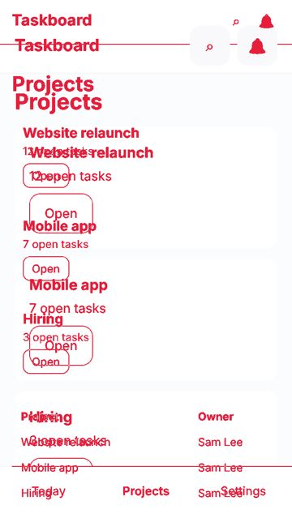 |
| settings @ landscape | 5.62% | 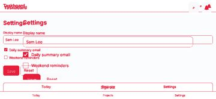 |
| settings @ iphone13 | 5.45% | 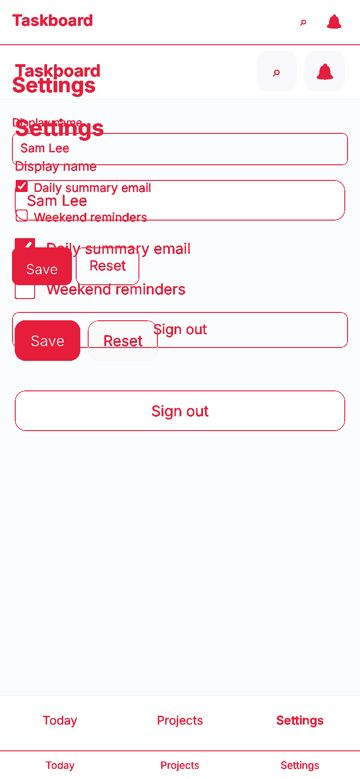 |
| projects @ landscape | 5.3% | 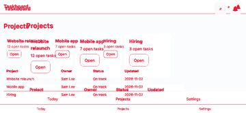 |
| settings @ iphone17 | 4.92% | 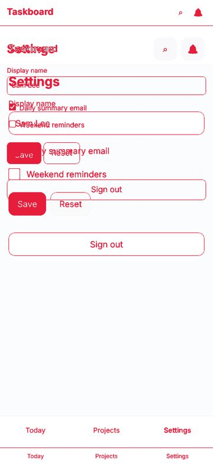 |
| projects @ iphone13 | 4.49% | 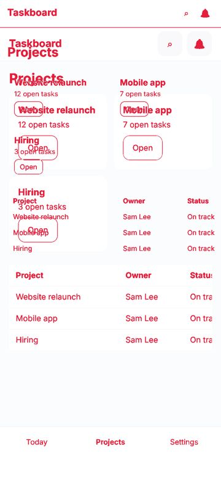 |
| home @ tablet | 4.29% | 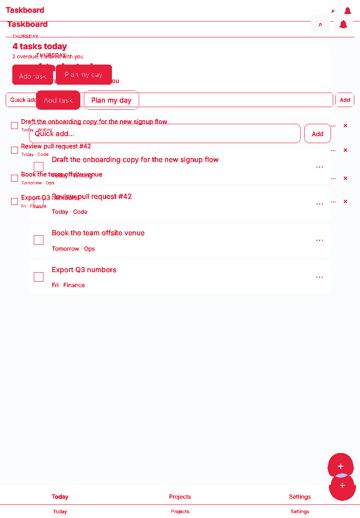 |
| projects @ iphone17 | 4.12% | 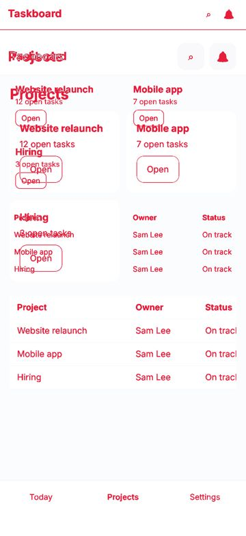 |
| home @ desktop | 3.47% | 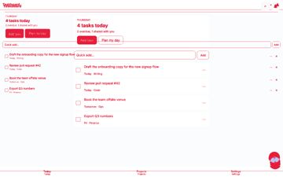 |
| task-item @ tablet | 3.23% | 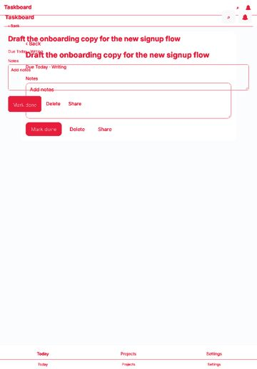 |
| task-item @ desktop | 2.64% | 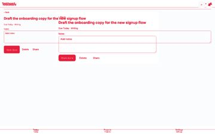 |
| settings @ tablet | 2.43% | 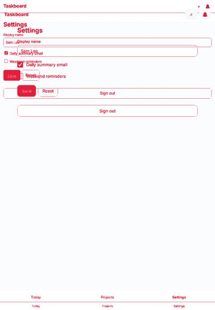 |
| projects @ tablet | 2.28% | 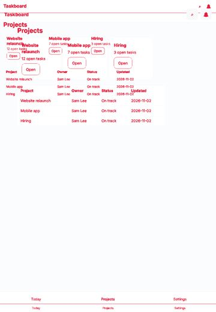 |
| settings @ desktop | 2.1% | 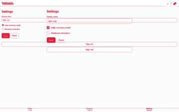 |
| projects @ desktop | 1.74% | 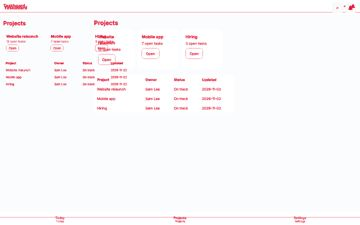 |
